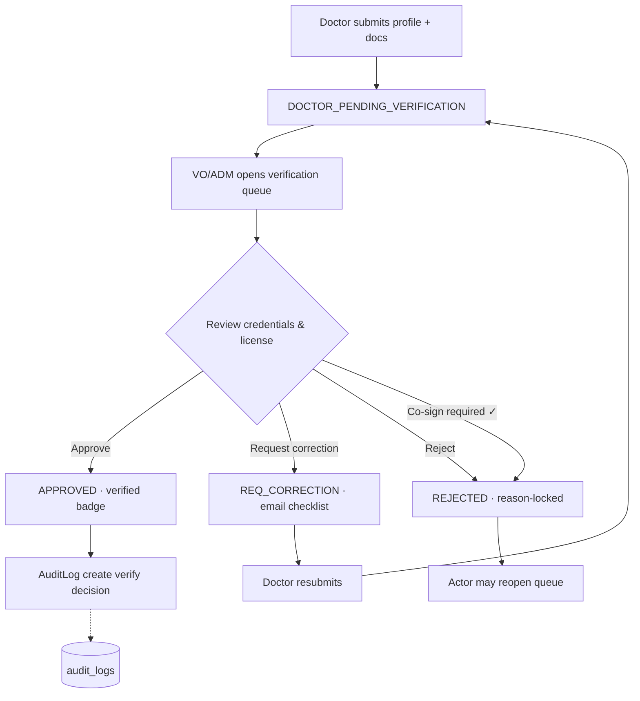
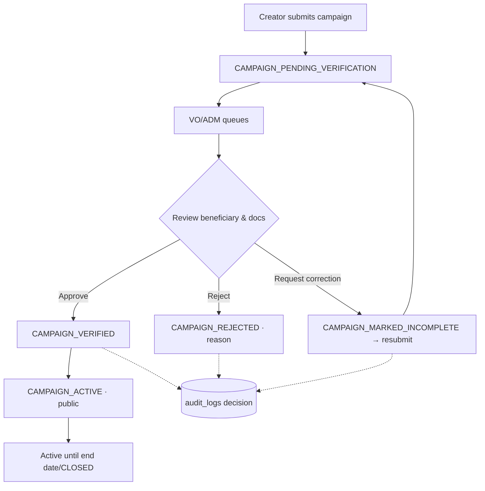
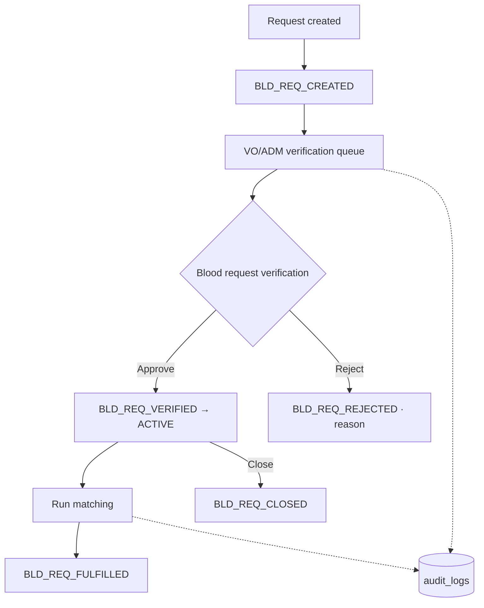
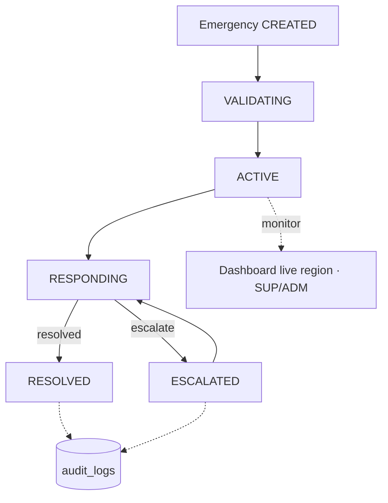
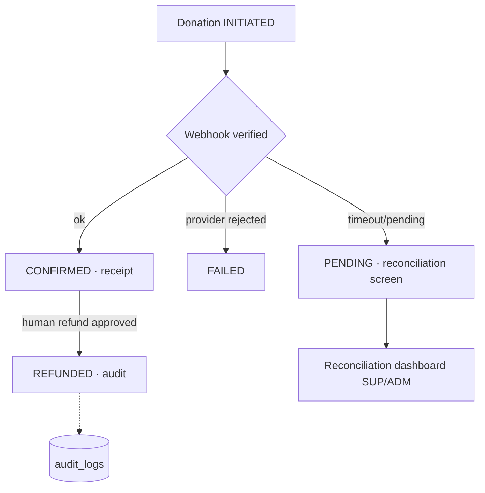
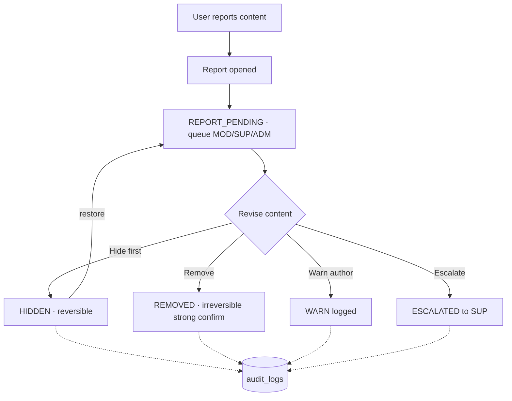

# 3.7 Admin Navigation Design

> Part of Stage 3.7 Admin Web UI/UX Design. Defines information architecture,
> route map, navigation guards, breadcrumbs, global search, and the six
> mandated approval/moderating workflow diagrams. Roles: SUP/ADM/VO/MOD.
> Source of truth for permission visibility: `admin-role-ui-matrix.md` (each
> screen's role mapping enumerated in `admin-screen-role-matrix.md`).

---

## 1. Route Map

React Router URL map (SPA). Leading shell: `AppShell`

```
/profile/me
/auth/login          → login (MFA step)      [public]
/auth/forgot         → reset requests         [public]
/auth/mfa-setup      → re-enroll TOTP         [post-auth]
/auth/reauth         → sensitive-op gate      [post-auth]

/app/                        AdminShell (guard)
/app/dashboard
/app/users                ← /app/users            list
/app/users/:uid           ← /app/users/:uid       detail
/app/patients             ← /app/patients         list (SUP/ADM C4)
/app/patients/:pid        ← /app/patients/:pid    profile (C4)
/app/doctors
/app/doctors/verification ← verification-queue
/app/doctors/:doctorId    ← doctor detail
/app/facilities
/app/facilities/verification
/app/facilities/:fid
/app/caregivers
/app/blood/requests
/app/blood/requests/:brId
/app/blood/verification
/app/blood/donors
/app/blood/matches
/app/emergency              ← monitor (SUP/ADM)
/app/emergency/:caseId
/app/donations/campaigns
/app/donations/campaigns/:cid
/app/donations/campaigns/:cid/verification
/app/donations/transactions
/app/donations/reconciliation
/app/appointments        ← HIDDEN [AD-A-6 API GAP]
/app/community/reports
/app/community/history
/app/education/
/app/education/:contentId/edit
/app/education/review
/app/notifications/broadcast
/app/notifications/history
/app/reports/analytics
/app/reports/exports
/app/audit
/app/audit/:entryId
/app/security            ← SUP (+ADM conditional)
/app/security/alerts
/app/settings            ← SUP (+ADM conditional)
/app/settings/...        child toggles
/app/search?q=
```

Route guard logic (§3). All `?`-gate routes (`appointments`) are absent from the
route table until AD-A-6 resolves — a hidden route never appears in this list.

---

## 2. Shell Layout + Global Navigation

```
┌──────────────────────────────────────────────────────────────┐
│ [R·1 Admin]        🔍 global search   🔔(n)   👤 SUP · A. N. │  TopBar
├────────┬─────────────────────────────────────────────────────┤
│ Sidebar│  Breadcrumb: Users / detail · [action]              │  Breadcrumb
│  (nav) │                                                     │
│        │  <router outlet / page>                             │  Content
│        │                                                     │
├────────┴─────────────────────────────────────────────────────┤
│ Privacy / role notice · © Sickler's Warriors                │  Footer
└──────────────────────────────────────────────────────────────┘
```

- **Sidebar sections** (permission-filtered by matrix; hidden groups are not
  rendered — visibility strategy §5).
  ```
  DASHBOARD
  USERS            Users, Patients, Caregivers
  CARE SERVICES    Doctors, Facilities, Blood, Emergency
  ENGAGEMENT       Campaigns, Donations, Community, Education
  COMMUNICATIONS   Notifications, Broadcasts
  DATA             Reports, Audit
  SYSTEM           Security, Settings
  ```
- **Top bar** mirrors: search, notification bell with queue badges, role badge,
  user menu → change password, MFA, sessions, logout.
- **Breadcrumbs** built from route segments; last mutable segment gets moving
  action slot.
- **Queue badges** rendered when the role has a non-empty queue on that section
  (server-driven counts; never fabricated).
- Sidebar collapses ≤1024px into overlay drawer (AD keyboard).

---

## 3. Navigation Guards

```
Enter route:
 1. if route not in user's allowed set        → render ForbiddenPanel (403)
 2. else if route needs C4 gate (patients/…)  → open ProtectedResourceGate
     (reason + justification; logged AD-A-9)  → load
 3. auth expired → silent refresh
     refresh ok  → continue
     refresh fail→ redirect /auth/login?next=
```
- Roles decide the menu; **backend 403 is authoritative** — on any 403 the
  panel shows ForbiddenPanel, never a blank.
- Deep-links on guarded routes go through the same guard.
- Idle timeout (AD-A-2) with keep-alive → logout.

---

## 4. Global Search Behavior

`/app/search?q=` triggers an aggregate request across authorized indexes only
(§24 main doc). Result groups by module; each row deep-links to the detail page
the role may open; `forbidden` indexes never appear. Zero PHI previews.

---

## 5. Role Visibility Strategy

Every nav item has an attribute `roles`. Rendered only when the session role
has `view` on that module (from 3.3/3.7 matrix). If the API still returns 403
(for example, misconfigured role map), the authority of the backend decides —
and `admin-role-ui-matrix.md` remains the contract the frontend cannot revise.

---

## 6. Navigation States Handled

| State | Behavior |
|---|---|
| 401 unauth | redirect `/auth/login` after refresh attempt |
| 403 forbidden | `ForbiddenPanel` + Home |
| 404 | `NotFoundPanel` |
| network error | `ErrorStatePanel` + Retry |
| missing API | `API GAP` placeholder panel §4 (no fake data) |

---

## 7. Workflow Diagrams (Mermaid)

### 7.1 Doctor Verification



### 7.2 Campaign Approval



### 7.3 Blood Request



### 7.4 Emergency



### 7.5 Donation / Payment



### 7.6 Community Moderation



---

## 8. Navigation Anomalies & Edge Cases

- Deep-link directly into a detailed page → same guard as normal nav.
- `ADM-APP-*` routes absent (AD-A-6). `security/settings` locked besides SUP.
- Queue badge counts stale after worker actions → poll 60s + on-focus refresh.
- Emergency region never routed through hidden-role nav; if the resolver lacks
  `emergency` view, the region itself does not render (SUP/ADM only).
- Role switch/impersonation is not supported (no such permission).

---

END — next: `admin-screen-inventory.md`.