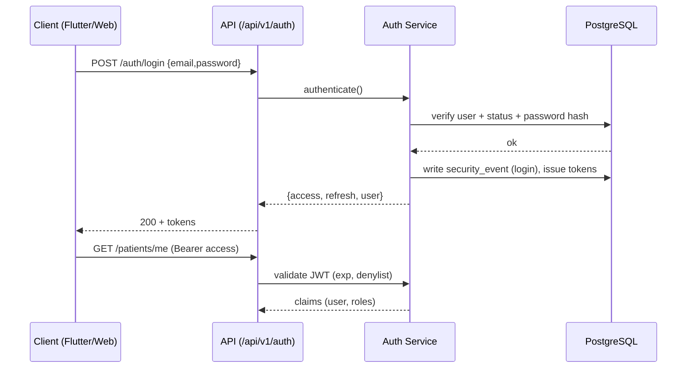
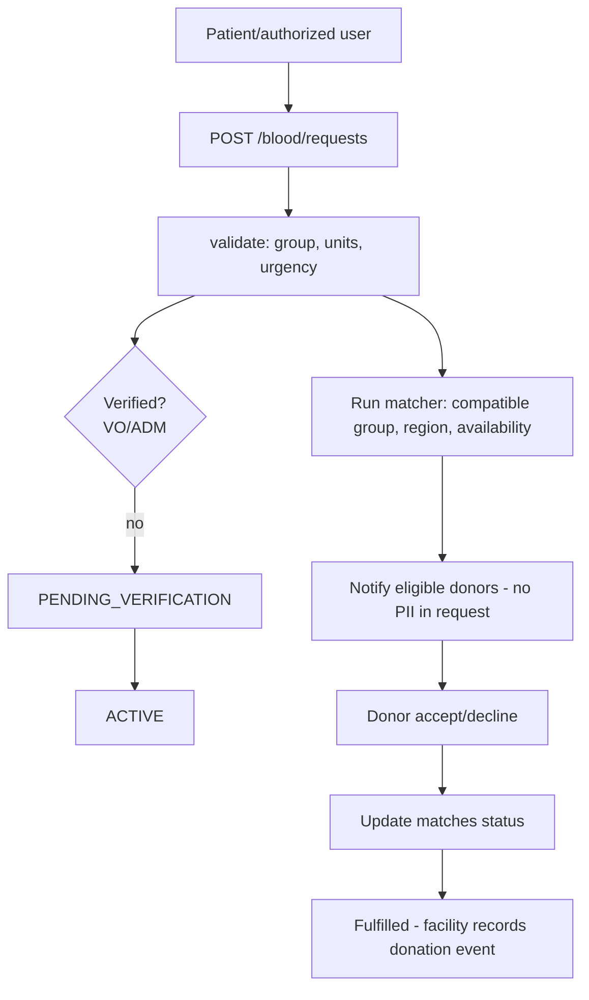
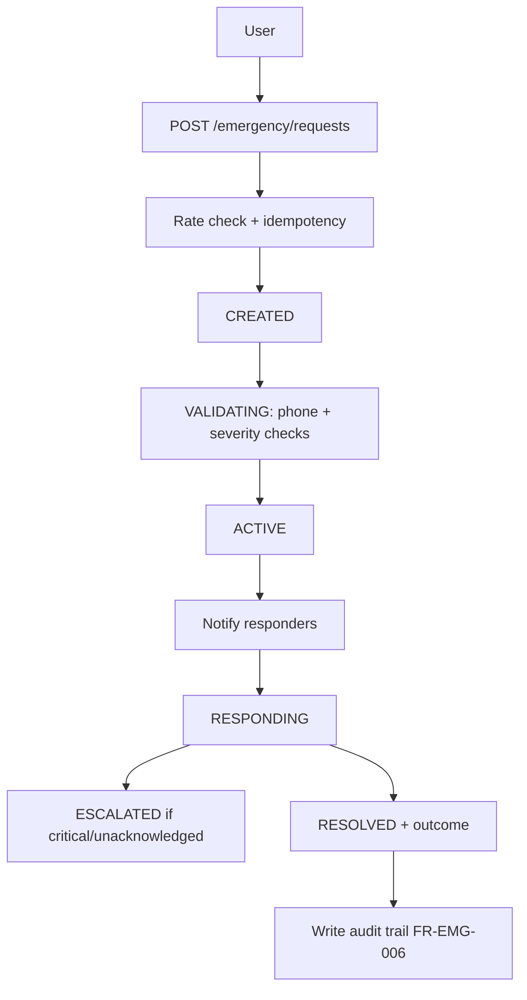

# 3.5 API Design

> Stage: 3.5 — System Design. Status: **Design** (no serializers, no viewsets,
> no routers, no endpoints implemented). Companion files:
> `api-endpoint-matrix.md` (full endpoint matrix) and `api-design-review.md`
> (audit + SDLC gate).
>
> Source of truth: Stage 2 requirements, 3.1 system architecture, 3.2 module
> architecture, 3.3 roles & permissions (design + matrix), 3.4 database design
> and ERDs. Application database: `sickle_cell` on system PostgreSQL (port 5432).

---

## 1. API Architecture

```
Flutter Mobile App ──┐
Admin Web Panel  ────┼──▶ REST API (/api/v1/)
                     │        │  Django API layer (viewsets/views)
                     │        ▼
                     │  Business / Service layer (use-cases, permissions)
                     │        ▼
                     │  Django ORM / Repository (object-level authorization)
                     │        ▼
                     │  PostgreSQL 18 (sickle_cell)
                     ▼
              Payment Providers / Firebase / Object Storage (via server only)
```

- Client applications **never** connect to PostgreSQL directly (§3.1, NFR-SEC-003).
- The API is the **only** entry point for Flutter and the admin web panel.
- Admin web uses the same backend API wherever possible; specialized admin
  endpoints are grouped under `/api/v1/admin/` and gated by strict permissions.
- Backend is authoritative for authentication, authorization, consent, payment
  and business rules — never the client (repeat from §27.3).
- DRF 3.18 on Django 6.1 (already installed in `backend/venv`).

### 1.1 Layering (implemented later)

- **Presentation**: serializers (DRF), schema via drf-spectacular.
- **API layer**: viewsets/views + router, thin HTTP concerns only.
- **Service layer**: use-case functions/classes owning business rules, state
  transitions, audit calls. Mandated by NFR-MAIN-002 (business logic separate).
- **Repository/DAO layer**: query functions that build object-level
  authorization (owner/consent/facility filters) — foundation from 3.4 §12(8).
  No raw SQL in views.

---

## 2. API Versioning

- Primary versioning: **URL path** — `/api/v1/....`
- Ancillary: `Accept: application/json; version=v1` header (informational).
- Backward compatibility:
  - Breaking changes are additive-first (new fields, nullable additions);
    end-of-life versions are announced (≥2 release cycles, ≥90 days dev).
  - v1 error envelope and pagination shape are frozen for the lifetime of v1.
- Deprecation policy:
  - `Deprecation` header + `Sunset` header on deprecated endpoints.
  - Log `Deprecation` usage in metrics; retire only after agreed threshold.
- Future `v2`:
  - New path segment `/api/v2/`; never reuse `/api/v1/` paths for new
    incompatible semantics.
  - v2 planned for real-time messaging, event-sourcing reads, or a breaking
    domain change — none required today.

---

## 3. Authentication

Token strategy: **JWT access + refresh** (djangorestframework-simplejwt), HTTPS
only (NFR-SEC-001). All endpoints except an explicit public allow-list require
`Authorization: Bearer <access>`.

| Endpoint | Method | Auth | Body (key fields) | Response | Validation / notes |
|---|---|---|---|---|---|
| `/api/v1/auth/register` | POST | Public | `email`, `phone?`, `password`, `first_name`, `last_name`, `role_code` (default `PATIENT`) | 201 `{data: {user, verify_token?}}` | Limit role_code to self-registerable roles; admin-only roles rejected (C17). Email/phone format + uniqueness. Rate-limited. |
| `/api/v1/auth/login` | POST | Public | `email_or_phone`, `password` | 200 `{data:{access, refresh, user}}` | 401 INVALID_CREDENTIALS; disabled/suspended accounts rejected with ACCOUNT_DISABLED. Rate-limited. Audit login result. |
| `/api/v1/auth/refresh` | POST | Refresh token | `refresh` | 200 new `{access, refresh}` | Rotation on; old refresh blacklisted (DB `token_denylist`). |
| `/api/v1/auth/logout` | POST | Yes | `refresh?` | 204 | Blacklists refresh; access expires naturally. FR-AUTH-006. |
| `/api/v1/auth/password-reset/request` | POST | Public | `email_or_phone` | 202 `{}` (always) | Sends reset token via email/SMS; never discloses account existence. Rate-limited. FR-AUTH-003. |
| `/api/v1/auth/password-reset/confirm` | POST | Token (reset) | `token`, `new_password` | 204 | Validates strength, single-use token, expiry. |
| `/api/v1/auth/password/change` | POST | Yes | `current_password`, `new_password` | 204 | Requires re-auth; blacklists other sessions optional. |
| `/api/v1/auth/verify/email` | POST | Public | `token` / `code` | 204 | FR-AUTH-004 verification. |
| `/api/v1/auth/verify/phone` | POST | Public | `code` | 204 | Phone verification (needed for emergency/blood-donor flows). |
| `/api/v1/auth/mfa/setup` | POST | Yes | — | 200 `{secret(challenged), qr}` | `auth.mfa_manage`. |
| `/api/v1/auth/mfa/enable` | POST | Yes | `code` | 204 | Enables TOTP. |
| `/api/v1/auth/mfa/disable` | POST | Yes | `code`, `password` | 204 | |
| `/api/v1/auth/sessions` | GET | Yes | — | 200 list | Active refresh-token sessions (device, last_seen). |
| `/api/v1/auth/sessions/{id}` | DELETE | Yes | — | 204 | Revoke one session. |

Security:
- Passwords hashed server-side (PBKDF2/Argon2, NFR-SEC-002); never returned.
- No password/credential fields in any response.
- Refresh rotation + reuse detection → token_denylist.
- Access TTL ~15–30 min; refresh ~14–30 days (config-driven).
- Login/register/OTP/password reset rate-limited (§29).

---

## 4. User & Profile APIs

| Endpoint | Method | Auth | Permission | Notes |
|---|---|---|---|---|
| `/api/v1/users/me` | GET | Yes | `auth.profile_view` | Current user (public profile subset). |
| `/api/v1/users/me` | PATCH | Yes | `auth.profile_view` | Contact/name/preferences. |
| `/api/v1/users/me/privacy` | GET/PATCH | Yes | `notifications.manage_prefs` | Notification + privacy settings (mirror `patient_preferences`). |
| `/api/v1/users/me/notifications/preferences` | GET/PATCH | Yes | `notifications.manage_prefs` | Per-category toggles (`notification_preferences`). |
| `/api/v1/users/{uid}` | GET | Yes | `users.view` (C6 for VO) | Profile detail — admin scope. |
| `/api/v1/users/{uid}` | PATCH | Yes | `users.update` | Admin operational edit (not patient self-update). |

Rules:
- Separate public vs private profile output; private/sensitive fields filtered
  by serializer per permission (avoid excessive data exposure).
- A user's own `role_code`/permissions are never self-editable (C17; §5).

---

## 5. Role & Permission APIs

Restricted to privileged admins. Normal users never modify their own privileges
(C17, role-permission-design §21).

| Endpoint | Method | Auth | Permission | Notes |
|---|---|---|---|---|
| `/api/v1/admin/roles` | GET | Yes | `audit`-scoped admin (SUP/ADM) | Catalog (`roles`). |
| `/api/v1/admin/permissions` | GET | Yes | SUP/ADM | Catalog (`permissions`). |
| `/api/v1/admin/users/{uid}/roles` | GET | Yes | `users.view` | Current role set (`user_roles`). |
| `/api/v1/admin/users/{uid}/roles` | POST | Yes | `users.role_assign` | **SUP only for privileged roles; ADM only non-privileged (C17).** Self-assignment denied. Audited. |
| `/api/v1/admin/users/{uid}/roles/{role_id}` | DELETE | Yes | `users.role_assign` | Revoke role (with audit reason). |
| `/api/v1/admin/users/{uid}/permissions` | GET/POST/DELETE | Yes | `users.role_assign` (override mgmt) | Audited ALLOW/DENY overrides (`user_permissions`). Deny hard-blocks; allow rare. |
| `/api/v1/admin/users/{uid}/activate` | POST | Yes | `users.update` | Account activation. |
| `/api/v1/admin/users/{uid}/deactivate` | POST | Yes | `users.deactivate` | Suspension; audited with reason. |

---

## 6. Patient APIs

All patient endpoints enforce **ownership**: a user acts on their own patient
profile or through an authorized context (C3). Changing an ID in the URL must
never grant access (see §28 IDOR).

| Endpoint | Method | Auth | Permission | Notes |
|---|---|---|---|---|
| `/api/v1/patients/me` | GET/PATCH | Yes | `patients.view` (scope: own) | Own profile + medical summary (FR-PAT-001/002). `update_own`. |
| `/api/v1/patients/me/profile-photo` | PUT | Yes | own | Private upload (§32). |
| `/api/v1/patients/me/dashboard` | GET | Yes | own | Summary: meds adherence, symptoms, next appointment, timeline. |
| `/api/v1/patients/me/emergency-contact` | GET/PATCH | Yes | own | FR-PAT-003. |
| `/api/v1/patients/{uid}` | GET/PATCH | Yes | `patients.view`/`patients.update` | Admin operational view/edit. |
| `/api/v1/patients/{uid}/health-summary` | GET | Yes | C2/C3 | Consent-scoped clinician summary. |
| `/api/v1/patients/{uid}/timeline` | GET | Yes | C2/C3 (own = A) | `health_timeline` projection (MED/analytics). |

Note `{uid}` = public UUID, never internal id (3.4 §21).

---

## 7. Doctor APIs

Doctor access depends on: authentication + verified status (BR-001, C5) +
permission + patient relationship/consent (BR-003/004). Verification is
first-class; verified status gates clinical workflows.

| Endpoint | Method | Auth | Permission | Notes |
|---|---|---|---|---|
| `/api/v1/doctors/me` | GET/PATCH | Yes | `doctors.self_manage` | Own professional profile (FR-DOC-001). |
| `/api/v1/doctors/me/verification` | POST | Yes | `doctors.self_manage` | Submit verification (FR-DOC-002) — documents via file upload (§32). |
| `/api/v1/doctors` | GET | Yes | `doctors.view` | Public directory (name, specialty, verified flag only). |
| `/api/v1/doctors/{uid}` | GET | Yes | `doctors.view` | Detail; contact only where permitted (BR-006 philosophy extends). |
| `/api/v1/doctors/me/availability` | GET/POST/PATCH | Yes | `doctors.self_manage` | Availability slots (for appointment scheduling). |
| `/api/v1/doctors/me/patients` | GET | Yes | `patients.view` C2/3 | Only patients where a clinical relationship + consent exists (FR-DOC-005). |
| `/api/v1/doctors/me/patients/{uid}/medical-records` | GET | Yes | `medical_records.view` C2/3 | Consent-gated (never blanket; BR-003). |
| `/api/v1/doctors/me/appointments` | GET | Yes | `appointments.view` C2/3 | Their schedule. |
| `/api/v1/admin/doctors/{uid}/verify` | POST | Yes | `doctors.verify` (VO/ADM/SUP, C6) | Approve/reject with reason + docs review. Audited. |
| `/api/v1/admin/doctors/{uid}/suspend` | POST | Yes | `doctors.verify` | Suspension; audited. |

---

## 8. Healthcare Facility APIs

| Endpoint | Method | Auth | Permission | Notes |
|---|---|---|---|---|
| `/api/v1/facilities` | GET | Public | — | Verified facilities list (name, type, region). |
| `/api/v1/facilities/{uid}` | GET | Yes | — (public read-ok) | Detail; staff/clinical data excluded. |
| `/api/v1/facilities/me` | GET/PATCH | Yes | HOSPITAL operator (C7) | Own facility profile. |
| `/api/v1/facilities/me/staff` | GET/POST | Yes | HOSPITAL (C7), `healthcare_staff` mgmt | Manage `healthcare_staff`. |
| `/api/v1/facilities/me/doctors` | GET | Yes | HOSPITAL | Linked verified doctors. |
| `/api/v1/facilities/me/appointments` | GET/POST | Yes | HOSPITAL/STAFF (C7) | Facility appointments. |
| `/api/v1/admin/facilities/{uid}/verify` | POST | Yes | `doctors.verify`-style (VO/ADM) | Facility verification (C6). |

Access scoped by facility context (C7) — a facility sees only its own patients'
interactions and only where consent permits.

---

## 9. Caregiver APIs

Explicit relationship; caregiver role alone grants nothing (§3.3 §10, BR-004).
Flow: patient invites → caregiver accepts → patient grants consent scope →
caregiver accesses permitted data only (C3/C14).

| Endpoint | Method | Auth | Permission | Notes |
|---|---|---|---|---|
| `/api/v1/caregivers` | GET | Yes | `caregivers.view` (patient: own, caregiver: C3) | List relationships. |
| `/api/v1/caregivers` | POST | Yes | `caregivers.invite` (PAT) | Create invitation (status PENDING). |
| `/api/v1/caregivers/{id}/accept` | POST | Yes | invitee only | Accept → ACTIVE (C2 consent grant next). |
| `/api/v1/caregivers/{id}/decline` | POST | Yes | invitee | Decline. |
| `/api/v1/caregivers/{id}/permissions` | GET/PATCH | Yes | `caregivers.modify` (PAT) | Manage consent scope for the relationship (§10). |
| `/api/v1/caregivers/{id}` | DELETE | Yes | `caregivers.remove` (PAT) | Revoke (marks consent REVOKED too). Audited. |

---

## 10. Consent APIs

**Critical.** Only the patient (or a patient-authorized context) creates/revokes
consent (`consents.grant`/`consents.revoke` = PAT only). Every operation audited
(FR-MEDREC-003..006, NFR-SEC-004).

| Endpoint | Method | Auth | Permission | Consent | Notes |
|---|---|---|---|---|---|
| `/api/v1/consents` | POST | Yes | `consents.grant` (PAT) | — | DRAFT→ACTIVE create; body: grantee, resource_type, `permission_scope[]`, optional `resource_ids`, purpose, `start_date`, `expires_at`. |
| `/api/v1/consents` | GET | Yes | `consents.view` | — | Patient: all their consents; grantee: only grants naming them (C3). |
| `/api/v1/consents/{id}` | GET | Yes | `consents.view` (C3) | — | Detail incl. scope + status. |
| `/api/v1/consents/{id}` | PATCH | Yes | `consents.grant` (PAT) | — | Scope/expiry amendment (DRAFT/ACTIVE only). |
| `/api/v1/consents/{id}/revoke` | POST | Yes | `consents.revoke` (PAT) | — | Immediate effect (FR-MEDREC-005). Audited. |
| `/api/v1/consents/{id}/renew` | POST | Yes | `consents.grant` (PAT) | — | Extend expiry (new audit event). |
| `/api/v1/consents/active` | GET | Yes | `consents.view` | — | C2 evaluation for the caller (grantees). |

Server enforces expiry (`expires_at` clock check, DRAFT/ACTIVE/REVOKED/EXPIRED),
so an expired consent is immediately non-evaluable even before any UI state.

---

## 11. Medical Record APIs

Every request evaluates **Authentication + Permission + Object authorization +
Consent + Business rules** (BR-002/003/004, FR-MEDREC-002). No unrestricted
endpoint; no listing across patients.

| Endpoint | Method | Auth | Permission | Notes |
|---|---|---|---|---|
| `/api/v1/patients/me/medical-records` | GET | Yes | `medical_records.view` (own=A) | Own records (paginated, filterable). |
| `/api/v1/patients/me/medical-records` | POST | Yes | `medical_records.create` (PAT C16 / DOC C15) | Patient-entered entry. |
| `/api/v1/patients/me/medical-records/{id}` | GET | Yes | own | Detail. READ of sensitive category → mandatory audit (FR-MEDREC-006). |
| `/api/v1/patients/me/medical-records/{id}` | PATCH | Yes | own C16 | Update own entries; clinical entries via C15. |
| `/api/v1/patients/me/medical-records/{id}` | DELETE | Yes | own C16 (soft) | Soft delete owned entries only. |
| `/api/v1/patients/{uid}/medical-records` | GET | Yes | `medical_records.view` C2/3 | Consent-scoped clinician/caregiver read (authorized context). |
| `/api/v1/patients/{uid}/medical-records` | POST | Yes | `medical_records.create` C15 | Clinical entry by DOC/STA/HOS in authorized context. |
| `/api/v1/patients/{uid}/medical-records/{id}/files` | POST | Yes | `medical_records.upload` C15 or own | Private upload (§32). |
| `/api/v1/patients/{uid}/medical-records/{id}/files/{fid}` | GET | Yes | `medical_records.download` C2/3 | Authorized download ; always audited. |
| `/api/v1/clinical-encounters` | GET/POST | Yes | C15 (DOC/STA/HOS) | `clinical_encounters` management within facility context. |

---

## 12. Medication APIs

| Endpoint | Method | Auth | Permission | Notes |
|---|---|---|---|---|
| `/api/v1/medications` | GET/POST | Yes | `medications.create/view` (own) | Own medications (FR-MED-001). |
| `/api/v1/medications/{id}` | GET/PATCH/DELETE | Yes | own | Manage (A for patient; C2/3 for authorized doc). |
| `/api/v1/medications/{id}/schedule` | GET/POST | Yes | own | Schedules (FR-MED-002). |
| `/api/v1/medications/{id}/schedule/{sid}` | PATCH/DELETE | Yes | own | Edit schedule. |
| `/api/v1/medications/{id}/log-dose` | POST | Yes | `medications.update` (own) | Log TAKEN/MISSED/SKIPPED/SNOOZED (FR-MED-004) — body incl. `idempotency_key`. |
| `/api/v1/medications/{id}/events` | GET | Yes | own | History (FR-MED-005). |
| `/api/v1/medications/stats` | GET | Yes | own | Adherence stats (FR-MED-006, NFR-PERF-003 async). |

Tracker records user-entered adherence; it is **not** medical advice and never
substitutes clinical adjustment (BR-010/011 safety framing).

---

## 13. Appointment APIs

Valid transitions (DB CHECK status): `SCHEDULED → CONFIRMED → COMPLETED | NO_SHOW | MISSED`,
and `SCHEDULED | CONFIRMED → CANCELLED`. Invalid transitions rejected 409.

| Endpoint | Method | Auth | Permission | Notes |
|---|---|---|---|---|
| `/api/v1/appointments` | GET | Yes | `appointments.view` (own / C7 / C2/3) | List own / clinic / doctor schedule. |
| `/api/v1/appointments` | POST | Yes | `appointments.create` | Create (idempotency key) → SCHEDULED. FR-APP-001. |
| `/api/v1/appointments/{id}` | GET | Yes | C3/C7 | Detail. |
| `/api/v1/appointments/{id}/confirm` | POST | Yes | DOC/STA (C7) | SCHEDULED→CONFIRMED. |
| `/api/v1/appointments/{id}/reschedule` | POST | Yes | PAT own / DOC(C2/3) | New time; audited. |
| `/api/v1/appointments/{id}/cancel` | POST | Yes | `appointments.cancel` | →CANCELLED (+reason). |
| `/api/v1/appointments/{id}/complete` | POST | Yes | DOC/STA (C7) | →COMPLETED. |
| `/api/v1/appointments/{id}/no-show` | POST | Yes | DOC/STA (C7) | →NO_SHOW. |
| Reminders | — | — | — | Notification job (FR-APP-002); no client polling. |

---

## 14. Blood Donation APIs

Privacy: donor PII is never embedded in requests (BR-006); matching exposes
minimum necessary (C8); final eligibility stays with blood-bank/healthcare staff.

| Endpoint | Method | Auth | Permission | Notes |
|---|---|---|---|---|
| `/api/v1/blood/donors/me` | GET/PATCH | Yes | `blood_donors.self_manage` (BLD) | Donor profile: blood group, region, availability (FR-BLD-001..004). |
| `/api/v1/blood/donors` | GET | Yes | `blood_donors.view` (SUP/ADM/STA, C7) | Internal registry (no public contact data). |
| `/api/v1/blood/requests` | GET | Yes | `blood_requests.view` (A / C3 / C8) | List (filtered, verified-only for public). |
| `/api/v1/blood/requests` | POST | Yes | `blood_requests.create` | Create → PENDING_VERIFICATION (FR-BLD-005/006). |
| `/api/v1/blood/requests/{id}` | GET | Yes | C3/tracked | Detail; no donor PII. |
| `/api/v1/blood/requests/{id}/cancel` | POST | Yes | owner | →CANCELLED. |
| `/api/v1/admin/blood/requests/{id}/verify` | POST | Yes | `blood_requests.verify` (VO/ADM, C6) | PENDING_VERIFICATION→ACTIVE (BR-005). |
| `/api/v1/admin/blood/requests/{id}/reject` | POST | Yes | `blood_requests.verify` | →REJECTED (+reason). |
| `/api/v1/blood/requests/{id}/matches` | GET | Yes | `blood_matches.view` C9 | Matching donors for own request (FR-BLD-007). |
| `/api/v1/blood/matches/{id}/respond` | POST | Yes | `blood_requests.respond` (BLD, C8/C9) | Accept/decline (FR-BLD-009). |
| `/api/v1/blood/requests/{id}/donation-events` | POST | Yes | STA/HOS (C7) | Record donation event (immutable history) (FR-BLD-010). |
| `/api/v1/admin/blood/run-matching` | POST | Yes | `blood_matches.run` (SUP/ADM) | Trigger matcher (async, NFR-PERF-003). |

---

## 15. Emergency APIs

Status flow (DB CHECK): `CREATED → VALIDATING → ACTIVE → RESPONDING → ESCALATED → RESOLVED`,
and `CREATED | VALIDATING | ACTIVE → CANCELLED`, any → `EXPIRED`.
Emergency is not a replacement for emergency medical services (§17 design).

| Endpoint | Method | Auth | Permission | Notes |
|---|---|---|---|---|
| `/api/v1/emergency/requests` | POST | Yes | `emergency_requests.create` (C14 for CAR) | Create → CREATED. Rate-limited (BR-009), idempotency key. FR-EMG-001/002. |
| `/api/v1/emergency/requests` | GET | Yes | `emergency_requests.view` (owner/responder/admin) | Own/tracked list. |
| `/api/v1/emergency/requests/{id}` | GET | Yes | owner/responder/admin | Detail + responder status. |
| `/api/v1/emergency/requests/{id}/validate` | POST | Yes | system/operator | CREATED→VALIDATING→ACTIVE; phone/severity checks (FR-EMG-003). |
| `/api/v1/emergency/requests/{id}/respond` | POST | Yes | `emergency_requests.manage` (scoped) | ACTIVE→RESPONDING; attach responder (FR-EMG-004). |
| `/api/v1/emergency/requests/{id}/escalate` | POST | Yes | `emergency_requests.manage` | RESPONDING→ESCALATED. |
| `/api/v1/emergency/requests/{id}/resolve` | POST | Yes | `emergency_requests.resolve` (scoped) | →RESOLVED (+outcome). |
| `/api/v1/emergency/requests/{id}/cancel` | POST | Yes | owner/operator | →CANCELLED. |
| `/api/v1/emergency/access-grants` | GET | Yes | C10 scope (patient context) | Life-saving override grants (time-bounded, audited). |
| `/api/v1/admin/emergency` | GET | Yes | SUP/ADM (C4) | Monitoring dashboard (FR-EMG-005/006). |

Every status change and grant writes an audit event (FR-EMG-006, BR-012).

---

## 16. Financial Donation APIs

Campaign / Donation / Payment **separate** (3.4 §13).

| Endpoint | Method | Auth | Permission | Notes |
|---|---|---|---|---|
| `/api/v1/campaigns` | GET | Public | — | Verified/active campaigns only (C11, BR-007); paginated. |
| `/api/v1/campaigns` | POST | Yes | `campaigns.create` (PAT/ORG C11) | Create → DRAFT (FR-CAM-001). |
| `/api/v1/campaigns/{id}` | GET | Public | — | Detail + progress (FR-CAM-003). |
| `/api/v1/campaigns/{id}` | PATCH | Yes | owner (C11) | Update draft/pause. |
| `/api/v1/campaigns/{id}/submit` | POST | Yes | owner | →PENDING_VERIFICATION. |
| `/api/v1/admin/campaigns/{id}/verify` | POST | Yes | `campaigns.verify` (VO/ADM, C6) | ACTIVE (BR-007) or REJECTED. |
| `/api/v1/donations` | POST | Yes | `donations.create` (all) | Initiate → PENDING; body: campaign_uid, amount, currency, provider, `Idempotency-Key`. FR-CAM-004. |
| `/api/v1/donations/{id}` | GET | Yes | `donations.view` (donor / FIN / ORG) | Status (FR-CAM-005). |
| `/api/v1/donations/{id}/receipt` | GET | Yes | donor | Receipt export (FR-CAM-006). |
| `/api/v1/donations` | GET | Yes | donor/ORG | Own history. |
| `/api/v1/admin/donations/{id}/refund` | POST | Yes | `donations.refund` (SUP/ADM) | Refund workflow (`refunds`). |

---

## 17. Payment APIs

Provider abstraction: `PaymentProvider` (interface) → `PaymentService` →
`payment_transactions` → provider webhook. Never trust client payment status
(BR-008, FR-PAY-004).

| Endpoint | Method | Auth | Permission | Notes |
|---|---|---|---|---|
| `/api/v1/payments/{transaction_id}` | GET | Yes | `payments.view` (donor/FIN/ORG) | Status lookup (FR-PAY-003). |
| `/api/v1/payments` | GET | Yes | donor/ORG | Own transactions. |
| `/api/v1/webhooks/payments/{provider}` | POST | Signed (provider) | `payments.verify` (service-internal) | Provider callback; signature verified; idempotent replay; 200 always after accept. FR-PAY-004/005. |
| `/api/v1/payments/{id}/retry` | POST | Yes | donor (PENDING/FAILED) | Re-attempt with idempotency key preserved. |

Provider lifecycle: **initiation** (request → provider) → **callback/webhook**
(signature+payload validation) → **verification** (provider confirm API, optional)
→ **success/failure/timeout** → **duplicate callback** (idempotency by
`provider_ref` + `transaction_ref`) → **reconciliation** (nightly job for
stuck PENDING). No card credentials stored; `payload` stored redacted (3.4 §24).

---

## 18. Community APIs

Community data is separated from medical data; no medical-record leak through
these endpoints (BR-002).

| Endpoint | Method | Auth | Permission | Notes |
|---|---|---|---|---|
| `/api/v1/community/posts` | GET | Yes | `community.create_post`/view | Feed (FR-COM-001). |
| `/api/v1/community/posts` | POST | Yes | `community.create_post` | Create → PUBLISHED. |
| `/api/v1/community/posts/{id}` | GET | Yes | — | Detail. |
| `/api/v1/community/posts/{id}` | PATCH/DELETE | Yes | author / moderator | Edit own; hide (soft-delete) own or moderate. |
| `/api/v1/community/posts/{id}/comments` | GET/POST | Yes | `community.comment` | Comments (FR-COM-002). |
| `/api/v1/community/posts/{id}/comments/{cid}` | PATCH/DELETE | Yes | author/moderator | Edit own / moderate. |
| `/api/v1/community/posts/{id}/reactions` | POST/DELETE | Yes | — | Toggle reaction. |
| `/api/v1/community/reports` | POST | Yes | `community.report` | Report content (FR-COM-003). |
| `/api/v1/admin/community/reports` | GET | Yes | `community.moderate` (SUP/ADM/MOD) | Review queue (FR-COM-004). |
| `/api/v1/admin/community/reports/{id}/resolve` | POST | Yes | `community.moderate` | Resolve/dismiss + action on target (FR-COM-005). |

---

## 19. Chat APIs

Conversations: `DOCTOR_PATIENT` (C13b: verified doctor partner) or `PEER`.
Participant-bound authorization: only members may read/send (C13). No
self-addition to private conversations.

| Endpoint | Method | Auth | Permission | Notes |
|---|---|---|---|---|
| `/api/v1/chat/conversations` | GET | Yes | `chat.start` scope (as participant) | Own conversations. |
| `/api/v1/chat/conversations` | POST | Yes | `chat.start` (DOC A / PAT C13b) | Start DOCTOR_PATIENT with verified doctor; or invite PEER. |
| `/api/v1/chat/conversations/{id}` | GET | Yes | C13 (member) | Detail + participants. |
| `/api/v1/chat/conversations/{id}/messages` | GET | Yes | C13 | History (paginated) |
| `/api/v1/chat/conversations/{id}/messages` | POST | Yes | `chat.send` (C13) | Send message; attachments via upload endpoint. |
| `/api/v1/chat/conversations/{id}/messages/{mid}` | DELETE | Yes | sender | Own-view tombstone (soft delete). |
| `/api/v1/chat/conversations/{id}/read` | POST | Yes | C13 | Mark messages READ / delivery status. |
| `/api/v1/chat/conversations/{id}/leave` | POST | Yes | member | Leave (participant LEFT). |
| `/api/v1/chat/conversations/{id}/add-participant` | POST | Yes | creator/role | Authorized adds only. |

Doctor-patient chat respects the consent/clinical relationship (C13 + C13b + C2).

### 19.1 Firebase (optional realtime, later)

- API stays authoritative for membership/authz; Firebase Cloud Messaging used for
  **delivery only**, never for authorization.
- Message ledger lives in PostgreSQL; Firebase delivers presentation copies.

---

## 20. Education APIs

| Endpoint | Method | Auth | Permission | Notes |
|---|---|---|---|---|
| `/api/v1/education/categories` | GET | Public | — | Categories (FR-EDU-002). |
| `/api/v1/education/content` | GET | Public | — | Published content + search (FR-EDU-001/004). |
| `/api/v1/education/content/{id}` | GET | Public | — | Detail (published only). |
| `/api/v1/education/content` | POST | Yes | `education.publish` (DOC C12 / ORG C12 / SUP/ADM) | DRAFT. |
| `/api/v1/education/content/{id}` | PATCH/DELETE | Yes | author (`education.publish`) | Edit draft/archived. |
| `/api/v1/education/content/{id}/submit` | POST | Yes | author | →IN_REVIEW. |
| `/api/v1/admin/education/content/{id}/review` | POST | Yes | `education.review` (SUP/ADM) | Approve/reject (FR-EDU-003). |

---

## 21. Notification APIs

| Endpoint | Method | Auth | Permission | Notes |
|---|---|---|---|---|
| `/api/v1/notifications` | GET | Yes | `notifications.view` | Own inbox (FR-NOT-001..005), paginated. |
| `/api/v1/notifications/{id}` | GET | Yes | recipient | Mark read. |
| `/api/v1/notifications/{id}/read` | POST | Yes | recipient | Mark read (POST variant). |
| `/api/v1/notifications/read-all` | POST | Yes | — | Bulk. |
| `/api/v1/notifications/preferences` | GET/PATCH | Yes | `notifications.manage_prefs` | Per-category toggles (FR-NOT-006). |
| `/api/v1/notifications/devices` | POST/DELETE | Yes | recipient | Device token registration for push. |
| `/api/v1/admin/notifications/broadcast` | POST | Yes | `notifications.broadcast` (SUP/ADM) | System broadcast. |

Push previews never contain sensitive medical detail (privacy; e.g., "You have a
consent update" not PHI).

---

## 22. Administration APIs

Strict role/permission controls; all write ops audited.

| Endpoint | Method | Auth | Permission | Notes |
|---|---|---|---|---|
| `/api/v1/admin/dashboard` | GET | Yes | SUP/ADM | KPIs (aggregate snapshots from `analytics_snapshots`). |
| `/api/v1/admin/users` | GET | Yes | `users.view` | User management (+search/filter). |
| `/api/v1/admin/doctors/verification-queue` | GET | Yes | `doctors.verify` (VO/ADM) | Pending doctor verifications. |
| `/api/v1/admin/blood/verification-queue` | GET | Yes | `blood_requests.verify` | Pending requests. |
| `/api/v1/admin/campaigns/verification-queue` | GET | Yes | `campaigns.verify` | Pending campaigns. |
| `/api/v1/admin/emergency` | GET | Yes | SUP/ADM (C4) | Emergency monitoring. |
| `/api/v1/admin/community/reports` | GET | Yes | `community.moderate` | Moderation queue (§18). |
| `/api/v1/admin/audit-logs` | GET | Yes | `audit_logs.view` (SUP/ADM, C6 VO) | Audit trail (+export C4). |
| `/api/v1/admin/analytics` | GET | Yes | `analytics.view` (SUP/ADM, C6 VO) | Aggregates/export (C4 for export). |

---

## 23. Search & Filtering

Consistent query params: `page`, `page_size`, `search`, `status`, `date_from`,
`date_to`, plus domain filters (`blood_group`, `location/region`,
`urgency`, `category`, `specialty`).

- Allowed filters are **whitelisted per resource** — never generic `**`.
- Sorting: explicit `ordering` param, whitelisted keys.
- Pagination (§24) bounds cost; list endpoints default `page_size` 20, max 100
  (NFR-PERF-002).
- Expensive operations (matching, analytics, health trends) run async
  (NFR-PERF-003) — status polled via task id.
- Search is backed by indexes (3.4 §23); no full-table scans on customer data.

---

## 24. Pagination

Single strategy: **page-number** (`djangorestframework` `PageNumberPagination`).

```
GET /api/v1/patients/me/medical-records?page=1&page_size=20
→ { "data": { "results": [...], "count": 57, "next":
  "/api/v1/patients/me/medical-records?page=2&page_size=20", "previous": null } }
```

- `page_size` clamp: 1..100 (default 20). `count` capped for privacy-sensitive
  lists where disclosure of totals is unnecessary (documented per resource).
- Cursor pagination considered later for chat/audit streams if paging fatigue.
- Consistent with the response envelope in §25.

---

## 25. Response Format

Success envelope:

```json
{
  "data": { ... },
  "meta": { "pagination": { ... }, "correlation_id": "c_..." }
}
```

Errors:

```json
{
  "error": {
    "code": "CONSENT_REQUIRED",
    "message": "You do not have active consent for this medical record.",
    "details": { "field": ["..."] },
    "correlation_id": "c_..."
  }
}
```

Rules:
- Machine-readable `code` (stable), human `message`, optional `details`.
- `correlation_id` generated by middleware and echoed in audit logs.
- Never expose stack traces, SQL, internal exceptions or secrets.
- Auth errors never reveal whether an email/phone exists (anti-enumeration).

---

## 26. Error Handling

| HTTP | Meaning | Used for |
|---|---|---|
| 200 | OK | Reads, actions that return a body |
| 201 | Created | POST resource creation |
| 202 | Accepted | Async/accepted (reset request, payments, validation) |
| 204 | No Content | Successful void actions |
| 400 | Bad Request | Malformed body/query |
| 401 | Unauthorized | Missing/invalid credentials |
| 403 | Forbidden | Authenticated but not permitted / no consent (non-disclosing where required) |
| 404 | Not Found | Unknown resource; also used to mask unauthorized access where policy requires |
| 409 | Conflict | Invalid state transition, duplicate idempotency conflict |
| 422 | Unprocessable | Validation errors (business-level) |
| 429 | Too Many Requests | Rate limit exceeded |
| 500 | Internal Server Error | Unexpected; sanitized body |

Custom exceptions map in one place (exception handler); all 5xx logged server-side
with correlation_id.

---

## 27. Security

- **Least privilege**: DRF permission classes mirror 3.3 matrix; no client-supplied
  role/permission/consent claims accepted.
- **Deny by default**: absent permission == denied.
- **Defense in depth**: auth → permission → object/context → consent → business
  rule → audit.
- **Credential handling**: hashed passwords (NFR-SEC-002), JWT short-lived,
  refresh rotation, denylist (NFR-SEC-001).
- **Server-side authorization** for: role assignment (C17), payment success
  (BR-008), consent (BR-004), emergency (BR-009).
- **Input validation**: DRF serializers whitelist fields (anti-mass-assignment);
  HTML sanitization for community/chat content.
- **Output filtering**: field-level serializer controls; privacy classification
  drives visibility (3.4 §25).
- **Transport**: TLS everywhere (NFR-SEC-001); CORS restricted in production
  (settings TODO already flagged in 3.4).
- **Rate limiting** (§29) on abuse-prone endpoints; WAF/heuristic controls in
  deployment.
- **Audit**: sensitive operations audit-logged (BR-012, NFR-SEC-004).

---

## 28. Object-Level Authorization (IDOR prevention)

- Every object access resolves an **object set** via repository filters:
  - Owner (`patient_id = caller.patient`)
  - Consent grantee (active `consents` for scope+resource, unexpired)
  - Caregiver relationship (ACTIVE + consent)
  - Facility/clinical context (C7)
  - Participant (chat C13), responder/owner (emergency), donor match (C9)
- Database-level scope pushed into queries (FK on caller context) — not filtered
  in Python memory.
- Strategy:
  - Owner: `403` with clear code.
  - Non-owner without any grant: `404` or `403` (per resource policy; consistent
    per resource, documented). Default for sensitive resources: `403` + audit.
- Tested for every resource (IDOR test suite, §43).

---

## 29. Rate Limiting

| Endpoint family | Policy (design) | Purpose |
|---|---|---|
| login / verify OTP / mfa | 5/min/user/IP | Credential brute-force (NFR-SEC-005) |
| register / password-reset | 3/hour/IP (+ email) | Abuse, enumeration |
| emergency requests | 5/day/user; burst 2/10min | BR-009 spam control |
| chat/message create | 60/min/user | Spam |
| donation/payment initiate | 10/hour/user; 1/campaign burst | Fraud/abuse |
| community post/comment/reaction | 30/min/user | Spam/moderation |
| webhooks | provider IP allowlist + signature | Forgery prevention |

Limits are config-driven (DRF throttles / Redis), tunable per env, and return
429 with `Retry-After`. Values are starting points justified by abuse vector;
calibrated under load testing (NFR-PERF-001).

---

## 30. Idempotency

Required where re-execution is harmful:

| Operation | Idempotency key | Duplicate behavior |
|---|---|---|
| Donation creation | `Idempotency-Key` header (donor-generated, stored unique `donations.idempotency_key`) | Return existing donation result |
| Payment initiation/retry | `transaction_ref` | No double-charge; replay returns same txn |
| Webhook callbacks | provider event id (`provider_ref` unique) | Ignore duplicates |
| Emergency create | `Idempotency-Key` | Same request → same request id |
| Appointment create | `Idempotency-Key` | No double-booking |
| Medication dose log | `Idempotency-Key` | No double count |
| Caregiver invite / consent grant | natural unique + key | Single resource |

Server stores key+digest per operation with TTL; conflicts → 409 `IDEMPOTENCY_CONFLICT`.

---

## 31. Webhooks

- Endpoint: `/api/v1/webhooks/payments/{provider}/` — provider-triggered POST.
- **Signature verification required** (provider HMAC/keys) — unsigned webhooks
  rejected (401), then audited as FAILED.
- Validation: event type, payload schema, amount/ref match.
- Idempotency: `provider_ref` unique → duplicates ignored.
- Retry: accept fast (200) then process async; reconcile stuck PENDING nightly.
- Logging: full event metadata (redacted), never card PAN.
- No sensitive content in webhook URL/paths.

---

## 32. File Uploads

| Aspect | Design |
|---|---|
| Storage | Private object storage (server-managed); store **keys**, never public URLs; presigned/download through API |
| Size limits | Verification/medical attachments ≤ 20 MB; chat ≤ 10 MB; images ≤ 5 MB |
| Type validation | MIME whitelist (pdf, png, jpg, jpeg, docx, heic for docs; mp4/webp relaxed for chat) + magic-byte check |
| Malware/scanning | Upload scanned (async) before use; flagged files blocked from download |
| Access control | Download only via authorized endpoints: `medical_records.download`, `chat` attachment (C13), portal-specific; always audited |
| Privacy class | medical_record_files/message_attachments/mfa_secret = Highly Sensitive (3.4 §25) — encrypted at rest |
| Cleanup | Virus-flagged/quarantined files purged per retention |

---

## 33. OpenAPI Strategy

- Generate schema with `drf-spectacular` (no hand-written Swagger).
- Schema (OpenAPI 3) served at `/api/schema/` (dev), UI at `/api/docs/`
  (dev only, auth-gated).
- Serializer-schema-driven with explicit `extensions` for permission codes and
  condition notes (`x-sw-permission`, `x-sw-consent`) so the matrix's
  authorization metadata stays machine-readable.
- Security schemes: `bearerAuth` (JWT); public endpoints tagged `public`.
- CI validates schema (no warnings, no breaking drift).

---

## 34. API Versioning & Deprecation

(Operational counterpart to §2.)

- Lifecycle: `v1` (current) → deprecated (header + docs) → `v2` additive → v1 retire.
- Deprecated endpoints log usage; removal only after review + ≥2 releases notice.
- Additive changes (new optional fields/endpoints) are backward compatible.
- Non-additive → new version, never silent break.

---

## 35. Requirements Traceability

| Requirement | Module | API group | Permission | DB entity (3.4) | Security rule |
|---|---|---|---|---|---|
| FR-AUTH-001/002/006 | auth | §3 | `auth.login/logout` | `users`, `token_denylist`, `security_events` | hashed pwd, rate limit, rotation |
| FR-AUTH-005 | auth/rbac | §5 | `users.role_assign` C17 | `roles/permissions/user_roles` | SUP-only privileged assign |
| FR-PAT-001..004 | patient | §6, §9 | `patients.*`, `caregivers.*` | `patients`, `caregivers` | ownership scope |
| FR-MEDREC-001..006 | medical | §11 | `medical_records.*` C2/C3/C15/C16 | `medical_records*`, `consents` | consent gate + audit |
| FR-MED-001..006 | medications | §12 | `medications.*` | `medications*` | owner scope; no clinical claims |
| FR-APP-001..004 | appointments | §13 | `appointments.*` C7/C2/3 | `appointments` | transition checks |
| FR-SYM-001..005 | symptoms | §12 + analytics | `symptoms.*` | `symptoms`, `health_timeline` | own/consent |
| FR-BLD-001..010 | blood | §14 | `blood_*` C6/7/8/9 | `blood_*` | no donor PII in requests |
| FR-EMG-001..006 | emergency | §15 | `emergency_requests.*` C10/C14 | `emergency_*`, `emergency_access_grants` | rate limit + audit |
| FR-DOC-001..005 | doctors | §7 | `doctors.*` C5/C6 | `doctors`, `verification_documents` | verified-gating |
| FR-CAM/FR-PAY | donations | §16/17 | `campaigns.*`, `donations.*`, `payments.*` | `campaigns`, `donations`, `payment_transactions`, `refunds` | verify campaign; server-verified payment |
| FR-COM-001..005 | community | §18 | `community.*` | `community_posts*`, `reports` | moderation records |
| FR-EDU-001..004 | education | §20 | `education.*` C12 | `educational_content` | review workflow |
| FR-NOT-001..006 | notifications | §21 | `notifications.*` | `notifications*` | no PHI in push preview |
| FR-AI-001..006 | ai_assistant | `ai` service (§notes) | `ai.use` | — | non-diagnostic, BR-010/011 |
| BR-001..012 | cross-cutting | all | per matrix | per entity | BR enforced in services |
| NFR-SEC-001..005 / PERF-002 | platform | all | — | — | TLS, audit, pagination, limits |

**Gaps:** FR-AI (assistant) has no dedicated endpoint group in §3.5.6 draft —
added as a service/endpoint note below (§36-AD).

---

## 36. Open Design Decisions

| # | Decision | Default / note |
|---|---|---|
| AD-1 | JWT vs session cookies | JWT access+refresh with rotation (default). Re-evaluate if a mobile/web single-client rollout needs cookies. |
| AD-2 | AI assistant endpoint shape | `POST /api/v1/ai/chat/` (non-diagnostic, BR-010/011), `GET /api/v1/ai/trends/{patient_uid}` (FR-AI-004, only own/consent). Confirm place under `ai_assistant` app. |
| AD-3 | Consent grant flow granularity | resource_type + permission_scope[] JSONB (default). Consider per-record `medical_record_links` migration if granularity needs grow. |
| AD-4 | Chat realtime | SQLite-lite now: polling/refresh + FCM push; migrate to websockets later (Stage 3.6+ for mobile). |
| AD-5 | Payment providers list | M-Pesa, AirtelMoney, TigoPesa, ClickPesa, Selcom (DB CHECK). Abstract per provider; support config per env. |
| AD-6 | IDOR masking policy | Sensitive medical: 403 + audit. Public directory (doctors/facilities/campaigns): 404. Documented per resource. |
| AD-7 | Analytics endpoints | Aggregates only via `analytics_snapshots`; no raw medical PII in admin analytics. |
| AD-8 | Demo/test auth | Dev-only fixture users + seeded roles; never in production. |
| AD-9 | Rate limit values | Calibrate via load test (NFR-PERF-001); defaults documented for rationale. |
| AD-10 | Notification push infra | FCM (Android/iOS); server authoritative; previews sanitized. |

---

## 37. API Flow Diagrams

### 37.1 Authentication



### 37.2 Medical Record Access

```mermaid
flowchart TD
    C[Client] --> R[API /medical-records/:id]
    R --> AU{Authenticated?}
    AU -- no --> U1[401]
    AU -- yes --> P{Permission granted?<br/>medical_records.view}
    P -- no --> U2[403 + audit DENIED]
    P -- yes --> O{Object authorization<br/>(owner / caregiver / facility C7)}
    O -- no --> U3[404 or 403 + audit]
    O -- yes --> E{Consent active?<br/>scope+resource+expiry (unless owner)}
    E -- no --> U4[409 CONSENT_REQUIRED + audit]
    E -- yes --> D[(PostgreSQL)]
    D --> SR[Response]
    SR --> L[Write audit_logs: medical_records.view SUCCESS]
```

### 37.3 Blood Request



### 37.4 Emergency



### 37.5 Payment

```mermaid
flowchart TD
    D[Client] --> DON[POST /donations {idempotency_key}]
    DON --> PEND[donation PENDING]
    PEND --> PROV[PaymentService -> Provider (M-Pesa etc.)]
    PROV --> WB[Provider callback /webhooks/payments/:provider]
    WB --> SIG{Signature valid?<br/>payments.verify}
    SIG -- no --> REJ[reject + audit FAILED]
    SIG -- yes --> VER{Verify with provider API}
    VER -- ok --> SUCC[transaction SUCCESS, donation COMPLETED]
    VER -- fail --> FAIL[FAILED, notify donor]
    SUCC --> DUP{Duplicate provider_ref?}
    DUP -- yes --> IGN[ignore, 200]
    DUP -- no --> REC[write transaction + receipt]
```

---

## 38. Security Threat Review

| Threat | Exposure | Mitigation (design) |
|---|---|---|
| Broken authentication | credential abuse | rate limits, hashing, JWT rotation+denylist, MFA, session mgmt (§3, §29) |
| Broken authorization | role/permission misuse | server-side 3.3 permission checks + C17 SUP-only role assign (§5, §27) |
| IDOR | object id guessing | repository object-set filtering, UUIDs, 403/404 policy (§28) |
| Privilege escalation | self role grant | `users.role_assign` C17, self-assignment denied, audited (§5) |
| Mass assignment | client-set fields | whitelisted serializers; role/permission never writable by client (§27) |
| Injection | SQL/XSS | ORM everywhere; parameterized queries; output encoding for posts/chat (§27) |
| Excessive data exposure | over-fetching | field-level serializer scoping, public/private profile split (§4, §25) |
| Rate abuse | spam/DoS | throttles + Redis, emergency BR-009 (§29) |
| Replay attacks | token/request reuse | refresh rotation, webhook idempotency, idempotency keys (§3, §30, §31) |
| Duplicate payments | double charge | unique idempotency/transaction refs, provider reconciliation (§17, §30) |
| Forged webhooks | fake callbacks | signature verification, IP allowlist, verify-with-provider (§31) |
| Insecure file uploads | malware/path traversal | size/MIME/magic-byte checks, private storage keys, scanning (§32) |
| Sensitive data leakage | PHI in logs/push | redacted payloads, audit-only refs, sanitized push previews (§25, §21) |
| Insecure chat access | conversation sniffing | C13 membership checks, DOCTOR_PATIENT verified-only (§19) |

---

## 39. Requirements → API Traceability (full)

Covered per module in `api-endpoint-matrix.md`. Summary: all FR groups above map to
at least one endpoint; FR-AI maps to `ai` service endpoints (AD-2). No FR
identified as lacking API coverage at design level.

---

## 40. Django Mapping (design)

| API Domain | Django App | View/ViewSet | Serializer | Service Layer | Permission |
|---|---|---|---|---|---|
| auth | `accounts` | AuthViewSet | RegisterSerializer etc. | AuthService, MfaService | public / auth |
| users/profile | `accounts` | UserViewSet | UserSerializer, PrivacySerializer | UserService | auth_profile / users.* |
| rbac | `accounts` | RoleViewSet, AdminUserViewSet | RoleSerializer, RoleAssignSerializer | PermissionService | users.role_assign |
| patient | `patients` | PatientViewSet | PatientSerializer, DashboardSerializer | PatientService | patients.* |
| doctors | `doctors` | DoctorViewSet, AvailabilityViewSet | DoctorSerializer, VerificationSerializer | DoctorService, VerificationService | doctors.* |
| facilities | `facilities` | FacilityViewSet, StaffViewSet | FacilitySerializer | FacilityService | HOSPITAL C7 / admin |
| caregivers | `patients` | CaregiverViewSet | CaregiverSerializer | CaregiverService | caregivers.* |
| consents | `medical_records` | ConsentViewSet | ConsentSerializer | ConsentService (evaluator) | consents.* |
| medical records | `medical_records` | RecordViewSet, RecordFileViewSet | RecordSerializer, FileSerializer | MedicalRecordService | medical_records.* |
| medications | `medications` | MedicationViewSet | MedicationSerializer, DoseSerializer | MedicationService | medications.* |
| appointments | `appointments` | AppointmentViewSet | AppointmentSerializer | AppointmentService | appointments.* |
| blood | `blood_network` | DonorViewSet, RequestViewSet, MatchViewSet | DonorSerializer, RequestSerializer | BloodService, Matcher | blood_* |
| emergency | `emergencies` | EmergencyViewSet | EmergencySerializer | EmergencyService | emergency_requests.* |
| campaigns | `donations` | CampaignViewSet | CampaignSerializer | CampaignService | campaigns.* |
| donations/payments | `donations` | DonationViewSet, PaymentViewSet | DonationSerializer | PaymentService, ProviderGateway | donations.* / payments.verify |
| community | `community` | PostViewSet, CommentViewSet, ReportViewSet | PostSerializer | CommunityService, ModerationService | community.* |
| chat | `doctors` | ConversationViewSet, MessageViewSet | ConversationSerializer | ChatService | chat.* C13 |
| education | `community`/`medical_records` | ContentViewSet | ContentSerializer | EducationService | education.* |
| notifications | `notifications` | NotificationViewSet, DeviceViewSet | NotificationSerializer | NotificationService | notifications.* |
| admin | across apps | Admin viewsets | — | AdminService | SUP/ADM/VO/MOD per resource |
| ai_assistant | `ai_assistant` | AiChatViewSet | AiChatSerializer | AiSafetyService | ai.use (BR-010/011) |
| analytics | `analytics` | AnalyticsViewSet | AnalyticsSerializer | AnalyticsService | analytics.* |
| audit | `audit` | AuditLogViewSet | AuditLogSerializer | AuditService (writer) | audit_logs.* |

---

## 41. Flutter Consumption Design

- **Base URL config**: per-env via flavors/`--dart-define`:
  `dev=http://10.0.2.2:8000/api/v1`, staging/prod HTTPS.
- **API client**: one `dio`-based client; typed response via code-gen (openapi →
  Dart, from drf-spectacular schema).
- **Auth**: access token in memory + `flutter_secure_storage` for refresh; never
  in shared prefs.
- **Refresh handling**: interceptor on 401 → refresh (with lock, single-flight);
  on refresh failure → root logout.
- **Request interceptors**: attach `Authorization`, `Idempotency-Key`,
  `correlation_id`, `Accept` version.
- **Response parsing**: envelope parser (`data`/`meta`/`error`); typed models.
- **Error handling**: centralized mapper for codes (§25) → user messages;
  offline → queue/retry.
- **Permission-aware UI**: server-returned capability hints (or client-side
  mirror of role matrix) drive menu visibility; **never a security boundary**.
- **Offline**: cache reads, queue writes with idempotency keys; sync on reconnect.
- **Retry**: idempotent writes retried with same key; reads retried with backoff.

---

## 42. API Testing Requirements (documented for later stage)

Every sensitive API must have tests for:

1. authorized access (happy path, variants per role)
2. unauthenticated → 401
3. unauthorized role → 403
4. object-level: owner ok / non-owner 403 or 404 (per policy)
5. consent granted → pass; revoked → block (immediate); expired → block
6. invalid input → 422/400 with field details
7. duplicate idempotent request → single resource, no side effects
8. rate limit → 429 after threshold
9. invalid/expired tokens → 401; refresh reuse → rotation/deny
10. privilege escalation (self role grant, client role claim) → denied
11. data leakage (over-fetch fields, PHI in responses/logs/push) → absent
12. forged webhook (bad signature) → rejected
13. state-transition matrix (appointments/emergency/blood/campaign/consent)

Not implemented in this stage — requirements only (NFR-MAIN-003).

---