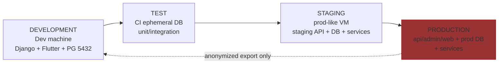
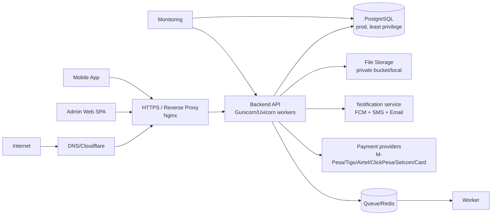
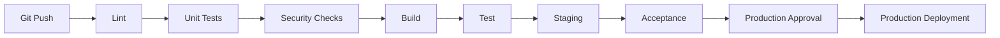
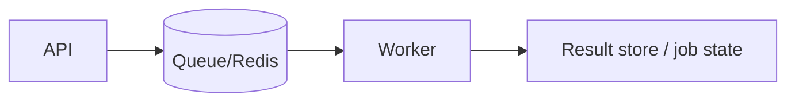
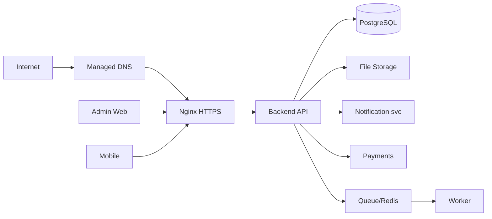
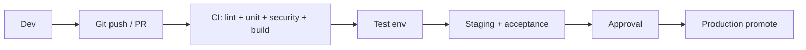
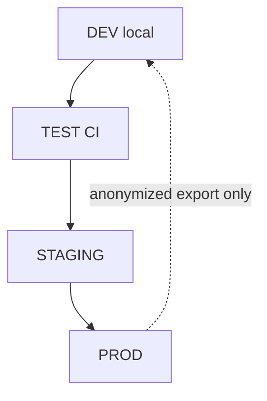
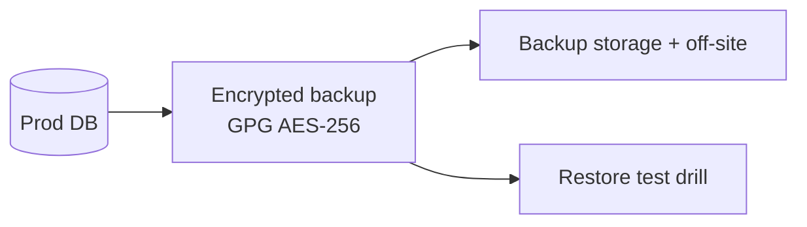

# Stage 3.9 Deployment Design — Sickler's Warriors

> Approved design for future production deployment of the Sickler's Warriors
> platform. **This stage is DESIGN ONLY.** No production infrastructure,
> credentials, domains, purchases or public exposure happen now.
>
> Status: `PASS WITH MINOR REVISIONS` (see `deployment-review.md`).
> Source of truth: Stage 3.1–3.8 documents; requirements in `02-requirements/`.

Companion documents (this stage):
* `deployment-environment-variables.md`
* `deployment-docker-architecture.md`
* `production-deployment-checklist.md`
* `deployment-runbook.md`
* `deployment-traceability.md`
* `deployment-review.md`
* `stage-3-completion-report.md`

---

## 1. Deployment Objectives

| Objective | Detail |
|---|---|
| Reliability | Production-quality deployment with health checks, graceful restarts, minimal-downtime releases |
| Security | HTTPS-only, least privilege, secrets management, no public DB, 3.8 Security Design applied |
| Scalability | Start single-node (Phase 1); defined path to horizontal growth (Phase 2–5, §36) |
| Maintainability | Containers + immutable tags, split settings, runbook, documented run paths |
| Observability | Logging, metrics, alerting, health endpoints (§25–§26) |
| Backup & DR | Encrypted scheduled backups + restore drills; RPO ≤24h (target ≤1h), RTO ≤4h (§27–§28) |
| Controlled releases | CI/CD with human approval for production; no auto-deploy (§18/§21) |
| Rollback | Every release reversible; mobile rollback distinct from server rollback (§29) |
| Minimal downtime | Rolling/simple swap release on a single host (Phase 1) with quick rollback (§30) |
| Secure configuration | Env vars by category, no secrets in repositories/bundles (§33–§34) |

Supported components being deployed: Mobile App, Admin Web, Backend API,
PostgreSQL, Notifications (FCM/SMS/Email), Chat/Realtime (v1 request-based;
ASGI planned), File Storage, Payment Providers, Monitoring.

---

## 2. Current Environment

### 2.1 Verified state (as inspected)

| Item | Verified observation |
|---|---|
| Local OS | Linux (Kali/Debian-family) for development; Flutter, Django, PostgreSQL, Android Studio present |
| Repo | `/home/golden-eagle/sicklers-warriors`; `.git` present with `.gitignore`; **0 commits, no branches, no remotes, no CI** (baseline gap) |
| Backend | Django 6.1.1, DRF 3.18.1, django-cors-headers 4.9.0, pillow, psycopg 3.3.5 (venv at `backend/venv`); **no requirements manifest file** (gap) |
| settings.py | `DEBUG=True`, `ALLOWED_HOSTS=[]`, insecure dev `SECRET_KEY` — dev only; production settings module to be created Stage 4 |
| Env files | `backend/.env.example` (6 placeholder keys) + `backend/.env` (gitignored, dev values only) |
| App DB | System PostgreSQL 18, **port 5432**, DB `sickle_cell`, user `sw_db_user` (dev). Verified accepting connections |
| Declared dev DBs | Legacy cluster **port 5433** with `sw_db`, `sw_db_test`, `sw_db_staging` — retained unused by owner decision (Stage 3 notes); **not** the app development DB |
| URLs | Only `/admin/` route present; `/api/v1/*` designed (3.5) but not implemented |
| Mobile | `apps/mobile` — Flutter; `applicationId = com.sicklerswarriors.sicklers_warriors`; deps minimal (flutter, cupertino_icons, flutter_lints); no Firebase/http/chat deps yet |
| Admin Web | `apps/admin-web` empty; React/TS/Vite target per 3.7 (AD-A-1..15) |
| Payments/Notifications | No configuration present (designed in 3.5/3.8) |
| Realtime | No WebSocket/Redis present; chat v1 via request API (3.6/3.8) |
| Docker/CI/CD | None found |
| Monitoring/Firebase | None |

### 2.2 Environment model

| Environment | Purpose | DB | Data allowed |
|---|---|---|---|
| **LOCAL (DEV)** | Developer machine → Django (dev server) → PostgreSQL | `sickle_cell` (5432) / legacy 5433 retained | Synthetic + anonymized data; NO real PHI; `DEBUG=true` |
| **TEST** | Automated & manual test runs | Ephemeral test DB | Synthetic; generated fixtures |
| **STAGING** | Production-like pre-release verification | Staging PG | Anonymized dataset only (never live PHI) |
| **PRODUCTION** | Real users | `sickle_cell_prod` | Real (anonymization rules apply for any export to lower envs) |

Rule: **never copy real production medical data into development/staging**
without a formally defined, approved privacy-safe anonymization process
(see §38 and 3.8).

---

## 3. Environment Architecture

Environment separation principles:

* Each environment has **its own database, settings, and secret set.**
* PROD DB is reachable only from the PROD backend host (network isolation).
* STAGING mirrors PROD topology but uses sandbox/dummy third parties and
  anonymized data.
* No `DEBUG=true` in STAGING/PRODUCTION.
* Versions/tags: promote the **same image** upwards; TEST–STAGING–PROD
  identical artifact (parity).

---

## 4. Production Architecture

Components map to 3.1 architecture (application/system/infrastructure docs).
Payments/notification flows comply with 3.5 §27–§30 and 3.8 security design.

---

## 5. Hosting Strategy

Evaluated options:

| Option | Pros | Cons |
|---|---|---|
| Single VPS (managed Linux) | Simple, cheap, full control; good Phase 1 | Single point of failure; manual ops |
| Managed cloud (AWS/Azure/GCP regional) | Managed components, auto-scaling | Cost; vendor complexity; data-residency rules for TZ PHI |
| Managed PostgreSQL + VPS apps | Reliable DB, easy backups | Cost; latency to VPS |
| Object storage + CDN | Scale static/media, cheaper egress | Extra config; guard private buckets |
| On-premise colocation | Full control, data stays in-country | High CAPEX/ops; not recommended for start |

**Recommendation (Phase 1):** single hardened Linux VPS (with unrecommended-not
Django-dev-server; Nginx + Docker app containers) in a **Tanzania/regional
data centre** OR regional cloud VM (data residency respected under documented
legal advice), plus DNS via a managed provider. Web/API/admin on one host;
PostgreSQL as a host-level service (not container) on the same or a second VM.

Why suitable:

* Tanzania-connected latency and fewer cross-border data questions.
* Cost proportional to current usage; no over-engineering.
* Application is containerized → later move to managed cloud by lifting images.
* Security: firewall 22/80/443, TLS only, secrets manager.

Complexity: LOW–MEDIUM. Scalability: vertical first, horizontal from Phase 3.
Operational burden: moderate (single host, one backup script, one monitoring
target). Future migration: images + managed PG + object storage migration path
documented in §36.

---

## 6. Domain Architecture

Placeholders only — **no domain registered/purchased.**

| Service | Placeholder hostname | Type |
|---|---|---|
| Main site/landing | `sicklerswarriors.example` | A |
| API | `api.sicklerswarriors.example` | A |
| Admin Web | `admin.sicklerswarriors.example` | A |
| Staging site | `staging.sicklerswarriors.example` | A |
| Staging API | `api-staging.sicklerswarriors.example` | A |

Notes:

* Real production domain chosen by owner at Stage 4 go-live; keep one apex
  `www`→`@` canonical redirect.
* Separate environments keep names obvious; API never runs on the apex.
* Certificates per subdomain (or wildcard `*.example` + `example` SAN) — decide
  with the DNS/TLS section (§7–§8).

---

## 7. DNS

| Record | Type | Value (placeholder) | TTL |
|---|---|---|---|
| `sicklerswarriors.example` | A | <server public IP> | 300 (stability: 3600) |
| `www.sicklerswarriors.example` | CNAME/A | apex | 300 |
| `api.sicklerswarriors.example` | A | <same IP Phase 1> | 300 |
| `admin.sicklerswarriors.example` | A | <same IP Phase 1> | 300 |
| `staging.sicklerswarriors.example` | A | <staging IP> | 300 |
| `api-staging.sicklerswarriors.example` | A | <staging IP> | 300 |
| `_dmarc`, `_spf`, `_dkim` | TXT | per email provider | 600 |
| `_acme-challenge` | TXT | DNSSEC/acme challenge | 60 (validation then reduce) |

Guidance:

* Prefer **A records** for origin servers; CNAME for `www`; do not CNAME apex.
* TTL: low during launch/maintenance for fast rollover; raise once stable.
* TLS validation uses HTTP-01 via CDN/DNS provider or DNS-01 (wildcard).
* Enable DNSSEC where the provider supports it; monitor at §39.
* Keep only required records public; never publish internal/prod-DB hostnames.

---

## 8. HTTPS / TLS

* **HTTPS-only production**; HTTP → HTTPS 301 redirect at Nginx.
* TLS 1.2 minimum, prefer 1.3; strong cipher suite (define in Stage 4).
* ACME automatic renewal (certbot/LE ansible/renew timer); renew check in advance (e.g. 30 days).
* HSTS (`preload` after validation), secure cookies (`Secure; HttpOnly; SameSite`),
  `X-Frame-Options`, CSP configured for Admin Web (3.7).
* API TLS enforced; no plain HTTP endpoint for mobile.
* **No certificates/private keys committed to Git**; certs mounted/generated on
  hosts, renewed automatically; staging uses real cert too (avoids prod-only
  surprises).

---

## 9. Reverse Proxy

**Nginx** selected (mature, low overhead, third-party parity).

Responsibilities:

* TLS termination and HTTP→HTTPS redirect.
* Routing: `/`→Admin Web (or separate subdomain/PROXY for admin static) and
  `api.<domain>/v1/*` → backend upstream.
* Static files serving with cache-busted hashing, gzip/brotli.
* Request limits (`client_max_body_size` for license/doc uploads — 3.8 §19),
  timeouts, rate limits at edge (complementary to API 3.5 §29).
* Security headers (HSTS, CSP, X-Content-Type-Options).
* WebSocket/ASGI upgrade forwarding (once realtime exists, §11).
* Upstream health: fail-fast + health route passes to `healthz` endpoint;
  no traffic to a dead upstream (502 handling).

---

## 10. Backend Deployment

* Production settings module (e.g. `config/settings/prod.py`) — `DEBUG=false`,
  `ALLOWED_HOSTS`, secure cookies, `DJANGO_SETTINGS_MODULE` set by env.
* Serve with **Gunicorn + Uvicorn workers** (or pure Uvicorn) behind Nginx —
  **never Django dev server**.
* Process manager: systemd (preferred Phase 1) or compose `restart`.
  Graceful: `kill -TERM` drain (workers finish in-flight).
* Workers: CPU-bound tuned (`--workers = 2*cores+1` cap); see §21 for
  background tasks.
* Static: `collectstatic` to shared dir; Media: private volume (Phase 1 local,
  Phase 2 object storage §16).
* Migrations: run as a release step (§13), not during traffic by default.
* Health checks: `/livez` (process alive) and `/healthz` (DB+core services) — §26.
* Logging: JSON to stdout (container) → collector; reqId trace; no PHI/tokens.
* Run as **non-root** user; container runs non-root (see Docker doc).

---

## 11. Realtime Deployment

* v1: chat + notifications are **request/response API** (3.5/3.6) — **no
  WebSocket required; therefore no Redis is introduced merely for chat.**
* ASGI path planned: when realtime approved (Stage 4+), run Uvicorn ASGI
  workers behind Nginx with `Upgrade`/`Connection` headers and a Redis channel
  layer only then.
* Scaling strategy (when realtime): sticky sessions off, Redis pub/sub
  channels per room; Nginx forwards WebSocket; worker pool handles auth.
* Redis is added **only if** realtime/queue requirements materialize; otherwise
  LRU caches stay Memcached/local (per 3.8/3.5 note).

---

## 12. PostgreSQL

* Production DB `sickle_cell_prod` with dedicated app user. **No root/superuser
  application account**; only migration/admin task may use elevated role, and
  only when required.
* Least privilege: `SELECT/INSERT/UPDATE/DELETE` on app tables; no DDL for the
  app role.
* Connection security: bind `127.0.0.1` Phase 1; if separate host then
  `verify-full` TLS, private network, `pg_hba` restricted to app server.
* Pooling: PgBouncer **when connections grow** (Phase 2); configured with
  statement/password auth, server reserved core.
* Backups: pg_dump encrypted (GPG) nightly + WAL archiving for PITR (target
  RPO ≤1h); off-site copy; restore drills (§27).
* Monitoring: dedicated DB metrics (connections, slow queries, disk);
  `pg_stat_activity` alerting.
* Replication: Phase 4 streaming replica (async) for failover read-offload;
  primary still single writer.
* Scaling strategy: vertical first; then read replicas; then partitioning by
  time (medical_records) if needed — phased §36.

---

## 13. Database Migration Strategy

* Migrations move Dev→Test→Staging→Production **in order**, together with code
  version (tag).
* Review: every migration reviewed in PR; `migrate --plan` logged; naming
  conventions; **no squashing of historical migrations** once any env is live.
* Before risky migration (drop/rename/backfill): dedicated encrypted backup
  taken and verified; confirm restore path.
* Migration testing: run against a copy of staging data (anonymized); measure
  duration; record before/after counts.
* Rollback strategy with schema:
  * Prefer **expand/contract**: additive-first migrations (safe forward for
    old code + new code), remove old columns in a later release — supports
    rollback without DB restore.
  * Destructive rollback (if unavoidable): restore from the pre-migration
    backup; document data-loss window; reconcile with audit trail.
* Deployment ordering: deploy new code → run approved forward migration →
  verify → (if instant rollout) keep old image for rollback without re-migrate.

**Never casually modify production schema; always via release + review + backup.**

---

## 14. File Storage

| Artifact | Phase 1 (local) | Phase 2 (object storage) |
|---|---|---|
| Doctor license, verification docs | private dir outside web root, signed-URL download via API | private bucket (`s3`/`gcs`-like), SSE encryption, presigned URL 60–600s |
| Medical documents | same private dir, DB references + ACLs (3.5 IDOR guards) | private bucket + per-object ACLs; never public |
| Profile images, campaign docs, edu files | public/private split per classification (`data-classification-security.md`) | CDN for approved-public |
| Encryption | disk-level + GPG backups | server-side encryption + versioning |
| Access control | ACL checks at API (3.5 §27/§28), ownership/set filters | ACL + signed URLs + skip-if-unauthorized |
| Backup/lifecycle/retention | nightly encrypted backup; retention per §33/3.8 | lifecycle rules + retention policy; audit |

**Sensitive documents must NOT be publicly accessible.** Storage service worker
(no separate uploader) — validation in API (size/type 3.8 §19).

---

## 15. Static Files

* Django static: `collectstatic` → hashed files → Nginx `location /static/`
  (Phase 1) or CDN (Phase 2).
* Admin assets: SPA build output served from `admin.<domain>` static root or
  same Nginx with `location /assets/` + long cache (immutable hashed).
* Flutter web assets: only if web target adopted; serve from CDN/static.
* Cache headers: hashed assets `Cache-Control: public, max-age=31536000,
  immutable`; HTML/index no-cache.
* Never place private uploaded files in the static root.

---

## 16. Mobile Distribution

### Android
* Internal testing: debug APK + signed release APK (gradle, `VERSION_NAME/CODE`
  bumped).
* Public: signed **AAB** for Google Play (bundle), release keys in secure
  store; `key.properties`/`.jks` **gitignored and never committed**.
* Release channels: Play internal test → closed → production rollout
  (staged %). Versioning: semver + `versionCode` increments; API contract lock
  per version.

### iOS (future, requires macOS)
* Development build → TestFlight → App Store; signing certs + provisioning in
  secure store; export compliance; review/approval lead times documented.

**NEVER commit** signing keys, keystores, Apple certs, private keys, or
production API secrets. Keystore password/alias in secret manager only.

---

## 17. Admin Deployment

* Frontend/backend: SPA at `admin.<domain>` → `api.<domain>`; no backend on same
  origin; CORS restricted to admin origin (3.7, 3.8).
* Auth: JWT + MFA (admin role mandatory MFA per 3.8 §6/§25), session idle 15 min.
* Env config: `VITE_API_BASE_URL` per env build; `.env.production` for build
  (no secrets baked).
* Static assets: built hashed → Nginx/CDN cache.
* Caching: SPA shell no-cache; assets immutable.
* Deploy process: part of CI release job (build → artifact → promote image).
* Rollback: previous static artifact/tag re-served instantly.
* **Admin panel exposes NO backend secrets.** Verify by scanning bundle +
  denying `/admin/` Django admin backend public exposure (only api endpoints).

---

## 18. CI/CD

* Pipeline executes on push/PR for lint+unit+security; tag/release triggers
  full path to staging + approval.
* **Production deployment requires explicit human approval** (owner +
  release manager); never automatic on every commit.
* Gates: tests pass, vulnerability scan (< threshold), build image pushed
  (immutable tag), staging smoke green.
* Rollbacks: automatic rollback blueprint on failed smoke (runbook Step 5).
* Runner: project-hosted or cloud runner with job-scoped secrets.

---

## 19. Git Strategy

Recommended **trunk + feature branches + short-lived release branches**:

* Branches: `main` (protected), feature/`issue-*`, `release/vX.Y`, `hotfix/*`.
* Rules: PR + ≥1 code review; status checks required (lint, unit, security);
  `main` ❌ direct push; merge via squash or merge-commit (pick, document);
  tags for releases; no force-push to protected.
* Hotfix: cut from `main`, fix, PR into `main` + backport to release if needed.
* Releases: version tag `vX.Y.Z` carries image/db-version mapping.

---

## 20. Containers

Decision: containerize app services (backend w/ Gunicorn/Uvicorn, worker,
optional Nginx) with immutable tags; **PostgreSQL NOT containerized** (phase 1
system/managed) — see `deployment-docker-architecture.md` for full layout,
Dockerfile stages, volumes, health, registry and rollback conventions,
no-`latest` and non-root rules.

---

## 21. Workers (Background)

Identified async tasks (from 3.5/3.6/3.8): email/SMS, push notification
dispatch, financial reconciliation jobs, report generation, document
processing (scanning validation), scheduled reminders (medication/clinic), and
sync-fallback relay for offline mobile (if needed).

Design:

* Celery (or Django-Q) with Redis broker **only when justified** — recommend
  enabling alongside async requirements in Stage 4; otherwise run minimal
  inline + systemd timer.
* Concurrency limits, visibility timeouts, dead-letter, retry with backoff +
  exponential; idempotent task keys; audit job outcomes (BR-012).

---

## 22. Scheduled Tasks

| Task | Frequency | Timezone | Failure handling | Retry | Audit |
|---|---|---|---|---|---|
| Medication reminders | daily cron by timezone per patient | Africa/Dar_es_Salaam | skip + alert | next run + retry queue | notification log |
| Clinic appointment reminders | T-1d / T-2h | same | log + SMS retry | 3x backoff | log |
| Payment reconciliation | hourly + end-of-day | same | manual re-run; alert | 3x; escalation | reconciliation report |
| Cleanup (expired tokens, stale session/devices, temp files) | nightly | same | alert on failure | next run | cleanup log |
| Report generation | scheduled per report type | same | retry + notify requester | 3x | report meta log |
| Backup verification (restore-check + encrypt check) | daily/weekly | same | **alert immediately** | none (fix-first) | backup log |
| Backup job | nightly + WAL | same | alert + retry | 1 retry | backup log |

Retries use exponential backoff with dead-letter for permanent failures;
all scheduled ops write to `security_events`/`audit_logs` as required.

---

## 23. Firebase / Notifications Deployment

* FCM for push; SMS + Email providers per §8. Environment separation:
  Dev project / Test project / Staging project / **Production project**
  distinct; routing key per env.
* Credentials: Firebase **service-account JSON via secret manager**, never Git;
  scope minimal (FCM + messaging); rotate keys.
* VAPID/legacy server key for web push as needed; failure handling: queue
  retries + dead-letter + alert; receipts logged (no PHI).
* Real-time features: v1 via polling API; FCM used for alerts/urgency.

---

## 24. Payments

* Providers: M-Pesa, Tigo Pesa, Airtel Money, ClickPesa, Selcom, card
  (per 3.5 §30) — **TEST vs PRODUCTION credential sets strictly separate**.
* Production: register callback/webhook HTTPS URLs; signature verification;
  ±5 min window + nonce (ASG-10); idempotent handling of duplicate callbacks.
* Reconciliation: periodic job comparing statement vs internal states; alerts
  on mismatch; manual review process.
* Mapping/verification all inside backend; **client never asserts payment
  success** (BR-008/3.5).
* Secret management: provider keys via secret manager; rotation schedule.

---

## 25. Observability

* Logging: application logs (structured JSON, reqId), API/access logs,
  authentication logs, payment logs, security logs — retention 90 days app,
  365 days auth/payment (3.8 §28/§42). No passwords/tokens/PHI in payloads.
* Metrics: CPU, memory, disk, DB (connections, lag), API latency (p95),
  error rate, uptime.
* Alerting: service down, DB unavailable, high error rate, disk ≥80%,
  suspicious activity(3.8), payment failures; routed by severity to ops
  channel + on-call.
* Error tracking: Sentry with PII/PHI scrubbers; sample rates tuned.
* Metric POST endpoint internal; external uptime checks for public endpoints.

---

## 26. Health Checks

| Component | Endpoint/check | Liveness vs Readiness |
|---|---|---|
| API | `/livez` (process), `/healthz` (DB/cache/queue/deps) | `/livez` = liveness; `/healthz` = readiness |
| Database | `SELECT 1` + replication status | readiness |
| Worker | heartbeat/last-job tick | readiness |
| Realtime service (future) | websocket handshake echo | both |
| Notifications | provider reachability probe (rate/safe) | readiness |
| Object storage | lifecycle probe + signed-URL generation test | readiness |

Expose `/livez` at edge (or internal only); never include PHI; health route
rate-limit to avoid abuse DDoS.

---

## 27. Backups

* PostgreSQL: nightly encrypted pg_dump (GPG AES-256) + WAL archiving for PITR
  (enable when targeting RPO ≤1h). Retention: e.g. 7 daily + 4 weekly + 12
  monthly (final numbers Stage 5; prototype now against dev).
* Uploaded documents/media: nightly encrypted copy (rsync) of private store.
* Critical config: .env/templates/cert config backed with the release; secret
  store has its own backup/recovery.
* Location: same-host staging + **off-site** copy (different provider/region).
* Access control: backup keys limited; restore requires secret access + audit.
* **Restore testing is mandatory** — a backup is not valid until a restore has
  been successfully executed (drill cadence: monthly; pre-release).

---

## 28. Disaster Recovery

Failure → Detection → Recovery → Verification → Restoration:

| Step | Detail |
|---|---|
| Detection | Uptime + metrics + health alerts |
| Recovery | For DB: failover to replica (Phase 4) or restore last good backup + WAL replay; for app: redeploy last good image (runbook rollback path) |
| Verification | `SELECT` digest checks + token/auth spawn smoke + consent/audit sample |
| Restoration | Bring services back; communicate; post-incident review |

* RPO: ≤24h standard, ≤1h with PITR (target). RTO ≤4h.
* DB recovery uses ordered restore (base backup + WAL). File recovery from
  encrypted backup/off-site. Service recovery re-runs deploy of last good tag.
* DNS recovery: TTL low → point apex records to failover IP; CDN purge.
* Credential recovery: secret-manager restore path + rotation plan documented.

---

## 29. Rollback Strategy

* Rules: every release ships with a defined rollback (image tag kept; migration
  forward/backward plan; config old snapshot).
  * Backend: re-point to previous image tag → reload.
  * Admin Web: re-serve previous static build.
  * DB: expand/contract makes most releases rollback-safe via old code on new
    schema; destructive-path rollback = restore pre-release backup (accepted
    data-loss window; documented per release).
  * Config: revert env/secret versions to previous snapshot.
  * **Mobile rollback differs**: cannot instantly uninstall for all users.
    Strategy: version-gating (feature flags), disable dangerously-buggy
    endpoints server-side via allowlist of supported client versions, then
    fast-fix release via store; document "mobile app version compatibility
    matrix" with the API contract lock (3.5).

---

## 30. Zero/Minimal Downtime Strategy

Phase 1 (single host): **rolling restart** — reload one worker at a time;
Gunicorn graceful workers; Nginx static 0-downtime; keep old image tag for 10
min on failure. Blue/green + canary reserved for Phase 3+ when multi-app-node
exists; no unnecessary lock-step tooling now.

---

## 31. Security Hardening (applies 3.8)

* Firewall: egress/ingress allowlist; only 22/80/443 inbound (§32, §35).
* SSH: keys-only, no root password, limited users, fail2ban, MFA for jump.
* Non-root runtime for all app services; containers run via unprivileged.
* Restricted ports: only required bind; PostgreSQL bound private/127.0.0.1.
* Secret management: secret manager/CI secrets; no secrets in Git/logs/bundles.
* HTTPS/TLS mandatory; HSTS; secure cookie flags.
* Database isolation: app role least-priv; no superuser; separate prod role.
* Backups encrypted with access-restricted keys.
* Monitoring + IDS baseline (suricata/log-based) Phase 2 where feasible.
* Dependency updates: pinned + CI scanning (§35/§38).
* Only expose necessary ports (map in §35).

---

## 32. Production Ports

| Port | Protocol | Purpose | Exposure |
|---|---|---|---|
| 22 | SSH | admin access | restricted IP allowlist + keys |
| 80 | HTTP | redirect to 443 | public (optional) |
| 443 | HTTPS | all app/admin/api traffic | public |
| 5432 | PostgreSQL | DB (Phase 1 same host) | **127.0.0.1 only** (never public); remote-host links via private net + TLS |
| 6379 | Redis | broker/cache (if used) | 127.0.0.1 only |
| 8000/8080 | app internal | backend upstream to Nginx | 127.0.0.1 only |
| 9090/9100 | monitoring/metrics exporter | collect | internal/private only |
| 15672 etc. | messaging admin (if used) | admin | internal only, restricted |

No public PostgreSQL unless documented & justified (design says NO).

---

## 33. Environment Variables

See `deployment-environment-variables.md`: categories, PUBLIC vs SECRET
classification, `DATABASE_URL`, `SECRET_KEY`, `ALLOWED_HOSTS`,
`CORS_ALLOWED_ORIGINS`, `FIREBASE_*`, `PAYMENT_*`, `STORAGE_*`, `EMAIL_*`,
`SMS_*`, observability, backup, CI. Values injected per env; never stored in
Git.

---

## 34. Secret Management

| Environment | Storage | Rotation | Access control | Revocation | Audit |
|---|---|---|---|---|---|
| DEV | `.env` (gitignored) | manual on leak | local dev | delete file | n/a (documented) |
| TEST | CI/CD secrets | per pipeline | owner-managed | revoke job | pipeline logs |
| STAGING | secret manager or `.env.prod.staging` (not Git) | quarterly + on personnel change | role-scoped | revoke | audit events |
| PRODUCTION | secret manager (preferred) + restricted access | on leak/personnel change/quarterly, esp. SECRET_KEY, payment creds | named ops/owner only | revoke key/credential | audit log of access |

Evaluate: env var, secret manager, CI/CD secrets. Mandate: no plaintext
secrets in repos, no sharing, no credentials in logs.

---

## 35. Dependency Management

* Python: `requirements/*.txt` pinned exact versions + hash lock
  (`--require-hashes`), virtualenv rebuilds from lock; security updates
  controlled via PR + CI scan.
* Flutter: `pubspec.lock` committed; `dart pub outdated` review cadence;
  avoid unbounded majors near production.
* System: OS LTS pins, unattended security upgrades, provider package mirrors.
* Vulnerability scanning: CI (trivy/bandit/safety equivalently), scheduled
  scans; block on critical CVEs with fix window.
* Version pinning and controlled upgrades before production are required — no
  uncontrolled bumps.

---

## 36. Scalability Design

| Phase | Scope | Actions |
|---|---|---|
| Phase 1 | Single prod application environment | VPS host, Nginx, backend, PG same host; start small (§7) |
| Phase 2 | Separate workers/services | Workers on own resources; PgBouncer; monitoring scale-up; Redis only if needed |
| Phase 3 | Horizontal API scaling | 2+ app nodes behind LB; stateless sessions (JWT), no sticky; shared media/static; DB read replica for read load |
| Phase 4 | DB optimization/replication | streaming replica, indexes by measurement, PITR maintained, partitioning if data volume warrants |
| Phase 5 | Advanced infra if required | managed cloud services, autoscaling, CDN, object storage, Kubernetes only if demonstrated need |

Explicit: **do not over-engineer the initial deployment** — Phase 1 is enough
for start.

---

## 37. Performance

* DB indexing: indexes matched to worst-query patterns (3.4); monitor with
  `EXPLAIN` in staging; add only when measurement justifies.
* Caching: immutable static assets; API-level cache only for safe,
  non-PHI resources; **avoid caching that risks exposing private medical data**
  (3.8 §41). PHI endpoints bypass shared caches.
* Pagination/cursors on collection endpoints (3.5).
* API response optimization: JSON size (select fields), compression at Nginx.
* Static asset cache + image optimization (thumbnails) for profile/campaign.
* Background processing for expensive jobs (§21).
* Connection pooling for DB connections (§12).

---

## 38. Data Privacy in Deployment

* Logs/analytics/error tracking: never store PHI; scrubbing filters; retention
  limits (3.8 §42).
* Backups: encrypted; restricted access; consent/audit preserved.
* File storage: private-by-default; signed URLs; ACLs enforced server-side.
* Third-party services: addendum coverage; data-collection minimization;
  DPA forms where applicable.
* Developer access: least privilege; prod requires approval; staging data is
  anonymized.
* **No production medical data copied into developer environments without an
  approved anonymization process** (executive rule of §2/3.8).

---

## 39. Deployment Access Control

* Least privilege, individual named accounts, no shared passwords; SSH keys +
  MFA.
* Production credentials only for owner + named release role; deploy triggered
  by approved pipeline (not direct login).
* Audit trail of every deploy/access; revoke on role change.
* Deployment access is separate from application user access; two-tier
  (approve vs execute).

---

## 40. Smoke Testing

Post-deploy smoke suite (safe test accounts/data ONLY — never real patient
data):

* API health + version endpoint
* Database connectivity check
* Authentication: login (+ MFA where required)
* User registration (throwaway test account)
* Doctor verification workflow
* Blood request
* Emergency request
* Donation workflow
* Notification (email/SMS/FCM delivery to green device)
* Admin access + permission checks (role-limited)

Each releases copies into runbook §4; failures → rollback trigger (§29).

---

## 41. Cost Model (conceptual — estimates only, NOT verified)

| Category | Range (est.) | Notes |
|---|---|---|
| Domain | LOW | 2-year registration (TZS/regional registrar) |
| Hosting VPS | LOW–MEDIUM | TZS-class VPS, mid-tier (2–4 vCPU / 4–8 GB) |
| Managed DB (Phase 2) | MEDIUM | if moving off same-host PG |
| Object storage (Phase 2) | LOW–MEDIUM | pay-as-used; monitor private bucket egress |
| Backups/off-site | LOW | encryption + storage of backups |
| CDN (Phase 2) | LOW–MEDIUM | for approved-public assets |
| SMS | LOW–MEDIUM (per-send) | rescue/verify flows; budget per volume |
| Email | LOW | SMTP/SES |
| Firebase | LOW | free tier + pay-as-you-grow FCM |
| Payment provider fees | MEDIUM (transaction-based) | % per transaction per provider (varies) |
| Monitoring | LOW | self-hosted or free tier early |
| App-store | LOW | Google Play one-time; Apple fee annually (iOS phase) |

Explicit: **no exact current prices are claimed**; ranges flagged as estimates;
revisit during Stage 4 planning with actual provider quotes.

---

## 42. Deployment Diagrams

### 42.1 Overall Production

### 42.2 CI/CD

### 42.3 Environment Separation

### 42.4 Backup

---

## 43. Open Decisions

| # | Decision needed | Impact | Default (if no change) |
|---|---|---|---|
| OPD-1 | Production domain/registrar choice | DNS/TLS | Use placeholders (`*.example`) |
| OPD-2 | Hosting provider: local TZ VPS vs regional cloud | cost/legal | Single VPS Phase 1 (docs) |
| OPD-3 | When to enable Redis/Celery realtime | Worker/cache | Not in v1 (API-request chat) |
| OPD-4 | Managed PG vs same-host PG timing | ops burden/cost | Same-host Phase 1; managed Phase 4 |
| OPD-5 | FCM/SMS provider final choice | integration work | FCM + selected SMS provider Stage 4 |
| OPD-6 | CI/CD host (self vs cloud runner) | security/cost | Cloud runner w/ job-scoped secrets |
| OPD-7 | Privacy anonymization spec approval | data use | Enforced §38 rule; spec in Stage 4 |
| OPD-8 | iOS launch timing | App Store path | Android first (Phase 4 iOS) |
| OPD-9 | DB PITR (RPO ≤1h) enablement in v1 | cost/ops | Target; nightly+RPO≤24h minimum v1 |
| OPD-10 | Backup retention final numbers | storage cost | 7d + 4w + 12m prototype; finalize Stage 5 |

---

_End of deployment-design.md (Stage 3.9 main document)._