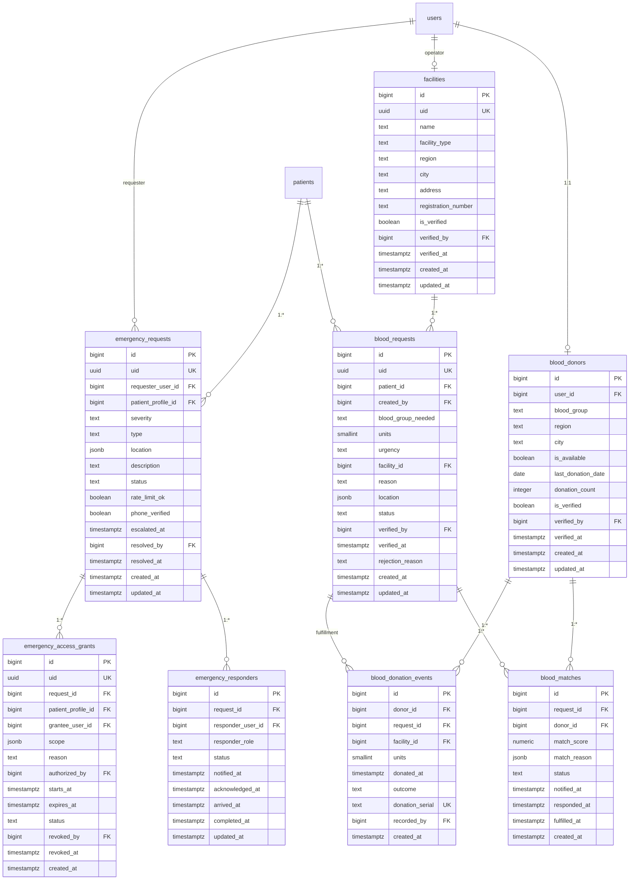

# 3.4 ERD — Blood & Emergency

Constraints & notes:
- `blood_group` CHECK (A+, A-, B+, B-, AB+, AB-, O+, O-); request `urgency` CHECK (NORMAL, URGENT, CRITICAL).
- Requests carry **no donor PII**; donor contact released only through accepted/fulfilled workflow at a facility (BR-006).
- `emergency_access_grants` bounded (default 24h), auto-expiry, audited — no bypass-all rule (Stage 3.3 §16).