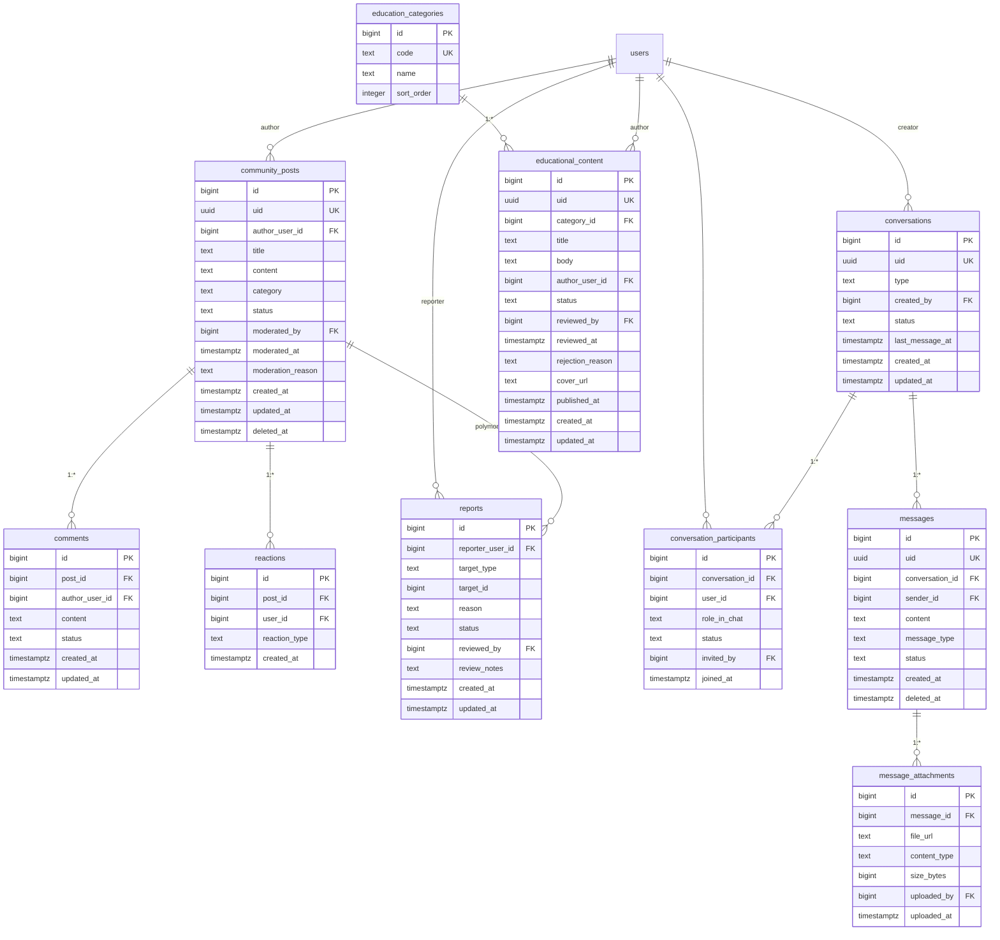

# 3.4 ERD — Community & Communication

Constraints & notes:
- `reactions(post_id, user_id, reaction_type)` unique; `conversation_participants(conversation_id, user_id)` unique.
- Doctor-patient chat requires active consent/authorized context; participant object-level checks at API layer (Stage 3.3 §17).
- Community content is separable from private medical records.