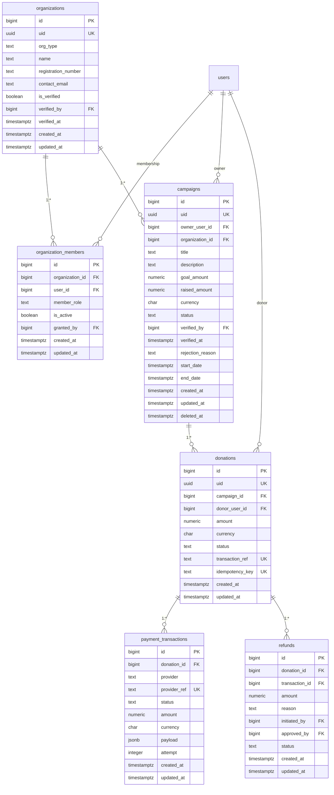

# 3.4 ERD — Donations & Payments

Constraints & notes:
- `goal_amount`, `amount` CHECK > 0; `status` CHECKs on campaigns/donations/txns/refunds.
- Payment success verified server-side (webhook + signature); no client-side trust (BR-008).
- `transaction_ref`, `idempotency_key`, `provider_ref` unique — safe duplicate webhooks (FR-PAY-004).
- Payload redacted: no PAN/token/card data in `payload` (privacy §25).