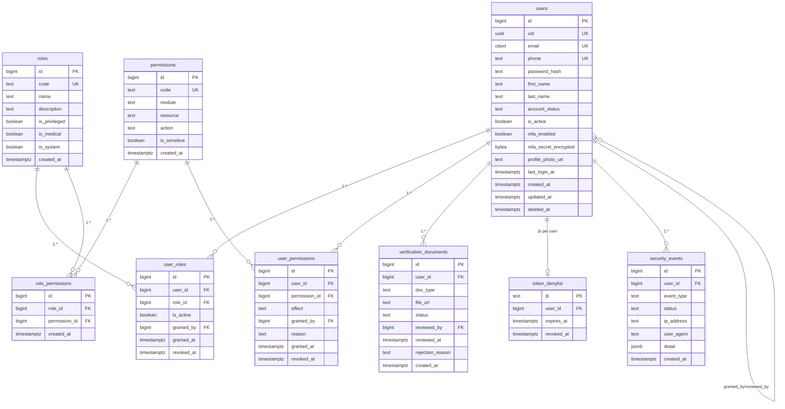

# 3.4 ERD — Identity & Access

Constraints:
- `roles.code`, `permissions.code` unique.
- `user_roles(user_id, role_id)` unique; `user_permissions(user_id, permission_id)` unique.
- `account_status` CHECK (ACTIVE, PENDING_VERIFICATION, SUSPENDED, DISABLED, DEACTIVATED).
- `effect` CHECK (ALLOW, DENY).
- Multi-role aggregation + SUP-only role assignment (Stage 3.3).