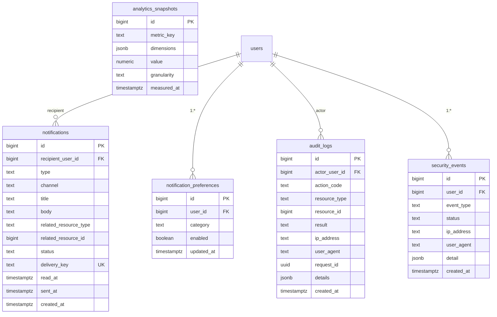

# 3.4 ERD — Notifications & Audit

Constraints & notes:
- `notification_preferences(user_id, category)` unique; `analytics_snapshots(metric_key, dimensions, granularity, measured_at)` unique.
- Audit logs append-only (no update/delete); no PHI in `details` (Stage 3.3 §22).
- `analytics_snapshots` store aggregates only — no duplicated sensitive/medical data (§19).
- Indexes: `audit_logs(resource_type, resource_id, created_at)`,
  `notifications(recipient_user_id, created_at)`.