# 3.4 ERD — Overall (high-level)

```mermaid
erDiagram
    users ||--o{ user_roles : "assigned"
    users ||--o{ user_permissions : "override"
    roles ||--o{ role_permissions : "grants"
    roles ||--o{ user_roles : ""
    permissions ||--o{ role_permissions : ""
    users ||--o{ verification_documents : "submits"
    users ||--o| patients : "patient profile"
    users ||--o| doctors : "doctor profile"
    users ||--o| healthcare_staff : "staff profile"
    users ||--o| blood_donors : "donor profile"
    users ||--o| facilities : "operator profile"
    users ||--o{ organizations : "members"
    patients ||--o{ caregivers : "caregiver links"
    patients ||--o{ medical_records : "owns"
    patients ||--o{ consents : "grants"
    patients ||--o{ medications : ""
    patients ||--o{ symptoms : ""
    patients ||--o{ appointments : ""
    patients ||--o{ health_timeline : ""
    facilities ||--o{ doctors : "employs"
    facilities ||--o{ healthcare_staff : ""
    patients ||--o{ blood_requests : ""
    blood_donors ||--o{ blood_matches : ""
    blood_requests ||--o{ blood_matches : ""
    patients ||--o{ emergency_requests : ""
    users ||--o{ emergency_requests : "requester"
    emergency_requests ||--o{ emergency_responders : ""
    organizations ||--o{ campaigns : "owns"
    campaigns ||--o{ donations : ""
    users ||--o{ donations : "donor"
    donations ||--o{ payment_transactions : ""
    donations ||--o{ refunds : ""
    users ||--o{ community_posts : "author"
    community_posts ||--o{ comments : ""
    users ||--o{ reports : "reporter"
    users ||--o{ conversations : "creator"
    conversations ||--o{ conversation_participants : ""
    conversations ||--o{ messages : ""
    users ||--o{ notifications : "recipient"
    users ||--o{ audit_logs : "actor"
    users ||--o{ security_events : ""
```

High-level notes:
- `users` is the hub; role assignment is M2M (`user_roles`), profiles are 1:1.
- Patient owns medical/consent data; doctors/caregivers are authorized actors.
- Money flow: `organizations → campaigns → donations → payment_transactions → refunds`.
- Emergency override grants live on `emergency_access_grants` (bounded, audited).