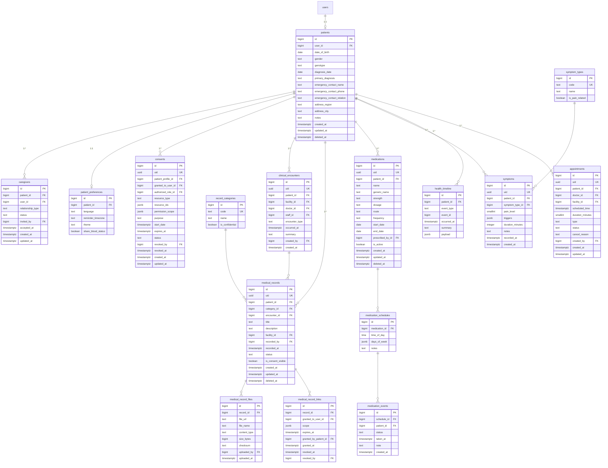

# 3.4 ERD — Patient & Medical

Constraints & notes:
- `caregivers(patient_id, user_id)` unique; CAREGIVER role alone grants no access — `consents` authorize (Stage 3.3 §10/§15).
- `consents.status` CHECK (DRAFT, ACTIVE, REVOKED, EXPIRED); `permission_scope` = array of permission codes.
- `pain_level` CHECK 0..10; appointments type/status CHECK.
- Medical data is Highly Sensitive (consent-gated, §25).