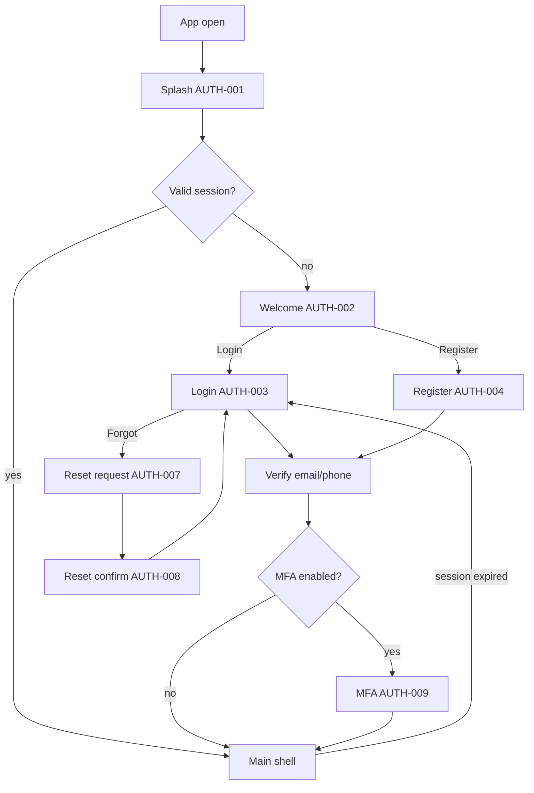
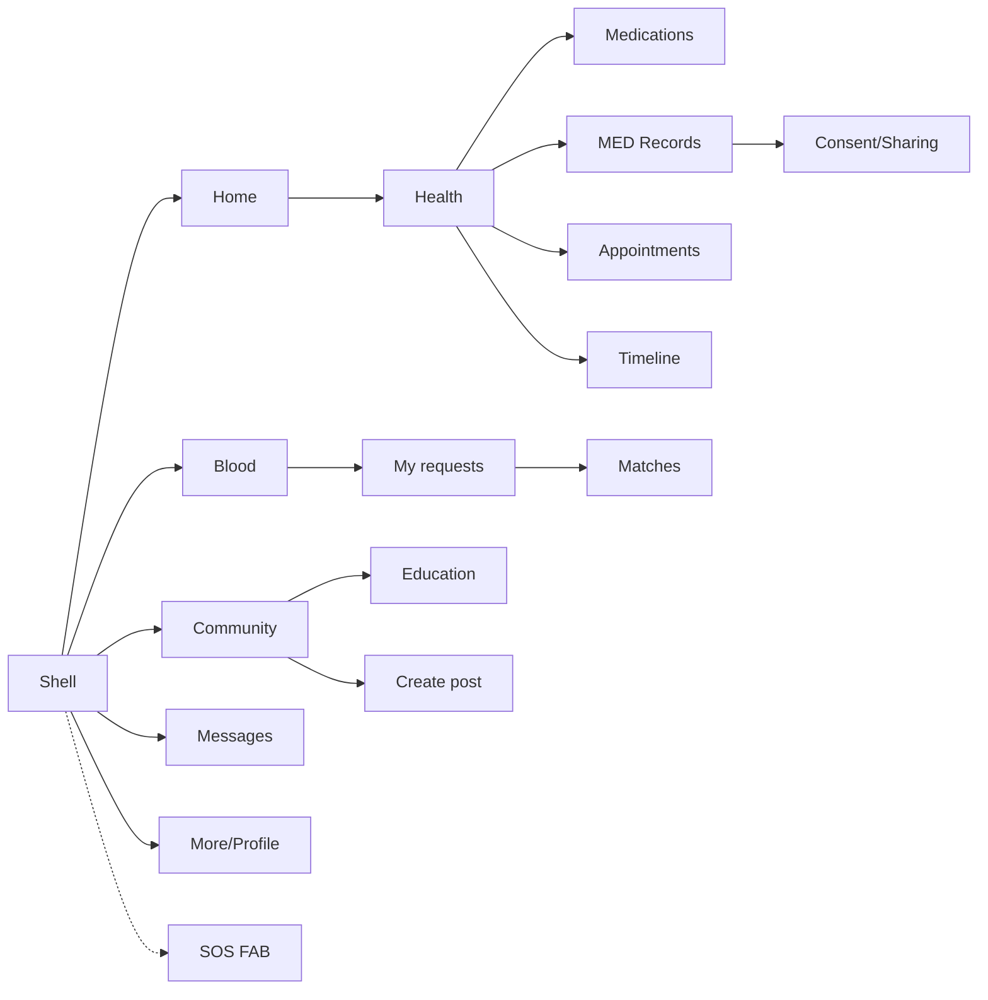
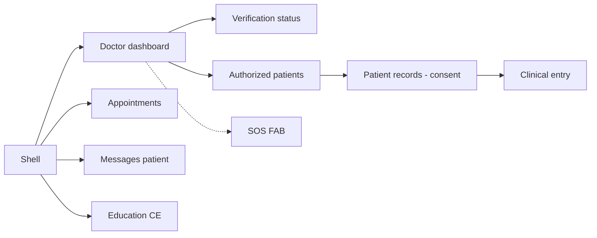
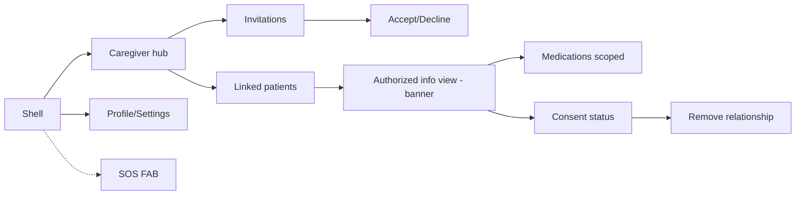
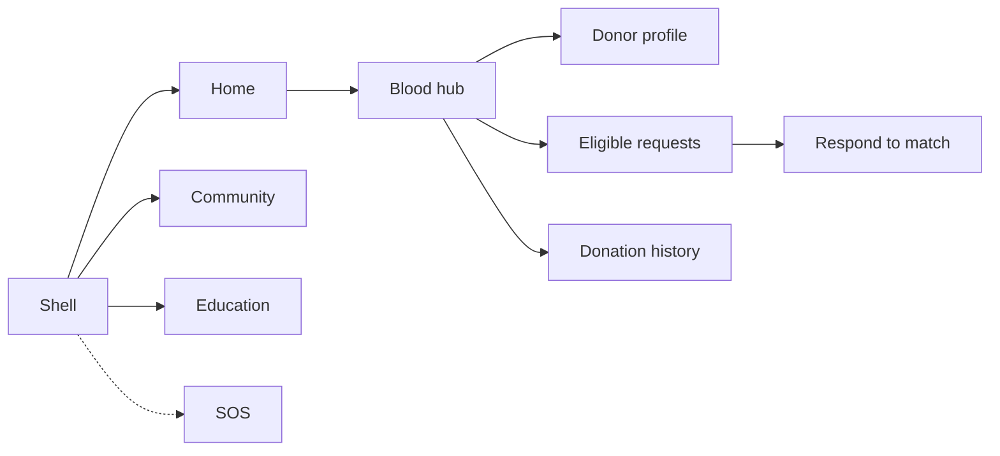
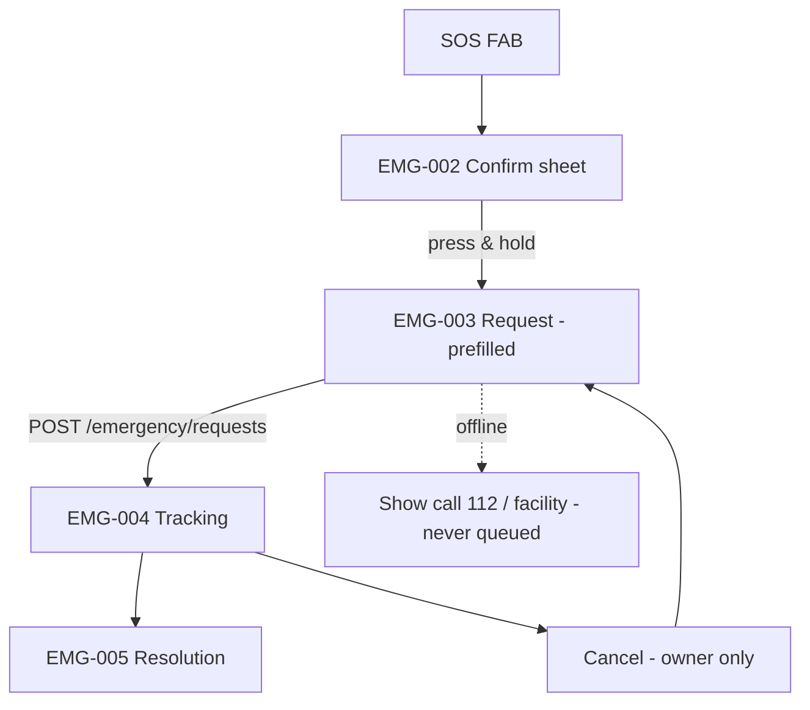
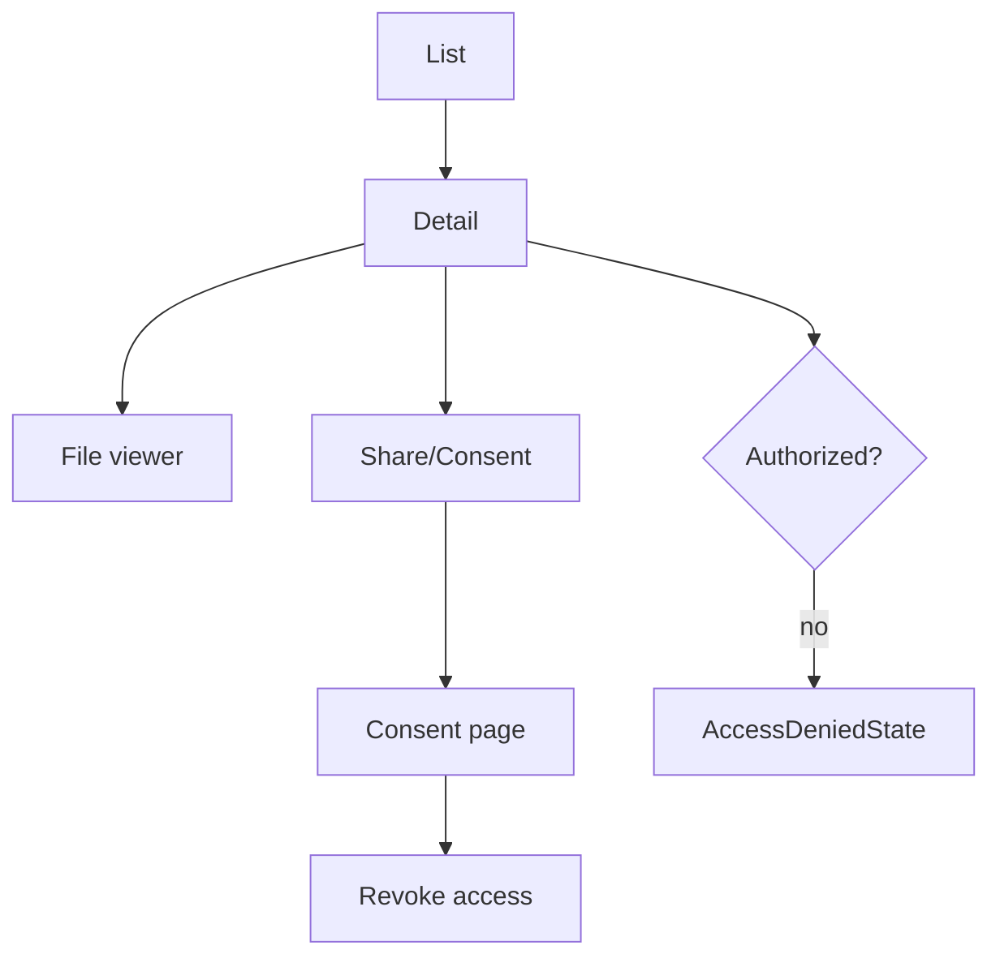
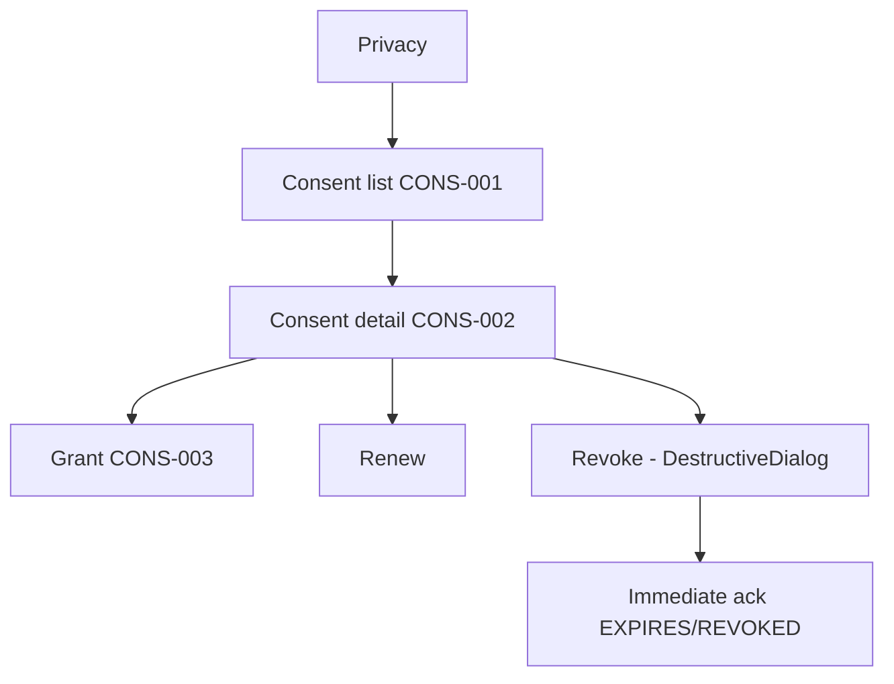
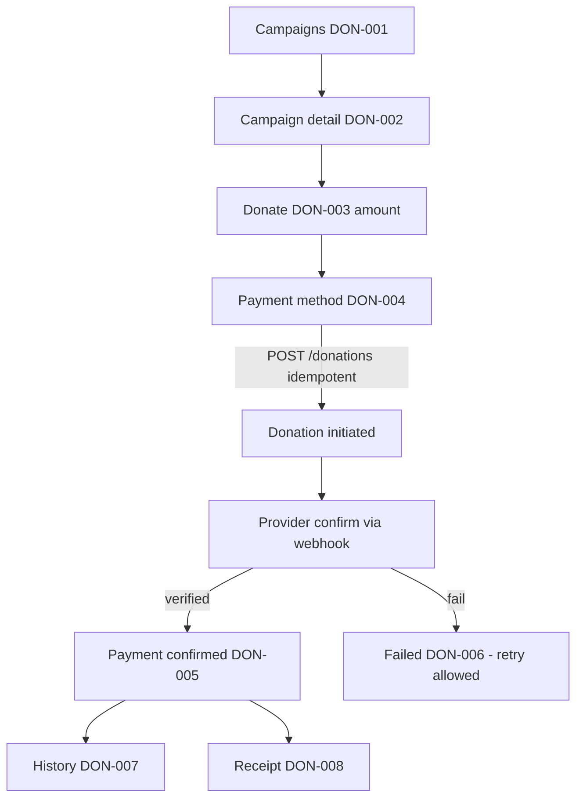

# 3.6 Mobile Navigation

> Navigation structure, role-specific maps, guards, deep links, auth redirects
> and unauthorized-screen behaviour. Companion to `mobile-ui-ux-design.md`
> (§3/§4/§5) and `mobile-screen-inventory.md`. Screen IDs match the inventory.

---

## 1. Navigation Structure

Two stacks:

1. **Auth stack** — `Splash → Welcome → Login/Register → Verify → MFA → Shell`.
   No bottom navigation. Back from Welcome exits (social pattern).
2. **Main shell** — bottom navigation (phone) / `NavigationRail` (≥600dp)
   hosting role-filtered destinations + a persistent **Emergency FAB** that is
   outside the destination list.

Route table (relative paths double as deep-link targets):

| Route | Screen | Auth | Guard |
|---|---|---|---|
| `/splash` | AUTH-001 | public | — |
| `/welcome` | AUTH-002 | public | — |
| `/login` | AUTH-003 | public | redirect → shell if session |
| `/register` | AUTH-004 | public | — |
| `/verify/email` · `/verify/phone` | AUTH-005/006 | pending | — |
| `/reset` | AUTH-007/008 | public | — |
| `/mfa` | AUTH-009 | pending | — |
| `/home` | HOME-001 | auth | shell |
| `/health` | PAT-001 (+children `/health/meds`, `/health/records`, `/health/appointments`, `/health/timeline`) | patient/caregiver(consent) | guard |
| `/consents` | CONS-001 (+`/consents/{id}` CONS-002) | patient | guard |
| `/blood` | BLOOD-001 hub (`/blood/requests` list, `/{id}` BLOOD-003; `/blood/donors/me` BLOOD-004) | patient(donor) | guard |
| `/emergency` | EMG-002/003/004 | auth | guard (C14/operator) |
| `/appointments` | APP-001 (`/{id}` APP-002) | auth | guard |
| `/community` | COM-001 (`/posts/{id}` COM-002) | auth | guard |
| `/messages` | CHAT-001 (`/{id}` CHAT-002) | chat roles | guard (C13) |
| `/education` | EDU-001/002/003 | auth | guard |
| `/donations` | DON-001 (`/campaigns/{id}` DON-002) | auth | guard |
| `/notifications` | NOT-001 | auth | guard |
| `/profile` | PRO-001 + settings/security/privacy/language/help | auth | shell |

## 2. Role-Specific Navigation

Destination derivation (server permission set at login + `GET /users/me`):
rule `destVisible(role, permission)` → membership table (§5 main doc). Bottom
bar slots are filled in priority order and capped at 5; overflow goes into the
`More/Profile` screen.

| Slot | Patient | Doctor | Healthcare Staff | Caregiver | Blood Donor | Financial Donor / Org |
|---|---|---|---|---|---|---|
| 1 | Home | Home | Home | Home | Home | Home |
| 2 | Health | Patients | Patients | Viewing-patient | Blood | Donate |
| 3 | Blood | Appointments | Appointments | Care* | Community | Community |
| 4 | Community | Messages | Messages | — | Education | Education |
| 5 | More | More | More | More | More | More |
| FAB | SOS | SOS | SOS | SOS | SOS | SOS |

\* Caregiver second slot opens the linked patient context (banner C18) — the
caregiver's own profile lives under More.

**Empty-permission rule:** no role ever sees an empty tab set; Home +
Notifications + Profile are always present; everything else hidden (not shown,
not "greyed").

## 3. Navigation Guards

1. **AuthGuard**: no valid access token → `/login` (route preserved for
   post-login return). Splash probes with silent refresh.
2. **RoleGuard**: role/permission/consent required by the screen (from the
   3.5 endpoint matrix). Violation → `AccessDeniedState` ("You don't have
   access to this." + Home) — no existence hints, mirrors API 403/404 policy.
3. **StateGuard**: action buttons hidden unless backend state permits (§42
   UI state machines).
4. **ConsentGuard**: patient-visible data requires active consent where
   granted; revoked → `AccessDeniedState` with "Request access / Contact
   patient".

Guards are **UX**; every guarded screen still verifies with the API.

## 4. Deep Links

- Notification → relative route (`/blood/requests/{uid}`, `/consents/{id}`,
  `/appointments/{id}`, `/messages/{id}`, `/community/posts/{id}`).
- Scan/QR (future) for verified campaigns, doctor profiles.
- Resolution: auth required first; then guard; then load. Never *preview*
  sensitive content in the link target before auth.

## 5. Authentication Redirects

| Situation | Behaviour |
|---|---|
| Launch with valid session | `Splash → /home` (role-aware) |
| Launch without session | `Splash → /welcome` |
| 401 on a resource | silent refresh once → retry; else `/login` + "Please sign in again." |
| MFA required | `/mfa` after login, then continue to original route |
| Signed out mid-flow | route preservation; after login return to original route |

## 6. Unauthorized Screen Behaviour

AccessDeniedState copy, variants:
- Not your role → "This area isn't available for your account."
- Revoked consent → "Access to this was removed. Contact {owner} if needed."
- Admin toolbar item (scaffold leftover `admin_panel_page`) → **removed from
  navigation** (moved to 3.7 web) — no dead route for ordinary users.

---

## 7. Navigation Maps (Mermaid)

### 7.1 Authentication flow


### 7.2 Patient navigation


### 7.3 Doctor navigation


### 7.4 Caregiver navigation


### 7.5 Donor navigation


### 7.6 Emergency flow


### 7.7 Blood request flow
```mermaid
flowchart TD
  BLD[Blood hub] --> CR[Create request BLOOD-002]
  CR -->|POST /blood/requests| DET[BLOOD-003 detail]
  DET --> ST[Status timeline CREATED/V/ACTIVE..]
  DET --> MATCH[Matches - C8/C9]
  MATCH -->|[donor]| RESP[Respond BLOOD-006]
  ST --> FULL[FULFILLED/CLOSED]
```

### 7.8 Medical record access


### 7.9 Consent flow


### 7.10 Donation/payment flow
