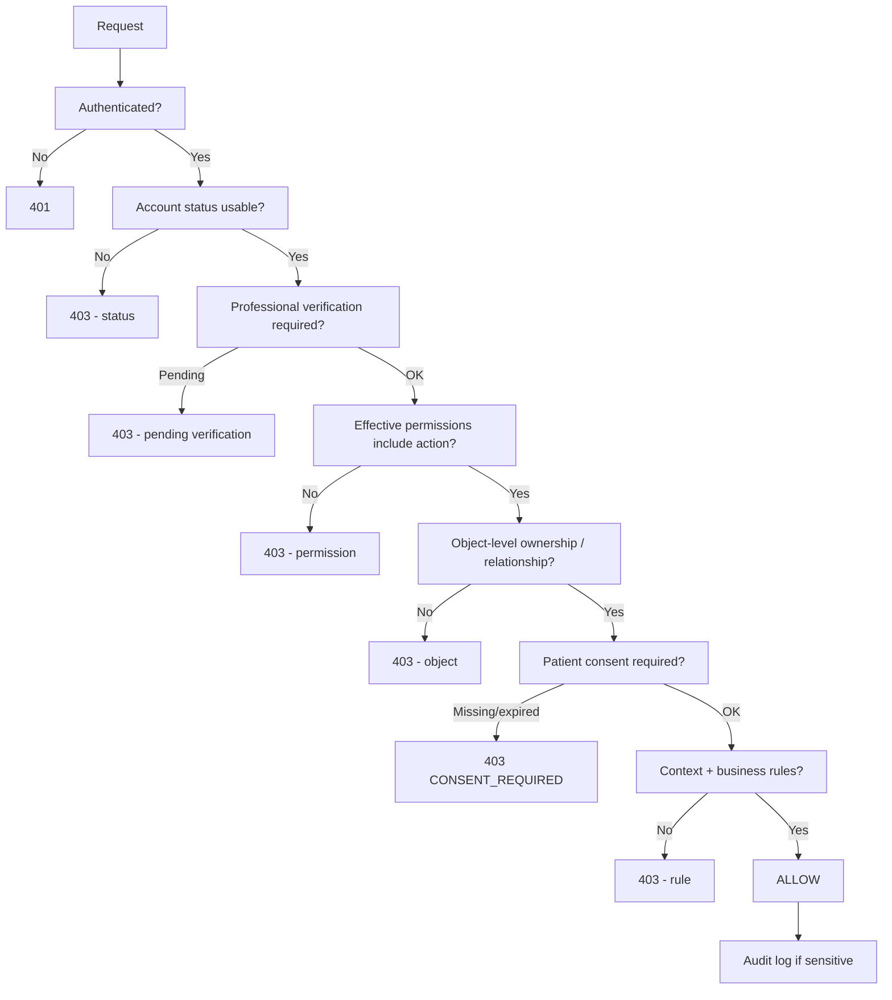
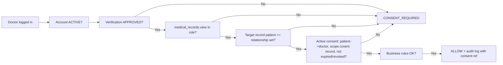
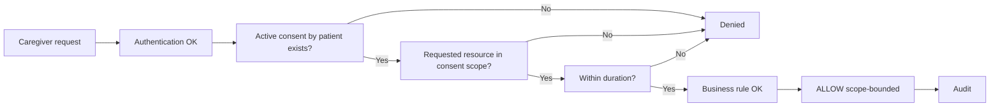
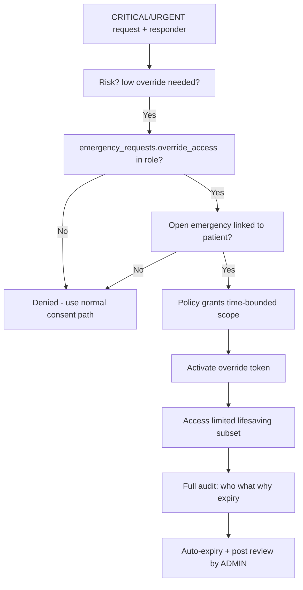
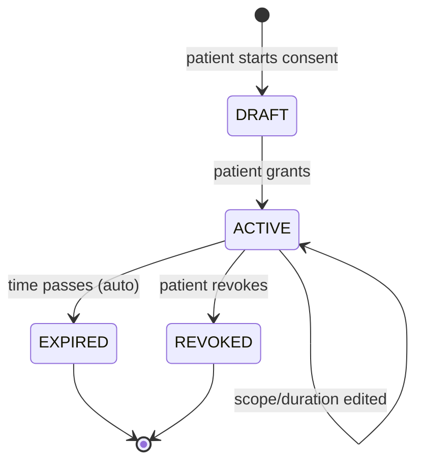

# 3.3 Roles & Permissions Design

> Stage: 3.3 — System Design
> Status: Design (no code changes)
> This document replaces the earlier draft of the same name. The authoritative
> permission matrix lives in `role-permission-matrix.md`. The design is traced to
> Stage 2 requirements and to the existing ERD / database design (gap analysis in
> §24). No migrations, models or API endpoints are created by this stage.

---

## 1. Authorization Philosophy

The system **MUST NOT** use the naive model:

```
ROLE = ACCESS
```

A role never equals access to a resource on its own. Access to anything
sensitive is always the result of a chain:

```
User
   ↓
Authentication
   ↓
Account Status
   ↓
Role
   ↓
Permission
   ↓
Resource Ownership / Relationship
   ↓
Patient Consent (for private patient information)
   ↓
Context + Business Rules
   ↓
Access Decision
   ↓
Audit Log
```

- A **role** is only a *collection of permissions* (a named bundle).
- A **permission** is a *single capability* of the form `<module>.<resource>.<action>`.
- **Consent** is a *separate authorization layer* that controls private patient
  information (medical records, medications, symptoms).
- **Business rules** impose extra restrictions (BR-001..BR-012, e.g. verified-only
  doctor functions, verified-only public blood requests, verified-only campaigns).
- **Context** distinguishes workflows (medical vs blood vs admin vs emergency).

Default posture: **deny by default**. Every allowance in the matrix is either
`ALLOW` (unconditional but still object-scoped) or `CONDITIONAL` (must satisfy an
explicit condition: consent, verification, relationship, or policy).

---

## 2. Authentication vs Authorization

| Concern | Question | Layer |
|---|---|---|
| **Authentication** | Who are you? | Login, tokens (JWT access + refresh), MFA, session |
| **Account status** | Is your account usable? | ACTIVE / PENDING_VERIFICATION / SUSPENDED / DISABLED / DEACTIVATED |
| **Authorization** | What may you do? | Role, permission, ownership, consent, context, business rules |
| **Audit** | What was done, by whom, when? | Audit log (append-only) |

- Authentication proves **identity**; it grants **no** access by itself
  (NFR-SEC-003, NFR-SEC-004).
- A valid login grants only the permission set tied to the user's roles *plus*
  what the user's account status allows (see §20).
- The server is the only authority for both identity and authorization. The
  client never supplies `role_id`, `user_id` or permission claims that the
  server trusts (§21).

---

## 3. System Roles

Twelve system roles, grouped by domain:

| # | Role | Domain | Summary |
|---|---|---|---|
| 1 | `SUPER_ADMIN` | Platform administration | Root owner; platform-wide config, security-critical administration, role/permission administration |
| 2 | `ADMIN` | Platform administration | Day-to-day operational administration |
| 3 | `VERIFICATION_OFFICER` | Platform administration | Verifies doctors, donors, blood requests, campaigns |
| 4 | `MODERATOR` | Platform administration | Community moderation only; **no medical access** |
| 5 | `DOCTOR` | Healthcare | Verified healthcare professional; consent-scoped medical access |
| 6 | `HEALTHCARE_STAFF` | Healthcare | Clinic/hospital staff in appointment, blood, emergency workflows |
| 7 | `HOSPITAL` | Healthcare | Institutional account for a clinic/hospital |
| 8 | `PATIENT` | Patient / community | Owner of their own health data |
| 9 | `CAREGIVER` | Patient / community | Person authorized by a patient to assist |
| 10 | `BLOOD_DONOR` | Patient / community | Person registered to donate blood |
| 11 | `FINANCIAL_DONOR` | Patient / community | Person donating money to verified campaigns |
| 12 | `ORGANIZATION` | Patient / community | Institution/company running fundraising campaigns |

**Multi-role.** A single user MAY hold more than one role
(e.g. `DOCTOR + BLOOD_DONOR`, `PATIENT + FINANCIAL_DONOR`, `CAREGIVER + BLOOD_DONOR`).
Nothing in the requirements forces one-user-one-role (§22). Permission sets are
*aggregated across roles*; medical permissions never leak into non-medical
workflows (§22).

---

## 4. Role Definitions

For each role: **Purpose**, **Scope**, **Responsibilities**, **Allowed modules**,
**Restricted modules**, **Key permissions** (all per matrix), **Sensitive
actions**, **Approval requirements**, **Verification requirements**, **Audit
requirements**.

### 4.1 SUPER_ADMIN

| Aspect | Definition |
|---|---|
| Purpose | Platform owner / technical root |
| Scope | Whole platform, including authorization configuration |
| Responsibilities | System config, security-critical administration, role/permission administration, releasing/deactivating accounts, overriding operational deadlocks |
| Allowed modules | Administration, users, roles/permissions, audit, analytics, all operational modules for oversight |
| Restricted modules | Medical data is **CONDITIONAL**: view/download for audit/oversight only, never as habitual access without consent-relevant justification (aligned with BR-002/BR-003/BR-004) |
| Key permissions | `users.*` (except self-management), `users.role_assign`, `audit_logs.*`, `analytics.*`, `doctors.verify`, `blood_requests.verify`, `campaigns.verify`, `community.moderate`, `payments.refund`, `emergency_requests.override_access` |
| Sensitive actions | Role assignment, permission grants/removals, privilege escalation, refunds, emergency overrides, account deactivation |
| Approval | Escalation/role changes require a second SUPER_ADMIN or audited break-glass protocol; self-service role change is impossible (§21) |
| Verification | Strong identity verification required before elevation (MFA mandatory) |
| Audit | **All** actions; role/permission changes and medical-data access always logged with reason |

### 4.2 ADMIN

| Aspect | Definition |
|---|---|
| Purpose | Day-to-day operational administrator |
| Scope | User management, verification queues, campaign/payment ops, reports, community oversight |
| Responsibilities | Manage users, verification approvals, payment/refund ops, analytics/reports, emergency monitoring, education publishing |
| Allowed modules | Most administration modules, users, blood, campaigns, donations/payments, emergency, community moderation, analytics, education publishing |
| Restricted modules | **Cannot assign privileged roles** (SUPER_ADMIN, ADMIN, VERIFICATION_OFFICER, MODERATOR — only SUPER_ADMIN may); no routine medical-record access without a consent-relevant/audit justification; cannot modify audit logs |
| Key permissions | `users.{view,create,update,deactivate}`, `users.verify`, `doctors.verify`, `blood_requests.verify`, `campaigns.verify`, `donations.refund`, `payments.refund`, `community.moderate`, `notifications.broadcast`, `audit_logs.view`, `analytics.view` |
| Sensitive actions | Deactivating accounts, refunds, approving verification, emergency management |
| Approval | Refund thresholds and emergency override require confirmed policy approval (config-driven); role assignment not allowed (§21) |
| Verification | Identity + MFA (admin accounts) |
| Audit | All admin actions logged with reason |

### 4.3 VERIFICATION_OFFICER

| Aspect | Definition |
|---|---|
| Purpose | Specialist who verifies people/workflows |
| Scope | Doctor verification, blood/donor verification, campaign verification, identity verification |
| Responsibilities | Review submitted professional documents, approve/reject doctor registration, verify blood requests and donors, verify campaigns |
| Allowed modules | Users (verification context), doctors, blood network (verification), campaigns (verification), limited audit (verification actions only) |
| Restricted modules | **No community moderation authority** (unless also MODERATOR), **no medical records**, **no payments/refunds**, **no role assignment**, **no analytics/export** |
| Key permissions | `users.view` (C), `users.verify`, `doctors.verify`, `blood_donors.view` (C), `blood_requests.verify`, `blood_matches.run`, `campaigns.verify`, `audit_logs.view` (C — own scope) |
| Sensitive actions | Approval/rejection decisions affecting a professional's or campaign's status |
| Approval | Decisions must be justified; some decisions may require an ADMIN co-sign (configurable) |
| Verification | All VO actions limited to `PENDING_VERIFICATION` workflows |
| Audit | Every approve/reject decision logged (actor, applicant, action, reason) |

### 4.4 MODERATOR

| Aspect | Definition |
|---|---|
| Purpose | Community safety |
| Scope | Community posts, comments, reports |
| Responsibilities | Moderate reported content, hide/remove violating content, resolve or dismiss reports |
| Allowed modules | Community |
| Restricted modules | **All medical modules** (records, medications, symptoms, consent), users (except view for context on reports), payments, blood, emergency, analytics, audit |
| Key permissions | `community.moderate`, `community.view_reports`, `community.create_post` (as a user) |
| Sensitive actions | Removing content (must be reversible + reason-locked) |
| Approval | None beyond appointment to role |
| Verification | Standard staff identity |
| Audit | Moderation actions always logged (who removed what, why) |

### 4.5 DOCTOR

| Aspect | Definition |
|---|---|
| Purpose | Provide clinical support to patients who have authorized it |
| Scope | Consent-scoped medical records, medications, symptoms, appointments, chat with own patients; blood-request support in an emergency/clinical context |
| Responsibilities | View permitted patient info, add clinical notes when authorized, manage own appointments, chat with consenting patients, assist emergency/blood workflows |
| Allowed modules | Medical records (consent-scoped), medications (consent-scoped), symptoms (consent-scoped), appointments, education (view + publish with review), chat, blood (in emergency/context), notifications |
| Restricted modules | **Never** whole-patient-list browsing; **no** access to unrelated patients (BR-003); **no** caregiver management; **no** admin functions; **no** payments/refunds |
| Key permissions | `medical_records.{view,create,update,download,upload}` (C), `medications.*` (C), `symptoms.*` (C), `appointments.*` (C), `doctors.self_manage`, `chat.start` (C), `education.publish` (C) |
| Sensitive actions | Reading/downloading medical records, editing clinical notes, uploading documents |
| Approval | Doctor role requires **verification approval** before any doctor-specific permission activates (§20) |
| Verification | `doctor_verification_status = APPROVED` (license, specialty, facility details reviewed by VO/ADMIN) |
| Audit | Every medical-record access/download logged (patient, record, consent ref, actor) |

A doctor **must never** automatically see every patient, every record, or every
document — even with the `DOCTOR` role — because `medical_records.view` is always
evaluated against consent + relationship (§9, §17).

### 4.6 HEALTHCARE_STAFF

| Aspect | Definition |
|---|---|
| Purpose | Clinic/hospital operational staff |
| Scope | Appointments, blood workflows, emergency response, basic status updates |
| Responsibilities | Manage clinic appointments, record status updates, assist blood-request handling, respond to emergencies, limited record creation within their own clinic context |
| Allowed modules | Appointments, blood network (workflow), emergency (responder), notifications, limited medical records (own clinic context, consent-scoped), education (view) |
| Restricted modules | **No** broad patient-browsing, **no** doctor verification, **no** campaigns/payments, **no** role administration, **no** audit/analytics |
| Key permissions | `appointments.*` (C), `blood_requests.*` (C), `emergency_requests.{create,manage,resolve}` (C), `medical_records.{view,create,upload}` (C — own clinic + consent), `notifications.*` |
| Sensitive actions | Creating medical entries, entering clinical observations, emergency status changes |
| Approval | Staff accounts linked to a facility; actions bounded by facility + consent |
| Verification | Employment verification at linked facility |
| Audit | Clinical entries and emergency actions logged |

### 4.7 HOSPITAL

| Aspect | Definition |
|---|---|
| Purpose | Institutional profile representing a clinic/hospital |
| Scope | Facility-level workflows: appointments, blood requests, emergency, verification documents |
| Responsibilities | Register/confirm facility, participate in blood-request and appointment workflows, respond to emergencies |
| Allowed modules | Appointments (own facility), blood (own requests), emergency, notifications, education (view) |
| Restricted modules | **No** cross-facility patient access, **no** payments administration, **no** role assignment, **no** audit logs beyond its own operations |
| Key permissions | `blood_requests.{create,view}` (C), `appointments.*` (C), `emergency_requests.*` (C), `medical_records.*` (C — own facility + consent), `doctors.view` |
| Sensitive actions | Access to patient information within its facility (consent-scoped) |
| Approval | Facility verification required; operational access granted after verification |
| Verification | `hospitals.is_verified` (registration documents reviewed) |
| Audit | Patient-data touches and facility actions logged |

### 4.8 PATIENT

| Aspect | Definition |
|---|---|
| Purpose | Owner of their own health information |
| Scope | Own profile, medical profile, records, medications, symptoms, appointments, consents, emergency requests, blood requests |
| Responsibilities | Maintain own data, grant/revoke consent, manage caregivers, request blood, request emergency assistance |
| Allowed modules | All personal health modules (own scope), consent management, blood requests, emergency, community, notifications, education, AI (assistance), chat (with verified professionals) |
| Restricted modules | **No access to any other patient's data** (§7); cannot grant consent to themselves |
| Key permissions | `patients.update_own`, `patients.manage_caregivers`, `medical_records.view` (own), `medications.*` (own), `appointments.*` (own), `symptoms.*` (own), `consents.{grant,revoke,view}`, `blood_requests.create`, `emergency_requests.create`, `caregivers.*` (own) |
| Sensitive actions | Consent changes, sharing data via caregiver invitations |
| Approval | Consent changes are immediate and audited; shared access is time-bounded |
| Verification | Phone/email verification for account activation; medical-profile completion for clinical flows |
| Audit | Consent grants/revocations and any access granted are audited |

### 4.9 CAREGIVER

| Aspect | Definition |
|---|---|
| Purpose | Supports a patient who authorized it |
| Scope | Only information the patient explicitly shares; duration-bounded |
| Responsibilities | View shared medication/appointment/emergency information, assist tracking, receive emergency notifications |
| Allowed modules | Only modules granted by the patient's consent: typically `medications.view`, `appointments.view`, `medical_records.view` (selected), `emergency_requests.*` |
| Restricted modules | **No** unrestricted medical access; **no** access to other patients; no consent management; no admin functions |
| Key permissions | `medical_records.view` (C), `medications.view` (C), `appointments.view` (C), `symptoms.view` (C), `emergency_requests.{create,view}` (C) |
| Sensitive actions | Viewing shared medical data |
| Approval | Patient invitation/authorization (consent) required |
| Verification | Standard identity; the **patient** is the authorizer |
| Audit | Caregiver access to medical data logged |

Revocation must take effect immediately and be auditable (§11, §15).

### 4.10 BLOOD_DONOR

| Aspect | Definition |
|---|---|
| Purpose | Donates blood through the network |
| Scope | Own donor profile, eligibility info, responding to compatible requests |
| Responsibilities | Register baseline (blood group, location), update availability/last donation, accept/decline compatible requests, manage own donation history |
| Allowed modules | Blood network (donor side), notifications, education, community, AI |
| Restricted modules | **No** patient medical records, **no** unrelated donor data, **no** private contact info of others (BR-006 protects donor contact from public exposure) |
| Key permissions | `blood_donors.self_manage`, `blood_requests.view` (eligible/compatible), `blood_requests.respond`, `blood_matches.view` (own) |
| Sensitive actions | None beyond own profile (medical-safety relevance of blood group appears without exposing full records) |
| Approval | Donor verification at a blood bank for some flows (configurable) |
| Verification | Blood-group self-declaration to be verified where required |
| Audit | Responses and matches logged |

### 4.11 FINANCIAL_DONOR

| Aspect | Definition |
|---|---|
| Purpose | Contributes money to verified campaigns |
| Scope | Browse approved campaigns, donate, view own history and receipts |
| Responsibilities | Browse verified campaigns, donate securely, view transaction status, obtain receipts |
| Allowed modules | Campaigns (view), donations (create/view own), payments (view own), notifications, education, community, AI |
| Restricted modules | **Cannot** create/verify/modify campaigns (unless also ORGANIZATION/PATIENT with verified campaign), **cannot** see other donors' financial data |
| Key permissions | `campaigns.view`, `donations.create`, `donations.view` (own), `payments.view` (own) |
| Sensitive actions | Making payments (always provider-verified server-side, BR-008) |
| Approval | None beyond being a registered user |
| Verification | Payment identity handled by provider + webhook verification |
| Audit | Donation/payment events logged (no unnecessary financial detail in logs) |

### 4.12 ORGANIZATION

| Aspect | Definition |
|---|---|
| Purpose | Runs verified fundraising campaigns |
| Scope | Own campaigns, donations toward them, receipts |
| Responsibilities | Create campaigns (draft), submit for verification, track progress, view receipts for own campaigns |
| Allowed modules | Campaigns (create/monitor own), donations (view own org), payments (view own), notifications, education (publish with review), community |
| Restricted modules | **No** medical data, **no** platform administration, **no** role assignment |
| Key permissions | `campaigns.create`, `campaigns.view`, `donations.view` (own), `payments.view` (own), `education.publish` (C) |
| Sensitive actions | Publishing public fundraising content |
| Approval | Campaign must be verified before public fundraising starts (BR-007) |
| Verification | Organization registration documents verified by VO/ADMIN |
| Audit | Campaign verification and public fundraising events logged |

---

## 5. Permission Model

- **Deny by default.** If no rule grants a permission, access is denied.
- A **role is a bundle of permissions**. Granting/revoking role membership
  changes the effective permission set.
- **Multi-role aggregation.** Effective permissions = union of permissions from
  all the user's roles.
- **Per-user overrides (rare, audited).** The existing `user_permissions`
  concept is retained *only* as an explicit per-user permission **grant** or
  **deny** used for documented exceptions. A specific `DENY` on a user
  overrides a role grant for that user (hard block). Intermediate staff may not
  create overrides on themselves.
- **No "CAN_USE_SYSTEM" style permissions.** All permissions are granular
  (see the catalog in `role-permission-matrix.md`, ~80 permissions across 20
  modules).
- **Resource-level + object-level.** Permissions answer *"may this class of
  action be attempted?"*; object-level checks answer *"may this action be
  applied to THIS object?"* (§17). Both must pass.

### Resolution order

```
1. Authenticated?                     → else 401
2. Account status usable (ACTIVE)?    → else 403 + actionable reason
3. Professional verification required (if role demands it)? → else 403/451
4. Effective permission set contains <module.resource.action>? → else 403
5. Object-level authorization (ownership/relationship/facility)? → else 403
6. Consent requirement satisfied?     → else 403 (CONSENT_REQUIRED)
7. Context + business rules satisfied → else 403
8. ALLOW → audit log (if sensitive)
```

Hard medical denials (patient data, records, download) are evaluated last and
cannot be "rescued" by any earlier grant unless a documented CONDITIONAL
override (e.g. emergency, §16) explicitly applies.

---

## 6. Permission Naming Convention

Format: `<module>.<resource>.<action>`

- **module** — the design module (patients, medical_records, medications,
  appointments, symptoms, blood_network, emergency, campaigns, donations,
  payments, community, consents, caregivers, doctors, education, chat,
  notifications, analytics, audit, ai, users, auth).
- **resource** — the entity (e.g. `medical_records`, `blood_requests`,
  `blood_matches`, `donations`).
- **action** — CRUD verbs (`view/create/update/delete`) or domain verbs
  (`verify`, `download`, `upload`, `respond`, `manage`, `resolve`,
  `override_access`, `grant`, `revoke`, `invite`, `moderate`, `publish`,
  `refund`, `broadcast`, `export`, `analyze`, `run`).

Examples:

```
patients.view                 medical_records.view         medications.create
medical_records.download      appointments.cancel          blood_requests.verify
blood_requests.create         blood_matches.view           emergency_requests.manage
emergency_requests.override_access  campaigns.verify       donations.refund
payments.view                 community.moderate           consents.grant
consents.revoke               audit_logs.view              doctors.verify
```

The full catalog is the authoritative reference in `role-permission-matrix.md`.

---

## 7. Role-Permission Matrix

The complete matrix (12 roles × ~80 permissions, using `A` = ALLOW,
`D` = DENY, `C` = CONDITIONAL with enumerated conditions) is in
**`role-permission-matrix.md`**.

Rules that govern the matrix:

1. **Sensitive medical operations prefer CONDITIONAL, never ALLOW** — this is a
   hard rule. `medical_records.*`, `medications.*`, `symptoms.*` and
   `consents.*` may never be plain `A` for non-owner roles.
2. **Admin roles do not get blanket medical access.** SUP/ADM medical-read is
   `C` (audit/oversight only, with reason), consistent with BR-002/003/004.
3. **PATIENT is the only role that may grant/revoke patient consent.**
4. **BLOOD_DONOR and FINANCIAL_DONOR never see patient medical data.**
5. **MODERATOR never sees medical data.**
6. **Privilege-sensitive administration** (`users.role_assign`,
   `audit_logs.export`, `payments.refund`) is limited to SUP (ADM gets
   operational but not escalation rights).

---

## 8. Patient Authorization

The PATIENT is the subject and owner of their own health data. Permissions are
always interpreted **relative to the patient's own resources**:

| Domain | Authorized (own scope) |
|---|---|
| Profile | `patients.update_own`, `patients.manage_caregivers` |
| Medical profile / records | `medical_records.view`, `medical_records.upload` (self files), `medical_records.delete` (soft, self) |
| Medications | `medications.view/create/update/delete` |
| Appointments | `appointments.view/create/update/cancel` |
| Symptoms / pain | `symptoms.view/create` |
| Health timeline | derived from own data; `symptoms.analyze`, `analytics.health_trends` (own) |
| Consent | `consents.grant/revoke/view` (own) |
| Emergency | `emergency_requests.create/view/resolve` (own/cancel) |
| Blood | `blood_requests.create/view` (own) |

**Rule:** a patient NEVER obtains another patient's information. Object-level
authorization is always anchored to the authenticated patient's own record
(`patients.view` for PATIENT resolves to "me" only — see §17). Cross-patient
attempts return `404`/`403` and are audited as unauthorized access attempts.

---

## 9. Doctor Authorization

Designed workflow:

```
Doctor registration
   ↓
Professional documents submitted
   ↓
Verification review (VERIFICATION_OFFICER/ADMIN)
   ↓
Doctor account ACTIVE + doctor_verification_status = APPROVED
   ↓
Emergency/other non-medical permissions active (as matrix)
   ↓
Medical permissions become evaluable
   ↓
Patient relationship/authorized context check
   ↓
Active patient consent (scoped, time-bounded)
   ↓
Business rule check
   ↓
Medical record access  ──► audit log
```

**What a DOCTOR may do, and under what conditions:**

| Action | Condition |
|---|---|
| View permitted medical record | (a) record belongs to the target patient, (b) active consent grants `medical_records.view` for that patient/category, (c) consent not expired/revoked |
| Add/update clinical note | (a,b) as above **plus** (c) doctor is `APPROVED`, (d) record category includes clinical notes |
| Download record/document | Consent must include `medical_records.download`; download is always logged and counts toward per-patient access review |
| Upload document | Consent/authorized context; uploads are encrypted-at-rest |
| Share a record | Only where the platform exposes a controlled share action bound by consent; raw sharing URL keys never exposed |
| Chat with patient | Only with a patient who initiated a verified professional relationship; consent-bearing |

**Never allowed without consent:** whole-history reads, cross-patient
browsing, downloading another consenting patient's unrelated records, adding
notes to a patient who never granted the doctor access (BR-003, BR-004).

---

## 10. Caregiver Authorization

Workflow:

```
Patient identifies caregiver (invite)
   ↓
Caregiver accepts (account exists)
   ↓
Patient defines permission scope (resources + actions)
   ↓
Patient sets duration (default window; expires_at)
   ↓
CAREGIVER role activated on that user (scope-bound)
   ↓
Access while ≥1 active scope grant exists
   ↓
Revocation / expiry → immediate loss of access
   ↓
Audit (grant, access, revocation)
```

- A caregiver has **no** default rights. Every capability comes from a consent
  record the patient created/is holding (§15).
- Default scope example: `medications.view` + `appointments.view` for 90 days.
  Nothing broader unless the patient explicitly extends it.
- Emergency notifications may reach caregivers (UR-CAR-002) without granting
  medical read access; notification content is limited to the emergency context.
- **Revocation** (§11) is immediate and auditable.

---

## 11. Healthcare Staff Authorization

- Staff act on behalf of their **linked facility** (`healthcare_staff.facility`).
- All medical actions are `CONDITIONAL`: (a) patient record exists in the staff
  member's facility context, (b) consent where the workflow involves private
  info, (c) no cross-facility reads.
- Staff cannot verify other staff, cannot assign roles, cannot touch payments
  or campaigns, and cannot grant consent.
- Clinical entries made by staff are attributed to the individual (not the
  facility), so audit trails can distinguish who acted.

---

## 12. Blood Donation Authorization

| Capability | Rule |
|---|---|
| Manage own donor profile (blood group, region, availability, last donation) | `blood_donors.self_manage` → BLOOD_DONOR |
| View relevant (compatible, nearby, available) blood requests | `blood_requests.view` (C) — eligible donors only, no requester PHI beyond need |
| Accept/decline a request | `blood_requests.respond` → BLOOD_DONOR |
| View own match record | `blood_matches.view` (C) — own match only |
| Create a blood request | `blood_requests.create` → PATIENT (own), staff/hospital (facility), doctor (clinical) |
| Verify/activate a request | `blood_requests.verify` → SUP/ADM/VO (BR-005: only verified requests become publicly active) |
| Run matching engine | `blood_matches.run` → verification roles (server-side) |

**Never:** a donor sees another donor's full profile or private contact
information (BR-006 — donor contact must not be publicly exposed), never sees
patient medical records, and can decline a request without giving a reason
(privacy).

---

## 13. Financial Donation Authorization

| Capability | Rule |
|---|---|
| Browse approved campaigns | `campaigns.view` → any user (public read of **verified** campaigns only) |
| Donate to a campaign | `donations.create` → any authenticated user; payment always provider-verified (BR-008) |
| View own donation history | `donations.view` (own scope) → FINANCIAL_DONOR, ORGANIZATION |
| Receive payment confirmation / receipt | `payments.view` (own transaction) |
| Manage own donation info | Own-scope updates only |
| Create a campaign (submit for verification) | `campaigns.create` → ORGANIZATION (also PATIENT/ADMIN for platform campaigns, all CONDITIONAL/verified) |
| Verify a campaign | `campaigns.verify` → SUP/ADM/VO (BR-007) |
| Refund | `donations.refund` / `payments.refund` → SUP/ADM only, audited |

**Never:** a financial donor modifies or approves campaigns, or views another
donor's private financial data.

---

## 14. Administration Authorization

Separation of duties (no universal administrator):

| Responsibility | Roles |
|---|---|
| Platform-wide configuration, security-critical admin, role/permission administration | **SUPER_ADMIN only** |
| Operational administration (users, verification, payments, reports, emergency ops) | **ADMIN** (SUPER_ADMIN may assist) |
| Verification of doctors/donors/blood/campaigns | **VERIFICATION_OFFICER** (+ ADMIN) |
| Community moderation | **MODERATOR** (+ ADMIN/SUPER_ADMIN) |
| Reading/exporting audit logs | **ADMIN** view; **SUPER_ADMIN** export |

- **MODERATOR has no medical access. ADMIN has no unconditional medical
  access.** Admin medical read is CONDITIONAL (audit/oversight, reason-locked).
- No single role combines *verification authority* and *role assignment*
  together without supervision; `users.role_assign` is SUPER_ADMIN-only.

---

## 15. Consent-Based Access

Consent is a **separate authorization layer** for private patient information.

A consent record conceptually contains:

| Field | Example |
|---|---|
| patient | Patient A |
| authorized user | Doctor B |
| authorized role/context | DOCTOR (clinical support) |
| resource/category scope | `medical_records`, `medications` |
| permission scope | `medical_records.view`, `medications.view` |
| purpose | "Follow-up review of crisis history" |
| start date | 2026-01-01 |
| expiry date | 2026-01-31 |
| status | ACTIVE / REVOKED / EXPIRED |
| revocation info | revoked_by, revoked_at |
| created timestamp | created_at |
| updated timestamp | updated_at |

**Examples:**

```
Patient A → Doctor B : medical_records.view  for 30 days
Patient A → Caregiver C : medications.view   for 90 days
Patient A → Doctor B : medical_records.download  for 7 days (single document)
```

**Lifecycle (state machine):**

```
DRAFT ──grant──▶ ACTIVE ──revoke──▶ REVOKED
                  │        (immediate)
                  └─time──▶ EXPIRED (automatic)
                  └─expiry changed──▶ ACTIVE (new dates)
```

**Rules**
- Only the **patient** grants/revokes (`consents.grant` / `consents.revoke`).
- A consent grants **permissions**, not a role. The consent references
  permission codes; at request time the system checks the *grantee's effective
  permissions* **AND** the *consent permission scope* — the intersection wins.
- Consent is **subject-specific**: consent to "Doctor B" is not transferable to
  "Doctor D".
- Expiry enforcement is automatic (server-side clock; no-client trust, §19).
- Consent records are audited; access under a consent references the consent id.

---

## 16. Emergency Authorization

There is **no** `EMERGENCY = BYPASS ALL SECURITY` rule.

The emergency override is a **defined, bounded, strongly-audited policy**:

| Dimension | Policy |
|---|---|
| What can be accessed | Limited "lifesaving context" subset only: blood group, genotype, current medications, allergy/notes flag, emergency contacts, severity-relevant profile — **not** the full medical history |
| By whom | Healthcare roles involved in the response (DOCTOR / HEALTHCARE_STAFF / HOSPITAL) or PATIENT/CAREGIVER for their own event; monitorable by ADMIN/SUPER_ADMIN |
| Under what conditions | Open CRITICAL/URGENT emergency request linked to the patient, and the responder is part of the response |
| For how long | Time-bounded (default **24 hours** from activation, configurable; auto-expiry) |
| Who authorizes it | The role holding `emergency_requests.override_access` (SUPER_ADMIN grants; ADMIN/CAREGIVER/clinical roles activate within policy); no user activates an override on themselves alone where a supervisor is available (configurable) |
| What gets logged | Full audit: patient id, responder id, reason, scope selected, grant token, start/expiry, every accessed resource |

**Emergency override flow (mermaid):** see §26.

Every override access is logged, post-reviewable by ADMIN/SUPER_ADMIN, and
revocable immediately. Abuse prevention (rate limiting, verification, admin
monitoring) follows `special-systems.md` §3.9.2 and BR-009.

---

## 17. Object-Level Authorization

Permissions answer *"may this user attempt this action at all?"*. Object-level
authorization answers *"on THIS object?"*.

Example: a doctor holding `medical_records.view` does **not** see every record.
Evaluation:

```
Target record R
   ├── R.patient == interacting patient ?
   │      (requires relationship/authorized context)
   ├── active consent covers R.category + doctor ?      (BR-004)
   ├── consent expiry intact ?
   ├── business rule (e.g. record soft-deleted? flag revoke?) ?
   └── context (medical view, not admin bulk)
All pass → ALLOW  |  any fail → DENY
```

Owner rules make object checks cheap: a PATIENT's object set is always filtered
by `resource.patient == me`. Caregivers/HOSPITAL/staff have explicit
relationship/consent object sets. The backend enforces object filtering in the
query layer, never by relying on clients to pass `patient_id` (§21).

---

## 18. API Authorization

Every sensitive endpoint is defined by: authentication, permission,
object-level authorization, consent requirement, validation, business rules,
audit. A representative sample (full per-endpoint spec follows in Stage 3.5
expansion):

| Endpoint | Auth | Permission | Consent | Object Rule | Audit |
|---|---|---|---|---|---|
| `POST /api/v1/auth/login` | Public (verify) | `auth.login` | – | – | Login + failed login (result only, no credentials) |
| `POST /api/v1/auth/register` | Public | – | – | – | Account creation event |
| `GET /api/v1/patients/me` | Token | `patients.view` (PAT) | – | patient = self | – |
| `PATCH /api/v1/patients/{id}` | Token | `patients.update` (ADM) **or** `patients.update_own` (owner) | – | target = self or admin operational | Admin edits |
| `GET /api/v1/medical-records` | Token | `medical_records.view` | Yes | owner sees own; grantees via consent | Reads of foreign data |
| `GET /api/v1/medical-records/{id}` | Token | `medical_records.view` | Yes | record.patient ∈ {own} ∪ consent set | Foreign/sensitive reads |
| `POST /api/v1/medical-records/{id}/download` | Token | `medical_records.download` | Yes | as above | Always |
| `POST /api/v1/consents` | Token | `consents.grant` | n/a (creates consent) | patient = self | Always |
| `PATCH /api/v1/consents/{id}` (revoke) | Token | `consents.revoke` | n/a | patient = self | Always |
| `GET /api/v1/blood/donors/{id}` | Token | `blood_donors.view` | n/a | self, or workflow personnel | Contact exposure avoided |
| `POST /api/v1/blood/requests` | Token | `blood_requests.create` | n/a | own request / facility | – |
| `PATCH /api/v1/blood/requests/{id}/verify` | Token | `blood_requests.verify` | n/a | verification scope | Always |
| `POST /api/v1/emergency/requests` | Token (+rate limit) | `emergency_requests.create` | n/a | self or authorized context | Always (BR-009) |
| `POST /api/v1/emergency/override` | Token + policy | `emergency_requests.override_access` | bypass limited | CRITICAL/URGENT + response context | Always (token, scope, expiry) |
| `POST /api/v1/campaigns` | Token | `campaigns.create` | n/a | own organization | – |
| `PATCH /api/v1/campaigns/{id}/verify` | Token | `campaigns.verify` | n/a | verification scope | Always (BR-007) |
| `POST /api/v1/donations` | Token | `donations.create` | n/a | verified campaign only | Money events |
| `POST /api/v1/payments/{ref}/refund` | Token | `payments.refund` | n/a | admin policy | Always |
| `POST /api/v1/community/posts` | Token | `community.create_post` | n/a | – | – |
| `PATCH /api/v1/community/reports/{id}` | Token | `community.moderate` | n/a | moderation scope | Always |
| `GET /api/v1/admin/users/{id}` | Token | `users.view` | n/a | admin scope | Admin reads |
| `POST /api/v1/admin/users/{id}/roles` | Token | `users.role_assign` | n/a | SUP only; never self (§21) | Always |
| `GET /api/v1/admin/audit-logs` | Token | `audit_logs.view` | n/a | admin scope | – |
| `POST /api/v1/admin/audit-logs/export` | Token | `audit_logs.export` | n/a | SUP only, reason | Always |

Representative error mapping: `401` unauthenticated, `403` permission/object
denied, `451`/`403` account not usable or verification pending,
`409`/`42x` consent missing → `CONSENT_REQUIRED` (see api-design §3.5.6).

---

## 19. Flutter Authorization

- **Backend authorization is authoritative.** Flutter only improves the
  experience by reflecting authorization *hints* the backend returns.
- Flutter may hide/show UI (e.g. hide "Delete record" when the user lacks
  permission) purely for usability — but hiding UI **never** substitutes for
  server enforcement. A malicious client can call any endpoint directly; the
  backend must still reject it (`medical_records.delete` without permission →
  `403`, consent expired → `CONSENT_REQUIRED`).
- The app stores the user's effective permission set (returned by the backend
  profile/permission endpoint) in a client-side policy view to drive menus.
  It is refreshed at login and on `403` responses.
- Tokens live in secure storage; the client never persists roles/permissions
  as a source of truth, and never sends `role_id`/`user_id` claims.
- Admin panel and patient app share the same authorization rules because both
  call the same API.

---

## 20. Account Status & Verification

Account states:

| State | Meaning | Allowed |
|---|---|---|
| `ACTIVE` | Verified and usable | Normal permissions |
| `PENDING_VERIFICATION` | Identity/professional verification underway | Non-sensitive self-service only (profile setup, no medical read of others, no professional functions) |
| `SUSPENDED` | Temporary block (policy/security) | Login blocked or read-only per policy; no privileged actions |
| `DISABLED` | Selected by admin/supported | No access except account recovery |
| `DEACTIVATED` | User exited / soft-deleted | No access; data retained per retention policy |

Professional verification is separate from account status:

- `doctors.verification_status` = `PENDING | APPROVED | REJECTED | SUSPENDED`
- `blood_donors.is_verified`, `hospitals.is_verified`,
  `campaigns.status` (draft → pending_verification → active/closed/rejected)

**Rule:** a DOCTOR with `verification_status = PENDING` (or account status ≠
ACTIVE) must not receive doctor-specific privileges even though their role is
correct. Role alone is never sufficient (§1). Every medical role activation
checks: account ACTIVE **AND** (verification status appropriate) **AND**
permissions **AND** consent/context.

---

## 21. Privilege Escalation Protection

The server derives authorization from the **authenticated identity + database
state** only. It never trusts client-supplied `role_id` or `user_id`.

| Threat | Protection |
|---|---|
| User changes own role | Role assignment endpoint: (a) requires `users.role_assign` (SUPER_ADMIN only), (b) **self-assignment is denied** (actor ≠ target checks), (c) every change audited |
| Doctor assigns self admin permissions | Direct `user_permissions` overrides cannot be created by a user on themselves; role assignment restricted to SUP/ADM-scope; `permission assign` not in doctor permission set |
| Caregiver accesses unrelated patients | Object-level filter anchored to consent scope (§10, §17) |
| Patient accesses another patient | Object-level owner filter; `404`/`403` + logged attempt |
| Moderator accesses medical records | MODERATOR matrix has zero medical permissions; deny-by-default |
| Donor accesses patient records | Donor matrix has zero medical permissions |
| Admin escalates privileges | `users.role_assign` is SUP-only; ADP based checks reject target=privileged roles for ADMIN; elevation requires second-actor/approval flow; audit |
| Client spoofs another user | All object reads bound to token identity; never accept `id` in path as authority (only as filter on server-computed object set) |

Additionally: password resets and MFA enrollment invalidate sessions; failed
authorization attempts are rate-limited and logged (no PHI in logs).

---

## 22. Audit Requirements

Authorization-relevant events are append-only audited (BR-012, NFR-SEC-004):

| Event | Actor | Action | Resource | Result | Context |
|---|---|---|---|---|---|
| Login / failed login | user | `auth.login` | account | ok/fail | ip, user_agent (no password) |
| Role assignment | ADMIN/SUPER | `role_assign` | user | ok/fail | target, grantee, reason |
| Permission add/remove | admin | `permission.*` | user/role | ok/fail | scope, reason |
| Consent grant | PATIENT | `consents.grant` | consent | ok/fail | scope, duration |
| Consent revocation | PATIENT | `consents.revoke` | consent | ok/fail | reason |
| Medical record access | doctor/caregiver | `records.view` | record | ok/fail | consent ref |
| Medical record download | doctor/caregiver | `records.download` | record | ok | consent ref |
| Emergency access | responder | `emergency.override` | patient | ok | reason, token, expiry |
| Doctor verification | VO/ADMIN | `doctors.verify` | doctor | ok/reject | documents, reason |
| Admin privilege change | SUPER | `users.role_assign` | user | ok | reason |
| Blood request verify | VO/ADMIN | `blood.verify` | request | ok/reject | reason |
| Campaign verify | VO/ADMIN | `campaigns.verify` | campaign | ok/reject | reason |
| Moderation | MODERATOR | `community.moderate` | post/comment | ok | reason |

**Log discipline:** log the *what/who/when/result/context*; do not bury medical
payloads in the audit row (e.g. no full lab values, no prescription text).
Reference, classify, aggregate; keep payloads minimal.

---

## 23. Security Principles

1. **Least privilege** — granular permissions; nothing is granted "just in case".
2. **Deny by default** — explicit grant required; defaults are false.
3. **Separation of duties** — verification, moderation, medical access, role
   assignment are distinct; no single role holds them all (SUPER_ADMIN aside).
4. **Need-to-know** — donor data, financial data and medical data are
   walled-off from each other.
5. **Defense in depth** — UI hiding + API enforcement + object checks +
   consent + audit.
6. **Server-side authorization** — clients never decide.
7. **Object-level authorization** — permission *and* object both gate access.
8. **Consent-aware authorization** — private patient data requires consent.
9. **Auditability** — sensitive actions always logged, append-only.

---

## 24. Data Model Implications

Comparison with the existing ERD/database design (`database-design.md`,
`erd/erd.md`). Goal: **smallest normalized architecture** that satisfies the
requirements; no blind table creation.

### 24.1 Alignment with existing ERD

| Existing entity | Status | Assessment |
|---|---|---|
| `users` | **Gap** | has a single `role` column; multi-role support and account status require change (§24.2) |
| `user_permissions` | Keep, **reinterpret** | becomes per-user permission override (grant/deny), audited; primary path remains role-based |
| `consents` | Keep, **expand** | add `permission_scope`, `purpose`, `start_date`, `revoked_by/at`; JSON `record_category` retained as resource-scope |
| `medical_record_links` | Keep | record-level visibility artifact derived from consent (remain useful for per-record private notes) |
| `verification_documents` | Keep | verification workflow support |
| `caregivers` | Keep | `permission_scope` retained; becomes the caregiver *link*; the consent record becomes the authorization of record |
| `audit_logs` | Keep | already suits §22 |

### 24.2 Required design changes (to be applied in Stage 3.4)

1. **Multi-role**: replace `users.role` with a `user_roles` join
   (`user_id`, `role_id`, `is_active`, `granted_by`, `granted_at`,
   `revoked_at`) + `roles` catalog table.
2. **Role catalog**: static/bootstrap table (`ROLE_CODE`, display name,
   description, is_privileged, is_medical).
3. **Permission catalog**: `permissions` table or a code-invariant constants
   list (`<module>.<resource>.<action>`, module, group). A DB table is
   recommended for audit/role-matrix administration.
4. **role_permissions**: M2M `(role_id, permission_id)`.
5. **user_permissions**: keep, with `effect` (`ALLOW` | `DENY`) for overrides.
6. **account status**: add `users.account_status` enum replacing free mixing of
   `is_active` + `is_verified` for auth decisions (keep booleans for workflow
   flags, but authority is `account_status`).
7. **consents**: extend as in §15 (permission-scope, dates, revocation).
8. **emergency authorization**: `emergency_access_grants` (patient, grantee,
   scope, reason, authorized_by, starts_at, expires_at, status).
9. **verification status** on professional profiles: `doctors`,
   `blood_donors.is_verified`, `hospitals.is_verified` already exist.

**No database is created, no migration is generated, and no random tables are
added at this stage.** The above are design inputs for Stage 3.4.

---

## 25. Open Design Decisions

| # | Decision | Notes / default |
|---|---|---|
| ODD-1 | MFA scope | Default: mandatory for SUP/ADM/VO/MOD; optional for others. Revisit in Stage 3.8 |
| ODD-2 | Emergency override duration | Default 24h, config-driven. Confirm with clinical safety review |
| ODD-3 | Admin medical read | CONDITIONAL, reason-locked, audit-only. Confirm whether a "clinical audit viewer" role should be split from ADMIN |
| ODD-4 | Staff clinical entry scope | Confirm whether HEALTHCARE_STAFF may edit records created by doctors (draft: no edit, only create/status) |
| ODD-5 | ORGANIZATION operations | Are organization accounts operated by a "delegate user" (B2C sub-account) or single credential? Default: designate an authorized operator user |
| ODD-6 | Role switching UX | With multi-role, does the client need an explicit "active role" selector? Default: yes, cosmetic only; server aggregates permissions regardless |
| ODD-7 | Caregiver multi-patient | Confirm a caregiver may serve multiple patients (default: yes, one consent record per patient) |
| ODD-8 | Patient share of health timeline | Confirm read-scope for `analytics.health_trends` granted to non-medical roles (default: patient only) |
| ODD-9 | Audit retention | 30-day rolling for routine, immutable retention for compliance (per retention policy) |
| ODD-10 | Blood-donor verification | Confirm documents required for `blood_donors.is_verified` (default: blood-bank attestation) |

---

## 26. Authorization Flow Diagrams

### 26.1 Global authorization flow



### 26.2 Doctor medical-record access



### 26.3 Caregiver access



### 26.4 Emergency access



### 26.5 Administrative access

```mermaid
flowchart TD
    A[Admin action] --> B[Authenticated + MFA]
    B --> C[Account ACTIVE]
    C --> D[Role permission (e.g. users.view)]
    D -- No --> X[Denied]
    D -- Yes --> E[Separation-of-duties check]
    E -- escalation? --> F[SUPER_ADMIN only + reason]
    E -- operational? --> G[ADMIN/VO scope]
    F --> H[Audit: actor action target reason]
    G --> H
```

### 26.6 Consent lifecycle



---

## 27. Traceability

Every major permission group is mapped to existing requirements (no new
requirements invented):

| Requirement | Module | Role | Permission | API | Resource | Test requirement |
|---|---|---|---|---|---|---|
| FR-AUTH-005, BR-001, NFR-SEC-003 | Identity & Access | All | role+permission resolution | `/api/v1/auth/*`, all endpoints | users, roles | Verify role never bypasses consent; doctor pending = denied |
| FR-MEDREC-001..006, BR-002/003/004, SR access control | Medical Records | PATIENT/DOCTOR/CAREGIVER/STAFF/HOSPITAL | `medical_records.*` (C), `consents.*` | `/medical-records/*`, `/consents/*` | records, consents | Consent grant/expire/revoke → access flips on/off; audit written |
| FR-DOC-001..005, BR-001, UR-03 | Doctors | DOCTOR/VO/ADMIN | `doctors.self_manage`, `doctors.verify` | `/doctors/*`, `/admin/verifications` | doctor profiles | Unverified doctor cannot access doctor functions |
| FR-PAT-001..004, FR-SYM-001..005 | Patients | PATIENT | `patients.update_own`, `patients.manage_caregivers`, `symptoms.*` | `/patients/me`, `/symptoms/*` | patient profile, symptoms | Patient cannot touch another patient; timeline permissions |
| FR-MED-001..006 | Medications | PATIENT/CAREGIVER/DOCTOR | `medications.*` | `/medications/*` | medications | Caregiver sees only consented meds; revocation immediate |
| FR-APP-001..004 | Appointments | PATIENT/DOCTOR/STAFF | `appointments.*` | `/appointments/*` | appointments | Staff only within facility; patient owns own |
| FR-BLD-001..010, BR-005/006 | Blood | BLOOD_DONOR/PATIENT/STAFF/VO/ADMIN | `blood_donors.*`, `blood_requests.*`, `blood_matches.*` | `/blood/*` | donors, requests, matches | Unverified request invisible publicly; donor contact hidden |
| FR-EMG-001..006, BR-009, SR access control | Emergency | PATIENT/CAREGIVER/STAFF/HOSPITAL/ADMIN | `emergency_requests.*`, `emergency_requests.override_access` | `/emergency/*` | requests, override grants | Override bounded+audited; rate limiting; spam prevention |
| FR-CAM-001..006, FR-PAY-001..005, BR-007/008 | Donations/Payments | ORGANIZATION/FINANCIAL_DONOR/ADMIN/SUPER | `campaigns.*`, `donations.*`, `payments.*` | `/campaigns/*`, `/donations/*`, `/payments/*` | campaigns, donations, txns | Campaign unverified = no public donations; refund SUP/ADM only |
| FR-COM-001..005 | Community | All/MODERATOR | `community.*`, `community.moderate` | `/community/*` | posts, comments, reports | Moderator has no medical perms; moderation audited |
| FR-AUTH-006, BR-012, SR audit | Audit | ADMIN/SUPER | `audit_logs.view/export` | `/admin/audit-logs` | audit_logs | Sensitive events always logged; no PHI in payload |
| FR-AI-001..006, BR-010/011 | AI | All | `ai.use` | `/ai/*` | conversations | Safety layer; no diagnosis; no medical record bypass |
| NFR-SEC-002/003/004/005 | Platform | Gatekeeper | account_status + permission + consent | all sensitive endpoints | credential/record layer | Password hashed; sensitive data auth; OWASP checks |

---

## 28. Review of Existing Implementation

### 28.1 Django backend

| Aspect | Status | Findings |
|---|---|---|
| Authentication | **Missing** | `accounts/models.py` empty; no custom user model; default Django `User`; no token/JWT/MFA layer; `REST_FRAMEWORK` not configured in `settings.py` |
| RBAC | **Missing** | No `Role`, `Permission`, `user_roles`, or role-permission tables; `users.role` only exists in ERD (not implemented); no DRF permission classes |
| Consent | **Missing** | No `Consent` model implemented; ERD has `consents`/`medical_record_links` designs only |
| Audit | **Missing** | `audit` app scaffolded, no model/views; no middleware/DRF hooks for authorization audit |
| Migrations | **None** | Only `migrations/__init__.py`; DB not created; Postgres dev instance is stopped (no migrations applied) |
| URLs/API | **None** | `config/urls.py` only wires admin; no `/api/v1` routing |
| DRF setup | Config present | `rest_framework`, `corsheaders` installed in `INSTALLED_APPS`; no `REST_FRAMEWORK` settings default |

**Alignment:** The scaffolded app list and settings already anticipate the
module split that §3–§13 assume; but **zero authorization code exists**.

### 28.2 Flutter mobile

| Aspect | Status | Findings |
|---|---|---|
| Auth flow | **Placeholder** | `login_page.dart` validates form then navigates to home; no API call, no token storage |
| Authorization rules | None | Pages are placeholders; no permission-gated UI; no `403` handling |
| Secure storage | Missing | No `flutter_secure_storage`; no `dio`/http client or interceptor layer |
| Role awareness | None | No roles/permissions policy view exists |

**Alignment:** Architectural philosophy is already correct in the docs
("client = presentation only", server authoritative). Implementation is pending.

### 28.3 Docs

| Aspect | Status | Findings |
|---|---|---|
| Existing 3.3 draft | **Matches partially** | Role list + consent principle + flow exist but lack matrix, catalogs, flows, escalation protection, status model |
| ERD / database-design | **Conflicts** | `users.role` single-value conflicts with multi-role (§24.2). This is the only architectural conflict requiring a Stage 3.4 change |
| Security architecture | Matches | 3.8 layered model aligns with this design (§1) |
| special-systems (emergency) | Matches | §3.9.2 emergency override aligns with §16 |

### 28.4 What should change later (implementation)

**Matches:** module split, security layer philosophy, consent-based access
principles already documented.

**Partially matches:** role list (now 12 + multi-role), verification flow
(now formal account-status model).

**Conflicts/missing:** single-`role` column (must become `user_roles` +
`roles` + `role_permissions`), account-status enum, permission catalog,
emergency override grants table, reuse/repurpose of `user_permissions` as
overrides, DRF authorization layer, custom user model, Flutter auth/network
layer.

> No production features or code were built during this stage, per the gate
> rules. Changes above are inputs for Stage 3.4 (Database/ERD) and Stage 3.5
> (API expansion) pending owner approval.

---

## Appendix A — Key files

- `docs/sdlc/03-system-design/role-permission-matrix.md` — full matrix
- `docs/sdlc/03-system-design/database-design.md` — table design (to be updated in 3.4)
- `docs/sdlc/03-system-design/erd/erd.md` — ERD visualization (to be updated in 3.4)
- `docs/sdlc/03-system-design/security-architecture.md` — 3.8 security layers
- `docs/sdlc/03-system-design/special-systems.md` — emergency & blood (3.9)
- `docs/sdlc/03-system-design/api-design.md` — endpoint catalog (3.5)