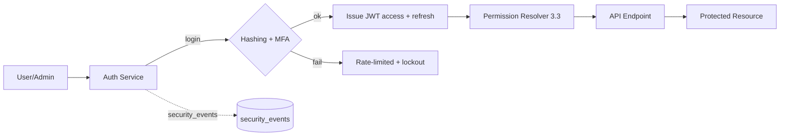
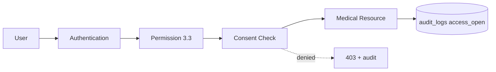
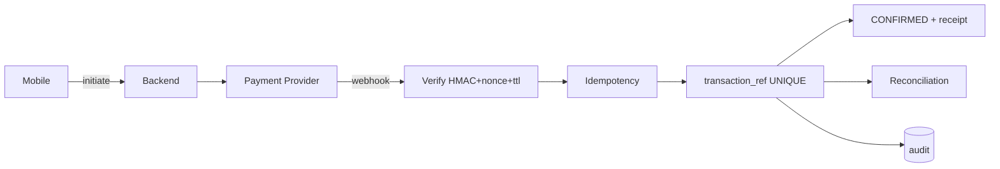
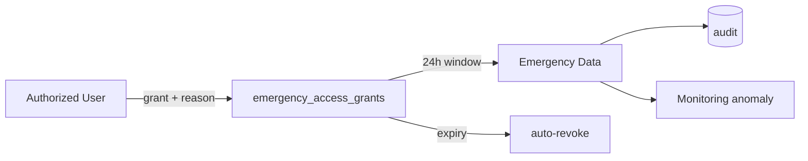

# 3.8 Security Design

> Stage 3.8 — System Design. Implementation-ready security architecture for
> **Sickler's Warriors**. **Design only** — no authentication/authorization code
> is written in this stage. All backend apps are currently scaffolds (no
> models); this design is the contract Stage 4 will implement, aligned to 3.5
> API design, 3.4 DB design, 3.3 roles/permissions, 3.6 mobile, 3.7 admin, and
> requirements NFR-SEC-001..005 / BR-001..012 / 2.9.
>
> Supersedes the earlier thin `security-architecture.md` (kept for history,
> marked SUPERSEDED).
>
> Decision codes: **SD-1..SD-20** (register §40). Sections 1–40 follow the
> mandated structure; extensions 41–44 follow.

---

## 1. Security Objectives

1. **Confidentiality** — PHI, credentials, donor data, payment data readable
   only by authorized parties; in transit (TLS) and at rest (encryption).
2. **Integrity** — medical records, consents, transactions, audit logs and
   decisions unmodified by unauthorized actors; tamper-evident audit.
3. **Availability** — emergency, blood, verification and payment flows remain
   available under load/attack (rate limits, monitoring, backups, RPO/RTO).
4. **Privacy** — data minimization, purpose limitation, consent-gated access,
   rights to access/erasure (§34/§43), no PHI in notifications/URLs/previews.
5. **Accountability** — every sensitive action maps to an audited event
   (actor, action, resource, result, correlation id).
6. **Least privilege** — roles from 3.3; object- and field-level gating; UI
   visibility ≠ authority (3.7).
7. **Defense in depth** — network → TLS → auth → authorization → consent →
   business rule → audit, applied at every layer.
8. **Secure by default / fail securely** — deny by default; any missed check
   returns 403/404 + audit, never success.

---

## 2. Security Principles (mapped)

| Principle | Application |
|---|---|
| Confidentiality | TLS 1.2+; encryption at rest; masked outputs; no PHI in logs/push |
| Integrity | ORM/parameterized queries; immutable `audit_logs`; signed webhooks; status machines |
| Availability | rate limits (3.5 §29), 429 handling, backups, incident response |
| Privacy | data classification (`data-classification-security.md`), consent model (§8), minimization, G4 mobile rule (3.6) |
| Accountability | BR-012 audit register (§27, extension §42) |
| Least privilege | 3.3 matrix; app DB role not superuser; UI filters mirror backend |
| Defense in depth | layered model above |
| Secure by default | deny-by-default permissions, no wildcard CORS in prod, defaults locked |
| Fail securely | generic auth errors, denied on any missing check, fail closed on 5xx |

---

## 3. Threat Model

Sources: requirements 2.9, 3.5 §38, 3.7 §40, OWASP (§36); full register in
`security-risk-register.md`. Attack surfaces:

### External attackers
- Credential attacks (SR-001/002/003/041) → hashing, rate limits, lockout, MFA.
- API abuse / DoS (SR-026/036) → throttles, validation, WAF.
- Injection (SR-015/016/017/018) → ORM, serializers, sanitization, signed files.
- Malicious uploads (SR-019) → allowlist + magic bytes + virus scan + signed URLs.
- Webhook forgery/replay (SR-009/010) → HMAC + timestamp window + nonce + idempotency.

### Malicious users
- Fake blood requests & campaigns (SR-013/014) → verification queues (BR-005/007).
- Impersonation & fraud (SR-037) → verified identity docs, audit, anomaly detection.
- Chat/community abuse (SR-021/022) → C13 scoped access, moderation, rate limits.
- Privacy violations (SR-020) → privacy-safe notifications, no PHI previews.

### Compromised accounts
- Patient/doctor/caregiver/admin compromise (SR-001/002/037/043) → MFA (admin),
  refresh rotation, session revocation, device monitoring, anomaly alerts.

### Insider threats
- Excessive privileges / unauthorized medical access (SR-006/032/040) → least
  privilege, C4 reason gates, no bulk export UI, audit.
- Manipulation of emergency/financial records (SR-008/011) → bounded override,
  co-sign, webhook-only confirmations, immutability.

### Third-party risks
- Payment providers (SR-009/010/033/035) → minimal data, adapter profiles,
  HMAC verification, SSRF guard, sandbox in dev.
- Firebase/SMS/email (SR-033/034) → isolated credentials, project allowlists.
- Cloud storage & external health integrations (SR-033) → signed URLs, egress
  controls, documented fallback.

---

## 4. Risk Management

Risk register: `security-risk-register.md` (48 risks, score = likelihood ×
impact; LOW/MEDIUM/HIGH/CRITICAL). Loop:

1. **Identify** — threat model + OWASP (§36) + incident feedback.
2. **Assess** — likelihood × impact scored.
3. **Treat** — mitigate / transfer / accept (accepted risks documented).
4. **Verify** — Stage 5 tests (§35) + implementation checklist.
5. **Review** — re-validate at each SDLC gate; residual risks re-owned.

CRITICAL-list to close before production: SR-001/002/003/004/005/009/012/030/
036/037/041. HIGH-list must have implemented controls; MEDIUM/LOW monitored.

---

## 5. Authentication

Aligned to 3.5 §27/§29 and `/auth/*` endpoints (matrix §1).

- **Hashing (NFR-SEC-002)**: Django `PBKDF2PasswordHasher` default, upgraded to
  **Argon2id** when `argon2-cffi` available (SD-1). Salted, per-user; never
  plaintext, never returned by any endpoint.
- **Registration**: `POST /auth/register`, `role_code` limited to
  self-registerable roles (PAT/CAR); rate-limited (3/hour/IP); email + phone
  verification required before sensitive usage (`verify/email`, `verify/phone`).
- **Login**: `POST /auth/login` — unified, no account-existence disclosure;
  rate-limited (5/min/user/IP); lockout escalation after N failures (design 10,
  SR-001) with `security_events` alert; MFA step where enabled (§6).
- **Logout**: `POST /auth/logout` — denylist refresh token; revoke session.
- **Password policy** (SD-2): min 10 generic / min 12 admin; common-list block;
  no reuse within rotation window; current-password required on change.
- **Password reset**: request → 202 always (no enumeration); single-use timed
  token → confirm; MFA-aware (admin reset re-challenges MFA, SD-3).
- **Email/phone verification**: OTP single-use, short TTL, rate-limited;
  required for emergency/donor flows.
- **Account lockout / rate limiting**: 3.5 §29 values; config-driven; Redis.
- **Suspicious login handling**: monitor `security_events`; impossible travel,
  new-device-first-login, pattern shift → step-up MFA + alert.
- **Device/session management**: `GET /auth/sessions`, `DELETE /auth/sessions/{id}`.

### Token lifecycle (SD-4)
- **Access JWT**: 15 min TTL.
- **Refresh**: rotating; TTL mobile 30 d, admin 8 h (idle 15 min); rotation
  reuse-detected (old refresh rejected ⇒ all revoked).
- Denylist on logout / password change / MFA disable.
- `auth.sessions` list + revoke for device management.

---

## 6. Multi-Factor Authentication (MFA)

Positioned by 2.9 ("prioritized") and 3.7 (§33: admin mandatory).

- **Required for**: all admin roles (SUP/ADM/VO/MOD) at login; any user before
  privileged operations (role assignment C17, refunds, emergency override,
  system settings, C4 medical open). Optional for patients/doctors/caregivers
  (recommended on first high-risk event).
- **Method**: TOTP (RFC 6238, authenticator app). No SMS OTP as sole factor
  for admins (SMS interception risk).
- **When prompted**: login (admin), step-up for sensitive ops, password change,
  new-device sign-in (SD-5).
- **Recovery**: 8 single-use recovery codes hashed-stored, generated at setup,
  shown once; re-enrollment requires verified identity + support approval for
  admin; **no insecure downgrade reset** (SD-6).
- **Device trust**: optional remembered-device marker (revocable); not v1.
- **Rate limiting**: MFA verify 5/min/user/IP; TOTP brute-force guarded by
  short validity + lockout.
- **Sensitive-operation re-authentication**: TOTP prompt before privileged
  actions (§28, 3.7 AD-A-2/5).

---

## 7. Authorization

Source of truth: `role-permission-matrix.md` (3.3). **No conflict — this stage
adds no roles.**

- **RBAC**: users ↔ roles ↔ permissions (3.3 tables; matrix).
- **Permission checks**: endpoint-level (3.5 matrix) + view-level +
  action-level; absent permission ⇒ denied; sensitive → 403 + audit.
- **Object-level (IDOR prevention)**: object sets via repository filters
  (3.5 §28): owner / consent grantee / caregiver-consent / facility (C7) /
  participant (C13) / responder / donor match (C9); scoped in queries.
- **Field-level restrictions**: serializer output filtering by classification;
  e.g., masked donor contacts (BR-006), redacted payment payloads.
- **Ownership & context**: CAREGIVER role grants nothing alone — requires
  `consents` (§8); doctor access requires consent scope (BR-004); admin PHI is
  C4 reason-locked only (3.7 AD-A-9).

Examples enforced:
- Patient A cannot read patient B (IDOR test suite, 3.5 §28).
- Doctor accesses history only via active consent link, never bulk history.
- Administrator has no unrestricted medical-data access (C4 only).
- Donor PII not visible to other donors (BR-006, §20).
- Caregiver only within approved relationship + consent scope.

---

## 8. Medical Data Access Control

(Consent model follows in §9; this section = classification + gates.)

- **Classification levels** (full matrix: `data-classification-security.md`):
  - **Public** — education, awareness, verified campaign overview.
  - **Internal** — operational statistics, aggregated analytics.
  - **Sensitive** — contacts, donor matching info, appointment data.
  - **Highly Sensitive** — medical records, treatment history, clinical data,
    emergency health info, verification documents, payment payload.
- **Gate model**: `Role + Permission + Consent + Context` (2.9/3.3) applied on
  every record access; consent is the authorization tie for non-owners.
- **Who can** (derived from 3.3 matrix):

| Action | Public | Internal | Sensitive | Highly Sensitive |
|---|---|---|---|---|
| View | everyone | staff roles per matrix | owner/consent/C4 | owner/consent-grantee/clinical/C4 |
| Create | education staff | system/service | owner-author | clinical (C15/16), patient self (C15) |
| Update | edu moderators | service | owner/consent | clinical author / patient (bounded) |
| Share | — | — | consent-bound | consent-bound (BR-004) |
| Export | — | analytic roles | SUP/ADM gated | C4 reason-locked only; no bulk |
| Delete/archive | edu admin | — | non-owner denied | legal-hold aware (§33) |

---

## 9. Consent Management

- **Lifecycle**: grant (`consents` + `medical_record_links`), scope (record/
  category), grantee (doctor/caregiver), duration (`expires_at`), revoke
  (immediate, BR-004), history retained.
- **Access enforcement**: consent-gate resolver evaluated in query scope; any
  expired/revoked consent = denied (no lazy deferral);
  expiry checked at query time + scheduled cleanup for anomaly flags.
- **Auditability**: every grant/revoke/modify audited
  (`consents.grant`/`consents.revoke`, extension §42); link change maps to
  audit + original grant retained.
- **Withdrawal**: immediate effect; notification to affected grantee.
- **Expiration**: unexpired-only semantics; alerts before expiry where useful
  (patient re-auth flow, 3.6).
- **Emergency access**: exception via §10 (controlled, never automatic full
  access).

---

## 10. Emergency Access

From 3.3/3.5 (BR-009, FR-EMG), 3.4 `emergency_access_grants`, 3.7 §12.

- **Who**: request owner (patient), responding hospital staff (C7), SUP/ADM
  (C4 monitor). VO/MOD denied.
- **What**: operational + case-minimal PHI (identity, blood group, hospital,
  caregiver contact, status) — **never full history**.
- **How long**: access window **24 h** default, then auto-expiry; re-grant only
  with justification (SD-7).
- **Justification**: reason required at grant time; stored + audited.
- **Logging**: every grant/open/read/action logged (FR-EMG-006).
- **Unusual access detection**: >tolerated reads, out-of-hours, repeated grants
  → `security_events` → alert.
- **Revocation**: immediate revoke API; expiry enforced at query layer.
- **No unrestricted break-glass**: override is **C10 bounded** — rate-limited,
  reason-locked, 24 h, never unlocks full medical history.

---

## 11. API Security

Contract: 3.5 (envelope, pagination, errors). Security additions:

- **Authentication**: JWT bearer required on all non-public endpoints; refresh
  via `auth/refresh` (rotation); deny by default.
- **Authorization**: DRF permission classes per 3.3/3.5; no client-supplied
  role/consent claims accepted (3.5 §27).
- **Validation**: serializers whitelist fields (anti mass-assignment); strict
  JSON; malformed = 400 envelope.
- **Response filtering**: serializer field controls; no PHI in list views;
  classification-driven visibility (3.4 §25).
- **Rate limiting**: table §29; Redis; 429 + `Retry-After`.
- **Versioning**: `/api/v1/` prefix; breaking changes → v2; never mutate v1.
- **Error handling**: envelope `error.code/message/correlation_id`; no stack
  traces / SQL / secrets; generic auth errors (SR-027).
- **Abuse prevention**: throttle, WAF (3.9), payload-size + field-count caps,
  pagination caps (1..100), SSRF guard (§36).

---

## 12. Input Validation

- **SQLi**: ORM + parameterized queries only; never string-built SQL.
- **XSS**: sanitize HTML for community/chat/education (allow-list tags/attrs);
  output encoding (§13 CSP); no raw HTML from clients.
- **Command injection**: no shell exec from input; allowlisted commands.
- **Path traversal / unsafe names**: randomized storage names (SD-8); never
  client filenames as paths.
- **Malformed / oversized**: size cap (~1 MB JSON), field-count cap,
  content-type enforcement.
- **Unsafe file names / MIME**: allowlist + magic bytes (§19).
- **Numbers/IDs**: uuid/positive-int validators; slug regex.
Server-side enforcement only — clients never trusted (BR-008, 3.5).

---

## 13. Web Security (CSRF / CORS / Headers)

Applies to admin SPA (React) + API. Admin uses JWT bearer (no cookie flow ⇒
minimal CSRF); where cookies are used (Django admin/auth), Django
`CsrfViewMiddleware` + `SameSite` apply.

- **CORS**: `CORS_ALLOW_ALL_ORIGINS = False` in production; explicit
  `CORS_ALLOWED_ORIGINS` (admin origin, mobile webview), minimal methods/
  headers (SD-9). Dev wildcard only in DEBUG.
- **HTTPS**: TLS 1.2+ production; `SECURE_SSL_REDIRECT`, HSTS header.
- **HSTS**: includeSubDomains, long max-age.
- **Content-Security-Policy** (admin SPA): `script-src 'self' + nonce`,
  style-src self, object-src none, frame-ancestors none, base-uri self (SD-10).
- **X-Content-Type-Options**: `nosniff`.
- **Referrer-Policy**: `no-referrer`.
- **Frame protections**: `X-Frame-Options: DENY`; `frame-ancestors: none`.
- **Cookies (if used)**: HttpOnly + Secure + SameSite.
- **Secure cookie**: no auth-critical vars in JS accessible storage; admin JWT
  held in memory, idle timeout 15 min (3.7 AD-A-2).

---

## 14. Mobile Application Security

From 3.6 (G-principles). Design:
- **Tokens**: refresh/access in `flutter_secure_storage` (Keychain/Keystore);
  never SharedPreferences or plain files; never in logs.
- **Sensitive local data**: no PHI cached by default; cache, where approved,
  gated by classification and short TTL; **v1: no PHI persistence** (SD-11).
- **Local DB**: offline cache if later added → encrypted (SQLCipher) + wipe on
  logout; not shipped in v1.
- **Logs**: no PHI/tokens/screens in logs; release-build strip.
- **Screenshots**: `FLAG_SECURE` on medical/consent/emergency screens
  (Android); iOS set `UIApplicationExitsOnSuspend`? → snapshot blur/blank
  (SD-12).
- **Deep links / app links**: validate Android App Links / iOS Universal
  Links; never accept out-of-band tokens.
- **Clipboard**: block copy of OTP/recovery codes; no secret-paste logs.
- **No secrets in app**: no API keys/Firebase/credentials baked into the
  binary; server-side config + env-fed build flags only.

---

## 15. Network Security

- **HTTPS-only** production (NFR-SEC-001); HTTP dev (localhost) only.
- **TLS 1.2+**, prefer 1.3; reject TLS 1.0/1.1 and weak ciphers at server.
- **Certificate validation** strict on mobile (no disabled CA in prod);
  pinning evaluated but not default (SD-13); no MITM allow-paths.
- **Secure API base URL**: env-driven (`--dart-define`), never wildcard.
- **Secure WebSockets**: WSS/TLS where used (chat/status); participant
  authentication on connect (C13); no anonymous sockets.
- **MITM protection**: strict validation; host allowlist at egress; no
  HTTP fallback in prod.

---

## 16. Database Security

Current state: app DB `sickle_cell` on system PostgreSQL 5432 (role
`sw_db_user`); legacy 5433 cluster retained & unused (not used by app).
Production rules:
- **Separate app role**: `sw_db_user` DML on app schema only; **no
  superuser**, no CREATEDB, no system-table access.
- **Migrations** run under a distinct migration role; production runtime never
  holds migration privileges (SD-14).
- **Strong credentials** via secrets (§17), rotated (SD-17); not in repo.
- **Encrypted connections**: `sslmode=require`/`verify-full` for remote; local
  socket trusted per `pg_hba`; private network only.
- **Restricted network**: PG bound to private interface/FW allowlist
  (backend-only); no public exposure.
- **Backups**: encrypted + off-site + restore-tested (§32 note).
- **Auditing**: `audit_logs` append-only (no app update/delete path); DB roles
  `NOUPDATE/NODELETE` on audit objects; `pg_hba` restricts superuser to local.

---

## 17. Encryption

- **In transit**: TLS everywhere (clients, admin, APIs, webhooks HTTPS).
- **At rest**:
  - Database volume: disk encryption (LUKS on the system PG / EBS+ managed in
    cloud) — primary control (SR-030).
  - Backups: encrypted before off-site (GPG AES-256, SD-15).
  - Uploaded documents: encrypted media + signed URLs; sensitive documents
    additionally sealed in metadata where classified (SD-8/16).
  - `mfa_secret_encrypted`: **sealed with AES-GCM** before storage — not raw
    Base32 (SD-16).
  - Payment data: provider tokens only; no raw cards anywhere (BR-008).
- **Field-level scope** (deliberate, not blanket):

| Field | Why | Where |
|---|---|---|
| `password_hash` | credential | hashed column |
| `mfa_secret_encrypted` | 2FA seed | sealed column |
| webhook/payment secrets | 3rd-party creds | secrets storage, never DB plaintext |
| verification/medical documents | license/PHI | encrypted media |
| medical binary content | sensitive | encrypted media |
- **What/why/where** captured for each above; full map in
  `security-database-traceability.md`. Key mgmt + rotation in §18/SD-17.

---

## 18. Key Management

| Secret | Stage 4 dev | Production (3.9) | Rotation |
|---|---|---|---|
| Django `SECRET_KEY` | env var (not repo) | env/KMS/Vault | on compromise/release |
| DB password | env var | secrets manager | quarterly + breach |
| JWT signing key | env var | secrets manager / asymmetric | on compromise; periodic |
| MFA sealing key | env var | KMS envelope | on compromise |
| Payment HMAC/webhook secrets | env var per provider | secrets manager segmented | per provider policy |
| Firebase/APNs/FCM | env (dev project) | secrets manager (prod project) | rotation |
| Backup/files encryption | dev passphrase | KMS | annual + breach |

Rules (final): never in source; never in `flutter` code; never in committed
`.env`; never logged; never returned by APIs. `.env.example` documents names
only. No production `.env` in Git (SR clearance through checklist).

---

## 19. File & Doctor License Security

### File upload
Accepted: doctor licenses, verification docs, medical documents, profile
images, campaign documents.
- **Allowlist**: `jpg/jpeg/png/webp/pdf` (per doc-type groups). MIME **and**
  magic-bytes validation — never extension alone (SR-018/019).
- **Size caps**: images ≤5 MB; PDFs ≤20 MB; per-user daily aggregate cap
  (SD-20).
- **Storage**: backend bucket with **randomized names** (uuid+random), exec
  disabled, no public static serving; quarantine dir for unsigned content
  before scan.
- **Virus scan**: ClamAV scan path at upload (Stage 4 RFC; register §4) before
  persist; until shipped: allowlist + quarantine.
- **Access**: authorized upload endpoint; download via **signed URL** (short
  TTL) only after permission check; file viewer streams via API.
- **Retention**: per class (§33); sensitive docs 7 y or legal min; archival/
  deletion with legal hold override.

### Doctor license documents
- Encrypted/private storage; reviewer-scope only (`doctors.verify`, C6).
- After verification, docs remain locked to reviewer/SUP/ADM — never public,
  never bulk-exported (3.7 ADM-DOC-002).
- Document state (PENDING/ACCEPTED/REJECTED/EXPIRED) tracked in
  `verification_documents`; every review decision audited.
- Retention 7 y then archival; deletion only by erasure flow + legal hold.

---

## 20. Blood Donor Privacy

- **Minimize**: phone/address/exact location not exposed (BR-006). Store blood
  group + region/radius only.
- **Controlled communication**: masked in-app channel donor ↔ requester after
  verified match (C9); no contact in public lists.
- **Location matching**: approximate geographic region for logistics; exact
  location only at consent stage (SD-21 note → in SD table? see §40; default
  approximate).
- **No public donor list**: admin `blood_donors.view` masked (3.7
  ADM-BLD-003).
- **Retention/erasure**: donor data treated as sensitive category (§33).

---

## 21. Payment Security

In scope (3.5 §33): M-Pesa, Tigo Pesa, Airtel Money, cards via ClickPesa/
Selcom.
- **No stored raw cards**: provider tokens only; card data never enters DB.
- **Provider-approved flows**: initiate → provider → webhook/callback →
  verification → only then `CONFIRMED` (BR-008; UI cannot declare success).
- **Transaction IDs**: internal UUID `transaction_ref` + `provider_ref`
  (UNIQUE), non-sequential serial for reconciliation.
- **Webhook verification**: HMAC signature + timestamp window ±5 min + nonce +
  IP allowlist (§22).
- **Idempotency**: idempotency keys on initiate (3.5 §30); duplicate guarded.
- **Duplicate/replay protection**: `provider_ref` UNIQUE; replay ⇒ log + alert.
- **Status verification**: backend queries provider where supported; never
  trusts client.
- **Reconciliation**: snapshot job compares provider statements vs DB
  (3.4 analytics + 3.7 ADM-DON-004).
- **Fraud monitoring**: anomaly detection (SD-18) on pattern/amount/geo →
  `security_events` + admin alert.
- **Refunds**: `donations.refund`/`payments.refund` SUP/ADM, re-auth + reason,
  co-sign threshold (3.7 AD-A-11), idempotent, audited.

---

## 22. Webhook Security

- **Authentication**: HMAC-SHA256 signature per provider adapter; tokenized
  route `/api/v1/webhooks/payments/{provider}/`; no anonymous webhooks.
- **Timestamp validation**: reject outside TTL (±5 min) → replay defense.
- **Nonce/replay**: track processed events (event-id/nonce) idempotently.
- **Idempotency**: same `transaction_ref` handled once; duplicates 200-noop +
  log.
- **Provider verification**: adapter per provider (M-Pesa credential,
  Selcom/ClickPesa signature, card gateway scheme) + IP allowlist.
- **Event logging**: receipt logged (headers allowed, payload minimal) to
  `security_events`; failures alert.
- **Never** expose internal payment logic via unauthenticated paths.

---

## 23. Chat Security

- **Authentication**: authenticated participants only.
- **Authorization (C13)**: conversation membership enforced; admin roles
  `chat.*` = D (3.3) ⇒ admin cannot read private doctor↔patient chats
  (3.7 §18).
- **Message ownership**: per-message row ACL in DB filters; attachments via
  signed URLs + participant check.
- **Abuse reporting / moderation**: report entities (3.7 ADM-COM), spoiler
  previews; hide/remove/warn/escalate via `community.moderate`.
- **Blocking**: participant-level block marked FUTURE (v2).
- **Retention**: §33 (24 mo activity; messages masked after user deletion with
  legal caveat).
- **Privacy level (explicit)**: **NOT end-to-end encrypted in v1** — TLS
  transport + server-side access control is the designed security level;
  sealed-channel E2E flagged **FUTURE** (SD-19).

---

## 24. Notification Security

- **No PHI in previews** (NFR-SEC-002, G4): diagnoses, detailed records,
  private treatment info never in push/SMS/email preview text; safe tokenized
  templates; admin composer privacy-safe preview (3.7 §18).
- **Targeting**: channel prefs; verified contacts; `notifications.broadcast`
  SUP/ADM only.
- **Channel security**: FCM/APNs tokens stored server-side (never logged);
  SMS via allowlisted provider; email via secure SMTP/MC.
- **Logging**: delivery events without message-body PHI.

---

## 25. Admin Security

(3.7-informed.)
- **MFA mandatory** for all admin roles + password min 12.
- **Session**: idle timeout 15 min (AD-A-2), force logout, keep-alive prompt.
- **Privileged action confirmation + re-auth (TOTP)**: role assignment (C17),
  refunds, emergency override, system settings, security center, C4 medical
  open (§28).
- **Audit**: every admin action ↔ audit_logs, reason for C4 (AD-A-9).
- **IP/device monitoring**: device + IP logged at login; anomalies alert.
- **Least privilege**: 3.3 matrix + 3.7 screen-role; UI hide + backend 403.
- **Lockout & suspicious detection**: §5/§30.

---

## 26. Privileged Actions

Verified permission, confirmation, re-auth, audit, rollback/cap:

| Operation | Permission | Re-auth | Confirm | Audit | Rollback/cap |
|---|---|---|---|---|---|
| Approve doctor | `doctors.verify` | no | yes + reason | decision | queue re-open |
| Approve campaign | `campaigns.verify` | no | yes + reason | decision | reject/re-open |
| Access medical records (admin) | `medical_records.view` C4 | yes | reason (AD-A-9) | access_open | expiry/privacy |
| Change roles/permissions | `users.role_assign` C17 | yes | typed | change | revert/history |
| Suspend user | `users.update` | admin | yes | suspend | restore |
| Emergency access | `emergency_requests.*` C10 | yes | reason | grant | 24h expiry |
| Reconciliation / refund | `payments.refund` | yes | reason | refund | idempotent reverse |
| Export sensitive data | `analytics.export` / `audit_logs.export` | yes | scope+reason | export | no bulk PHI UI |
| Change system settings | settings (SUP) | yes | typed | save | config backup/revert |
| File sensitive download | `medical_records.download` C4 | yes | reason | download | signed URL expiry |

---

## 27. Audit Logging

Architecture from 3.4 (`audit_logs` + `security_events`), append-only, no PHI
in `details`. Requirements:

- **Logged** (§42 event codes): login, logout, failed login, password reset,
  MFA change, permission change, medical access, record modify, doctor
  verification, emergency access, blood approval, campaign approval, financial
  actions, exports, admin actions.
- **Never logged**: passwords, tokens, card numbers, raw PHI, secrets.
- **Immutable**: no update/delete path at app layer; DB-level
  `NOUPDATE/NODELETE` on audit objects; retention §33.
- **Traceability**: `request_id` correlates log ↔ incident (§30).

---

## 28. Monitoring

Detection → alert → investigate → respond → escalate.
- **Signals** (`security_events`): repeated failed logins; lockouts; privilege
  escalation; abnormal medical reads; unusual exports; payment anomalies; API
  abuse (429 spikes); brute-force; suspicious emergency activity; new-device
  logins; TOTP failure spikes.
- **Detection**: configurable thresholds on events.
- **Alert**: 3.7 security center + audit dashboards; ops channel email.
- **Response/escalation**: incident playbook (§38); lockout/session revoke/
  document freeze by direction.

---

## 29. Rate Limiting

From 3.5 §29 (authoritative), restated:

| Operation | Limit | Why |
|---|---|---|
| login / MFA verify | 5/min/user/IP | credential brute-force |
| register / password-reset | 3/hour/IP (+email) | abuse/enumeration |
| emergency create | 5/day, burst 2/10 min | spam (BR-009) |
| chat create | 60/min | spam |
| payment initiate | 10/hour, burst 1/campaign | fraud |
| community post/comment | 30/min | spam/moderation |
| webhooks | IP allowlist + signature | forgery |
| file upload | daily per-user cap | storage abuse (SD-20) |
| verification decisions | 60/hour/actor | admin op abuse |

Backed by Redis; 429 + `Retry-After`; per-env config; calibrated by load tests.

---

## 30. Account Recovery

- **Forgotten password**: `password-reset/request` (202-always) → emailed/
  phone single-use token → `password-reset/confirm`; MFA-aware (SD-3).
- **Lost phone (MFA)**: recovery codes (single-use) → re-enrollment flow with
  identity verification + support approval for admin (SD-6).
- **Lost email access**: proactive contact phone verified before recovery;
  support ticket with identity checks (admin).
- **Compromised account**: report → freeze + force re-auth + session revoke +
  password reset + security review (3.7/§38).
- **Principle**: recovery path is **never weaker** than normal auth — any
  reset sends a fresh challenge, never restores the previous secret directly.

---

## 31. Session Security

- **Token expiration**: access 15 min; refresh rotating (SD-4).
- **Refresh strategy**: rotation with reuse detection; denylist for
  logout/password change/MFA disable.
- **Logout behavior**: denylist refresh + revoke session + clear client
  storage (mobile).
- **Session revocation**: `DELETE /auth/sessions/{id}`; admin can revoke all
  on compromise.
- **Device sessions**: listed per user (matrix); new device flagged.
- **Inactive timeout**: admin 15 min idle; mobile app re-lock after idle +
  optional biometric.
- **Compromised-session response**: revoke + rotate signing context +
  re-auth + audit (playbook §38).
- **Sensitive ops require recent auth** beyond idle (step-up TOTP).

---

## 32. Backup & Disaster Recovery Security

- **Automated**: nightly `pg_dump` (or PITR WAL archiving), encrypted
  (GPG AES-256) before off-site; retention design: 14 daily / 6 weekly / 6
  monthly / 7 yearly (SD-15).
- **Access control**: encrypted archive, restricted signing role, restore test
  quarterly; off-site second target.
- **RPO**: ≤24 h (nightly); target ≤1 h via PITR.
- **RTO**: ≤4 h documented restore; target ≤1 h critical-path.
- **DR procedures**: runbook (restore, checksum verify, smoke auth), monthly
  drill, ownership defined.

---

## 33. Data Retention & Deletion

| Data | Retention (design) | Archive | Deletion |
|---|---|---|---|
| user accounts | active + 30 d post-deactivation | anonymized refs | erasure-flow (legal caveats) |
| medical records | legal minimum (design 7 y) | encrypted archive | after legal hold expiry |
| emergency/blood requests | 7 y (legal/clinical) | archive | after hold |
| donations/payment records | 7 y (financial) | archive | after hold |
| audit logs | hot 90 d; archive 7 y | immutable | legal hold override |
| uploaded docs | 7 y / class rule | archive | after consent/legal expiry |
| chat messages | 24 mo activity; deletion masks | archive | erasure w/ legal caveat |
| auth telemetry | 90 d | — | purge |

Account deletion ≠ physical wipe everywhere: anonymize identifiers (tombstone),
retain audit/legal refs (SD-14); full erasure with legal-hold check.

---

## 34. Privacy-by-Design

Per sensitive feature, audit the 8 questions (prompt §36): necessity / access /
retention / minimization / anonymization / consent / audit / revocation.
- Applied canonically to: medical records, emergency, blood, caregiver, chat,
  payments, education, admin PHI (§8/§9/§20/§23 tables).
- Data-subject rights (§43): access, rectification, erasure, restriction,
  portability (FUTURE endpoints flagged).
- Output: `data-classification-security.md` + this design + G4 guardrails (3.6).

---

## 35. Security Testing Requirements

Stage 5 definitions (applied later):
- **Auth**: login/register/logout; reset enumeration-safety; MFA setup/verify/
  recovery; session expiry; refresh rotation + reuse detection.
- **Authorization**: role restrictions; object-level (IDOR) suite; consent
  re-check; emergency expiry; admin 403 matrix; C17 exclusivity.
- **API**: injection (SQLi/XSS); malformed payloads; oversized; rate-limit 429;
  token abuse; privilege-escalation probes.
- **Files**: malicious uploads; invalid MIME; oversized; path traversal;
  signed-URL leakage; unauthorized download.
- **Payment**: duplicate initiate; forged/replayed webhook; invalid status;
  idempotency; refund repeat.
- **Privacy**: cross-patient reads; donor masking; emergency minimal set;
  export restrictions; notification preview leak checks.

---

## 36. OWASP-Aligned Review

| Risk (OWASP) | Affected component | Mitigation | Test requirement |
|---|---|---|---|
| A01 Broken Access Control | all PHI/admin/api | 3.3 RBAC + object ACL + C4/C17 + deny-by-default | IDOR + role suites |
| A02 Cryptographic Failures | tokens, files, at rest | TLS1.2+, AES-256 media, sealed MFA, hashed pwd | config/settings scans |
| A03 Injection | API/ORM/upload names | ORM + serializers + sanitizers + randomized names | injection suite |
| A04 Insecure Design | emergency/consent/payment refs | designed gates (24h, reason, verified-only webhook) | emergency expiry, webhook forgery |
| A05 Security Misconfiguration | settings/CORS/headers/debug | DEBUG=False prod, CORS restricted, HEADERS, HSTS | settings scans |
| A06 Vulnerable Components | dependencies | dependency pinning + monitoring (3.9 CI) | SBOM checks |
| A07 Identification & Auth Failures | login/MFA | rate limit, lockout, admin MFA, generic errors | auth suite |
| A08 Software & Data Integrity | webhooks/uploads/education content | HMAC/nonce/idempotency/allowlist/signed files | webhook + upload suite |
| A09 Logging & Monitoring Failures | audit/telemetry | append-only audit, security_events, alert thresholds | coverage check |
| A10 SSRF | payment/e-tools | egress allowlist + URL validation | SSRF tests |
| Mobile (OWASP MAS) | device layer | secure storage, no PHI cache, FLAG_SECURE, no token leak | mobile app review |

Each is paired with a concrete test requirement (§35) — not a bare list.

---

## 37. Third-Party Security

| Provider | Data shared | Purpose | Auth | Secrets | Failure mode | Privacy risk | Fallback |
|---|---|---|---|---|---|---|---|
| Payment (M-Pesa/Tigo/Airtel/Cards) | amount, refs, phone; no cards | payments | provider creds + HMAC webhooks | server-side env/KMS | webhook down → pending + reconcile | low (minimal) | reconcile + support |
| ClickPesa/Selcom gateways | same + tokenized card | card processing | gateway creds | server-side | gateway down → failed → retry | low | initiate retry + alert |
| Firebase (FCM/APNs) | device tokens, msg metadata | push | service account | server-side | push down → in-app + email | low | in-app fallback |
| SMS provider | phone, templated msg | OTP/emergency | API key | server-side | SMS down → app/email OTP | medium (OTP) | app OTP |
| Email (SMTP/MC) | email, templated msg | verification/logs | API key | server-side | email down → app fallback | low | in-app |
| Maps/location | reverse-geocode/region | facility/donor matching | API key | server-side | map down → manual region | low | region input |
| Cloud storage | signed uploads | files | IAM | server-side | storage down → 503+retry | low | queue + retry |
| External health integrations | opt-in referrals (FUTURE) | care | OAuth/hook | FUTURE | not shipped | — | — |

---

## 38. Incident Response

Lifecycle (design): **Detection → Triage → Containment → Investigation →
Recovery → Notification → Post-Incident Review**.

| Incident | Detection signal | Containment | Investigation | Notification |
|---|---|---|---|---|
| Compromised admin | MFA fail spike + unusual login | freeze account, revoke sessions, rotate secrets | audit + security_events correlation | owner + affected users |
| Leaked credentials | password-reset flood / dark-web alert | global password reset, force MFA | log review | affected users |
| Unauthorized medical access | anomalous read pattern | revoke consent/grants, alert | audit trace (request_id) | patient (if PHI) |
| Payment fraud | reconciliation anomaly / webhook mismatch | freeze refunds, verify provider | transaction audit | provider + finance |
| Database compromise | unexpected SQL activity | revoke DB creds, restore snapshot | forensics + backup verify | owner + regulatory |
| Malicious upload | scan hit / signature | quarantine file, revoke URLs | upload audit | owner |
| API abuse / DoS | 429 spike / traffic | throttle escalation, WAF block | traffic logs | owner |

Each has owner, runbook step, and IR post-review updating the risk register.

---

## 39. Security Architecture (Mermaid)

### 39.1 Authentication Flow

### 39.2 Medical Data Access

### 39.3 Payment Security

### 39.4 Emergency Access

---

## 40. Open Security Decisions

| # | Decision | Default |
|---|---|---|
| SD-1 | Interactive password hashing | **Argon2id** when available; PBKDF2_sha256 fallback |
| SD-2 | Password policy | min 10 generic; **min 12 admin**; common-list block; rotation window |
| SD-3 | Admin password-reset MFA re-challenge | Required |
| SD-4 | Token TTL | access 15 min; refresh rotating: mobile 30 d / admin 8 h (idle 15 min) |
| SD-5 | Step-up prompts | MFA on role-assign, refunds, emergency override, settings, C4 medical open |
| SD-6 | MFA recovery | 8 single-use hashed codes; re-enroll w/ identity checks; no downgrade reset |
| SD-7 | Emergency window | 24 h default; re-grant only with justification |
| SD-8 | File naming | randomized (uuid); never client names |
| SD-9 | CORS production | explicit origins; no wildcard; minimal methods/headers |
| SD-10 | Security headers | CSP(nonce)/HSTS/nosniff/frame-deny/referrer-none |
| SD-11 | Offline cache | v1: **no PHI persistence**; encrypted cache only by approved change |
| SD-12 | Screenshots | FLAG_SECURE medical/consent; iOS snapshot blank |
| SD-13 | Cert pinning | strict validation; pinning not default (evaluate Stage 5) |
| SD-14 | DB creds/keys | env-secrets (Stage 4); secrets manager (3.9) |
| SD-15 | Backup crypto | GPG AES-256 before off-site; restore-tested quarterly |
| SD-16 | MFA sealing | AES-GCM envelope key from secrets manager |
| SD-17 | Key rotation cadence | DB creds quarterly; signing on compromise; files annually |
| SD-18 | Payment fraud monitor | anomaly heuristics → `security_events` + admin alerts (Stage 4, marked) |
| SD-19 | Chat E2E | **NOT E2E v1** (TLS + server ACL documented); sealed-channel FUTURE |
| SD-20 | Upload caps | images ≤5 MB; pdf ≤20 MB; daily per-user cap |
| SD-21 | Donor location precision | approximate (region+radius) only; exact at consent stage |

Blocking set before Stage 4 implementation: SD-1, SD-4, SD-9, SD-14, SD-19.

---

## 41. Requirements Traceability (extension)

| Requirement | Design section | Component | Test |
|---|---|---|---|
| NFR-SEC-001 TLS | 5/14/15/17 | infra, mobile, admin, APIs | TLS/HTTPS checks |
| NFR-SEC-002 passwords | 5/16/17 | backend | auth suite |
| NFR-SEC-003 authorization | 7/8/9 | DRF permissions + consent | authorization suite |
| NFR-SEC-004 audit | 27/28 | audit + telemetry | coverage check |
| NFR-SEC-005 OWASP | 36 | all layers | OWASP suite |
| SR (2.9) access control model | 7/8/9 | role+permission+consent+context | IDOR/consent suites |
| BR-002/003/004 medical private | 8/9 | records, consents | IDOR + consent tests |
| BR-006 donor PII | 20 | donors | masking tests |
| BR-008 backend payment verify | 21/22 | payments/webhooks | webhook forgery tests |
| BR-009 emergency spam | 10/29 | emergency | rate-limit tests |
| BR-012 audit | 27/28 | audit | coverage |
| 3.8 privacy requirements | 8/9/24/34 | all | privacy review |

## 42. Audit Event Register (extension)

`action_code` contract for Stage 4 (mapped to 3.4 + 3.5):

`auth.login` · `auth.login_failed` · `auth.logout` · `auth.password_change` ·
`auth.password_reset` · `auth.mfa.enable` · `auth.mfa.disable` ·
`auth.session_revoke` · `roles.role_assign` · `permissions.change` ·
`medical_records.view` · `medical_records.modify` · `consents.grant` ·
`consents.revoke` · `emergency.access_grant` · `emergency.resolve` ·
`blood.verify` · `campaign.approve` · `payments.initiate` ·
`payments.webhook_received` · `payments.refund` · `exports.create` ·
`files.upload` · `files.download` · `admin.setting_change` ·
`community.moderate`

## 43. Data Subject Rights (extension)

- **Access**: patient data-portability export (3.6 self-serve; FUTURE endpoint
  flagged).
- **Rectification**: self-edit where permitted (C15/C16).
- **Erasure**: erasure path with legal-hold check (§33).
- **Restrict/object**: consent revoke immediate (BR-004).
- **Portability**: JSON export of own records (FUTURE, marked).

## 44. Security Decision Register (extension)

SD-1..SD-21 tracked in §40; blocking set recorded; each decision requires owner
sign-off before Stage 4 implementation; changes go through 3.3/3.5 alignment
review (C4/notation).

---

END OF 3.8 MAIN DESIGN — gate in `security-review.md`.